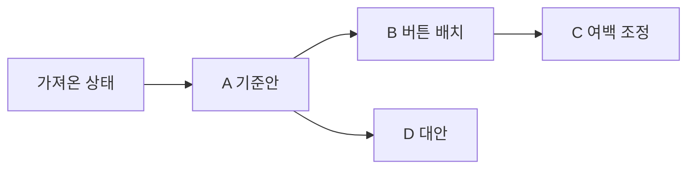

> 과거 기록: 0.44.0까지의 요구사항·구현·검증입니다. 새 제품 범위는 [현재 PRD](PRD.md), 후속 작업은 [티켓 추적표](ticket-review.md)를 따릅니다. 아래 기록은 삭제 기능의 재구현 요구사항이 아닙니다.

# Console Canvas PRD

제품 요구사항 기준 문서 · 요구사항 갱신일 2026-10-31 · 전수 대조일 2026-10-31 · 현재 소스 기준 0.44.0 (설치/배포 상태는 검증 문서에서 별도 관리)

이 문서는 지금까지 확정한 제품 목적과 사용자 동작을 통합한다. 제품 동작은 이 문서, 사용법은 [README](../README.md), 구현 구조는 [architecture.md](architecture.md), 실제 확인 결과는 [verification.md](verification.md)에서 관리한다. 요구사항을 적었다는 이유로 구현 또는 검증 완료로 간주하지 않는다. 전체 진입점과 코드·검사 대응, 발견한 차이는 [기능 전수 대조표](feature-audit.md)에 기록한다.

## 1. 제품 목적

Console Canvas는 실제 콘솔 웹 화면을 소스코드 없이 가져와, 요소를 직접 옮기거나 지우고 자유 텍스트 주석으로 개선 의도를 설명하는 로컬 편집기다. 사용자는 시안을 여러 갈래로 보관하고, **변경 후 화면과 주석을 포함한 이미지 한 장**으로 개발 에이전트에게 구현 방향을 전달한다. 에이전트는 로컬 MCP로 복제본을 조회·편집할 수도 있다.

**선택 영역의 AI 다중 시안 MVP:** 요소를 선택하고 ✨ 시안 만들기를 누르면 에이전트가 같은 기준에서 여러 HTML·CSS 시안을 생성한다. 사용자는 비교 후 하나를 선택해 적용한다. 자동 실행이 불가능해도 요청 한 번의 수동 전달로 같은 흐름을 사용할 수 있게 한다. 0.21.0은 공통 패치·갤러리·형제 분기·MCP와 API 호출 어댑터를 제공한다. 0.36에서 공식 로컬 ChatGPT OAuth·앱 내 직접 생성 경로를 추가했다. 0.37.3에서 실제 계정 동의·모델 목록을 확인했다. 실제 추론·이미지 보정 반복/대화 자동 시작의 검증 상태는 최신 배포 기록을 따른다. [구현/미검증 범위](ai-variants-0.21.md), FR-21~27·[AI 시안 계획](ai-variants-plan.md)을 따른다.

사용자가 원본 소스를 가지고 있는지는 가져오기·시안 편집의 전제 조건이 아니다. 원본 소스를 수정하는 작업은 해당 프로젝트에 접근할 수 있는 개발 에이전트가 별도로 수행한다.

### 세 가지 편집 경로 · 확정 방향

| 경로 | 입력/실행 | 공통 결과 | 현재 상태 |
| --- | --- | --- | --- |
| 사용자 직접 편집 | 선택·이동·삭제·복사·주석 | 현재 작업·이력·undo·스냅샷 | 제공된 조작 구현 |
| AI 직접 호출 | 전체 화면·선택/스크롤 상세 이미지·번호 타깃·프롬프트 → 제공자 API → 선언적 패치 | 독립 후보 렌더·비교·사용자 선택 적용 | API 키·로컬 OAuth 구현, 실제 ChatGPT 생성/비교/적용·재실행 검증. FR-43 |
| 외부 로컬 에이전트 MCP | 프롬프트 → 이미지 기본 조회·수정/후보 등록 | 같은 캔버스·후보·저장/이력/분기 | 공통 19개 도구·이미지 블록 구현. 원문 코드는 명시적 진단 조회로 구별 |

AI 직접 호출의 인증 선택지는 API 키와 적격/지원이 확인된 ChatGPT 로그인이다. 네 번째 편집 모드가 아니며 외부 MCP 연결을 API 호출의 필수 조건으로 두지 않는다. [편집 경로·인증 계획](editing-paths-plan.md), FR-26/27을 따른다.

### 해결할 문제

- 말로만 배치·간격·삭제·문구 변경을 설명하기 어렵다.
- 몇 개의 큰 박스만 옮길 수 있으면 실제 버튼·입력·문구·행의 변경 의도를 표현하기 부족하다.
- 과거 시안에서 대안을 만들 때 기존 미래 시안을 잃거나 부모 관계를 혼동하기 쉽다.
- 픽셀 이동량만 전달하면 반응형 레이아웃의 구현 의도가 충분히 전달되지 않는다.
- 사용자 편집과 에이전트 편집, 주석과 속성 변경을 다른 화면에서 확인하면 맥락을 놓치기 쉽다.

### 사용자와 주요 작업

| 사용자 | 주요 작업 | 얻는 결과 |
| --- | --- | --- |
| 콘솔 UI를 기획·검토하는 사람 | 실제 화면을 가져와 배치 수정·삭제·주석 작성 | 설명 가능한 시안 |
| 여러 안을 비교하는 사람 | 스냅샷 저장·분기·과거/미래 이동 | 원래 안을 잃지 않는 대안 탐색 |
| 소스를 수정하는 개발자·에이전트 | 전달 이미지와 필요 시 원본 식별 정보 확인 | 반응형 UI에 맞는 구현 방향 |
| MCP를 사용하는 에이전트 | 연결된 복제본 조회·편집·실행 취소 | 사용자와 공유하는 편집 상태 |

## 2. 범위와 원칙

### 대상과 제공 경로

- 목록·검색·선택·입력·편집·표·관리 메뉴가 중심인 HTML/CSS 콘솔 UI를 우선 대상으로 한다.
- Chromium 내장 독립 앱만 공식 사용 경로다. 독립 HTML은 개발/데모용이며 Chrome 확장 지원·신규 배포는0.25.0부터 종료한다.
- 로그인 후 화면을 가져올 수 있다. 앱의 로그인 세션은 기존 Chrome과 별개다.
- 현재 배포 대상은 macOS Apple Silicon이며 Python 3.9 이상이 필요하다.

**0.25.0 방향 전환:** 원본 재현 정확도를 우선해 내장 앱 한 경로에 집중한다. Chrome 설치/권한/WebMCP/스토어 제품화는 종료하며 공통 편집기·19개 로컬 MCP 도구는 유지한다. 기존 확장 코드·검증 기록은 [보관](../archive/chrome-extension/README.md)과 태그 v0.24.3으로 보존한다. 기존 설치 확장·저장 문서를 자동 제거하지 않는다. 편집 JSON의 확장→앱 이동을 안내하며 자동 동기화를 약속하지 않는다. [전환 계획·실제 검증](desktop-only-0.25.md), #71~#73을 따른다.

### 제품 원칙

1. 원본 웹사이트와 복제본 편집을 분리한다. 복제본의 업무 버튼은 디자인 요소이며 원본 업무를 실행하지 않는다.
2. 캔버스는 변경 의도를 표현하는 공간이다. 캡처 좌표를 원본 소스의 절대 위치 CSS로 그대로 적용하라는 뜻이 아니다.
3. 기본 편집·저장·전달 이미지 생성에 클라우드 서버나 AI API 키를 요구하지 않는다.
4. 자동 저장·실행 취소·스냅샷·파일 백업은 목적이 다르며 서로 대체하지 않는다.
5. 과거·미래·병렬 시안과 미저장 작업을 임의로 버리지 않는다.
6. 구현됨, 계획됨, 검증됨을 구분한다. 환경 제한으로 하지 못한 검사는 남은 항목으로 기록한다.
7. 큰 작업 모달은 하나를 기본으로 한다. 검색·선택·편집·설정은 본문 전환이나 인라인으로 처리한다. 꼭 필요한 작은 확인만 화면을 넓게 쓰는 작업 창 위에 허용하며 작은 메뉴·드롭다운은 유지한다. 전환/뒤로/전체 닫기와 초안·검색·스크롤·선택·초점 보존을 구분한다.

### 현재 제외 범위와 한계

- 임의의 모든 사이트를 완벽하게 재현한다고 보장하지 않는다. 다른 경로·닫힌 UI·서버에만 있는 정보·가상 목록의 미렌더링 행은 수집 대상이 아니다.
- Canvas·영상·접근 불가능한 iframe 내부 개체와 닫힌 Shadow DOM을 모두 개별 요소로 분해하지 않는다. 접근 가능한 iframe 내부 DOM은 중첩 5단계·총 32개까지 펼쳐 복제한다. SVG 아이콘도 보통 한 레이어로 다룬다.
- 외부 인증 리소스·웹폰트·특수 CSS·변형·고정 요소 등은 원본과 차이가 날 수 있다. 수집 가능한 리소스를 내장하고 제약은 안내한다.
- 편집 중 원본 서비스 저장, 원본 프로젝트 소스 자동 수정, 자동 반응형 코드 생성, 실시간 다중 사용자 협업은 현재 범위에 포함하지 않는다.
- 복사/붙여넣기는 같은 캡처 안에서 제공한다. 문서 간 요소 이식이나 전용 표 열 재정렬 편집기는 현재 범위에 포함하지 않는다.
- 폭넓은 스타일 편집기 전체를 약속하지 않는다. 현재 **요소 편집**은 위치·정렬 등 제공된 조절 항목을 대상으로 한다.
- Chrome 확장/WebMCP/스토어 게시·자동 확장 업데이트는 현재 지원 범위에서 제외한다. 기존 자료의 앱 이동은 편집 JSON으로 제공한다. 과거 확장 검증을 현재 지원으로 안내하지 않는다.

## 3. 용어와 상태

| 용어 | 의미 |
| --- | --- |
| 원본 화면 | 앱의 웹사이트 화면에서 실제로 접속한 서비스 |
| 캡처 / 문서 | 한 시점에 가져온 화면과 그 화면의 편집 작업 단위 |
| 요소 | 복제본에서 선택·이동·삭제할 수 있는 문구·아이콘·버튼·입력·셀·행·영역 등 |
| 현재 작업 | 문서에 자동 저장되는 최신 편집·주석·추가 설명 |
| 기준 스냅샷 | 현재 작업의 출발점인 실제 활성 버전 |
| 미리보기 선택 | 그래프에서 확인 중인 저장 버전. 실제 기준 버전과 다를 수 있음 |
| 저장 전 변경 | 기준 스냅샷과 달라진 현재 작업. 자동 저장되지 않았다는 뜻이 아님 |
| 스냅샷 | 이름과 부모 관계를 가진 편집·주석·추가 설명·이력 위치의 저장 버전 |
| 변경 이력 | 작업 종류·대상·전후 값·주석 내용과 분기 맥락을 가진 이벤트 목록 |
| 전달 이미지 | 결과 화면·번호 하이라이트·하단 요청 카드가 포함된 PNG 한 장 |
| 편집 파일 | 다른 기기에서 이어 편집하거나 복구하기 위한 전체 백업 JSON |
| WebMCP 도구 공개 | 사용자가 선택한 확장 문서의 기능을 document.modelContext에 등록한 상태. 에이전트 연결 성공과 다름 |
| AI 시안 / 후보 (계획) | 고정 기준의 HTML·CSS 패치와 독립 렌더/요약을 가진 대안. 현재 작업 적용과 구별 |
| 생성 요청 (MVP) | 기준·선택·주석·실행/후보 상태를 연결하는 작업 단위. 원본 소스 수정 요청과 구별 |
| 샘플링 (제품 동작) | 같은 기준에서 여러 UI 후보를 만드는 제품 동작. MCP Sampling 채택 여부와 구별 |
| 호출 확인 | 공식 MCP를 통해 해당 문서 도구의 실제 왕복 호출을 확인한 상태. 일반 브라우저 전체 권한과 구별 |

`현재 작업 자동 저장`과 `스냅샷 저장`을 구별해 표시한다. 미리보기만 선택해서는 기준 버전이나 현재 편집이 바뀌지 않는다.

## 4. 핵심 사용자 흐름

### 4.1 실제 화면으로 개선안 만들기

1. 웹사이트 화면에서 URL을 열고 필요하면 로그인한다.
2. 원하는 상태를 표시한 뒤 **이 화면 가져오기**를 누른다.
3. 편집기에서 요소를 선택·이동·삭제·복제하거나 주석을 남긴다.
4. 오른쪽 통합 이력에서 작업 내용과 주석을 확인한다.
5. 이름을 입력해 스냅샷을 저장한다.
6. **변경 내용 전달**에서 결과와 요청 카드를 검토해 이미지 한 장을 복사하거나 저장한다.
7. 개발 에이전트는 이미지와 요청의 의도를 실제 소스의 정렬·간격·순서·반응형 동작으로 구현한다.

### 4.2 과거에서 대안 분기 만들기

1. A→B→C를 저장한 상태에서 **스냅샷 목록**을 연다.
2. A를 클릭하면 선택 이름과 하단 미리보기만 바뀐다. 현재 작업의 기준은 여전히 C다.
3. **이 버전으로 이동**을 눌러 실제 기준을 A로 바꾼다. 이동 전 작업이 달라졌다면 먼저 자동 보관한다.
4. A에서 수정하고 D를 저장하면 D의 부모는 A다. B와 C는 남는다.
5. 그래프에서 C나 D를 선택하고 적용하면 각 버전으로 다시 이동할 수 있다.

**A를 미리보기만 한 뒤 C 위에서 D를 저장했다면 부모는 C다.** 그래프를 저장 순서대로 연결하거나 미리보기 선택을 실제 복원으로 혼동하지 않는다. 병합 커밋이나 Git 저장소 기능을 제공하는 것은 아니다.

### 4.3 에이전트로 복제본 편집하기

1. 앱에서 화면을 가져오고 MCP에 연결한다.
2. 에이전트는 연결 화면·요소·주석·버전·이력을 조회한다.
3. 최신 revision과 고유 operation ID로 이동·삭제·주석 작업을 적용한다.
4. 사용자는 같은 캔버스와 이력에서 결과를 확인하고 한 단계로 실행 취소할 수 있다.
5. 결과를 PNG로 전달하거나 저장 버전으로 보관한다.

### 4.4 기존 확장 자료를 앱으로 이동하기 · 0.25 지원 종료

기존 확장에서 각 문서의 **문서 메뉴 → 편집 파일 저장**으로 백업하고 내장 앱 **편집 파일 열기**로 가져온다. 현재/과거/분기/휴지통·주석을 파일에 유지한다. 필요한 모든 문서를 옮기기 전 기존 확장을 제거하지 않는다. 원본 로그인 프로필·문서 자동 동기화는 제공하지 않는다.

### 4.5 AI가 만든 여러 시안에서 선택하기 · MVP와 후속

1. 요소/영역을 선택하고 **✨ 시안 만들기**를 누른다. 주석이 있으면 우선 반영하며 필수 프롬프트 입력은 요구하지 않는다.
2. 선택·주변 구조·주석/초안·추가 설명·현재 미저장 편집을 포함한 기준을 고정한다.
3. 지원하는 자동 경로로 에이전트를 실행한다. 불가하면 **요청 복사 → 에이전트 채팅에 붙여넣기** 한 번으로 같은 요청을 시작한다.
4. 선택한 AI 직접 호출 또는 외부 에이전트 경로가 같은 기준에서 서로 다른 HTML·CSS 후보를 생성하고 후보별 실제 화면을 확인·보정한다. 초기 검증은 세 후보로 한다.
5. 갤러리에서 기준과 후보의 미리보기·개선 방향·차이를 비교한다. 준비된 후보를 볼 수 있고 부분 실패·재시도·취소도 구분한다.
6. **이 시안 적용**을 눌러 하나를 선택한다. 선택 전에는 현재 작업/활성 버전/미리보기/undo를 바꾸지 않는다. 기준 이후 편집이 있으면 보호한 뒤 명시적으로 이동하거나 재생성한다.
7. 후보는 같은 기준의 형제 분기이며 다른 후보와 과거/미래 작업을 보존한다. 선택한 안에서 편집·재생성하고 한 단계로 적용을 취소할 수 있다.
8. 확정한 시안의 개발 전달은 기존 번호/주석 카드의 PNG 한 장을 유지한다. [AI 시안 계획](ai-variants-plan.md)을 따른다.

## 5. 기능 요구사항

### FR-01. 실제 화면 가져오기

- 원본 소스코드 없이 현재 DOM·계산된 스타일·요소 정보와 읽을 수 있는 이미지/폰트를 수집한다. 화면 밖이라도 DOM에 존재하는 대상은 포함될 수 있으나 가상 목록의 미렌더링 행은 포함하지 않는다.
- 일반적인 표시 요소는 큰 박스에 한정하지 않고 세부 문구·아이콘·버튼·입력·표 셀·행·영역까지 편집 대상으로 다룬다. 2절의 분해 한계는 적용한다.
- 원본 selector·ID·문구 등 식별 근거를 유지한다. 캡처 내부 ID는 원본 소스 컴포넌트 ID와 구별한다.
- 업무 버튼을 실행하거나 원본 DOM을 수정하지 않는다. 수집 코디네이터는 지연 로딩과 긴 화면 촬영을 위해 스크롤할 수 있으며 원래 위치를 복원한다. 가져온 스크립트는 복제본에서 실행하지 않는다.
- 가져오는 중 진행 상태를 표시하고 실패 원인을 안내하며 다시 시도할 수 있게 한다.
- HTTP/HTTPS 웹사이트를 대상으로 하며 주소에서 스킴을 생략하면 HTTPS를 붙인다. 뒤로/앞으로·새로고침·샘플 콘솔을 제공하고 이동 기록이 없으면 해당 버튼을 비활성화한다.
- DOM의 입력값·체크/선택 상태·텍스트·의사 요소와 가능한 스크롤 상태를 보존한다. hidden input과 password input의 값은 제외한다. 화면 전체의 개인정보 자동 마스킹을 의미하지 않는다.
- 기본 가져오기에서 각 iframe의 자기 실행 문맥으로 DOM 수집을 먼저 시도하고 원본 selector와 프레임 경로를 유지한다. 실제 접근 거부·프레임 변경·신원 구분 실패·한도 때문에 수집하지 못한 프레임만 이미지 한 레이어로 보완한다. 내부 스크롤·테두리·배율·고정 요소를 반영하고 프레임 하나의 실패가 나머지 수집을 막지 않는다.
- open Shadow DOM과 슬롯을 펼쳐 가져온다. 내장 Chromium은 자기 문서의 닫힌 Shadow root도 검사기에서 읽을 수 있을 때 포함한다. 일반 확장의 닫힌 Shadow root 접근을 보장하지 않는다.
- 이미지 바이트와 읽을 수 있는 배경·스프라이트·마스크·폰트를 문서에 내장한다. 직접 읽을 수 없는 IMG와 외부 참조/이미지 배경 SVG는 촬영한 원본 픽셀로 보완한다. 문구·버튼·자식을 포함한 전체 UI를 이미지로 평탄화하지 않는다. 읽지 못한 CSS 리소스는 경고에 남긴다.
- 긴 화면과 프레임은 실제 촬영한 타일을 합치고 한도·누락·캡처 실패를 구별한다. 부분 이미지를 전체 크기로 늘리지 않는다. 주소·뷰포트 변경 시 잘못된 이미지 합성을 중단한다. Chrome은 활성 탭을 확인하며 사용자 또는 페이지의 스크롤 변동이 안정되지 않으면 경고한다. 단독 샘플의 screenshot은 없을 수 있다.

**0.24 구현:** 기본 프레임별 DOM 수집, 실패/변경 프레임만 이미지 폴백, 리소스 데이터 내장·미접근 IMG/외부 참조 SVG의 픽셀 보완, 긴 프레임 자동 촬영·상태 복원과 내부 클릭 선택을 제공한다. 세부 경로·한도·CORS/리소스 제약은 [0.24 범위](capture-quality-0.24.md), 최종 사이트별 비교/배포 확인은 [티켓 추적](capture-quality-plan.md)에서 구분한다.

### FR-02. 워크스페이스와 패널

- 0.22.1: 좌·중앙·우 및 접힌 패널의 상단 구분선은 공통 48px, 하단 상태 영역은 44px로 맞춘다. 같은 줄의 기본 입력/선택/버튼은 32px 높이와 시작점을 공유하며 아이콘·목록·다중 행 콘텐츠는 목적에 맞는 크기를 유지한다.
- 주석 이전/선택/다음은 같은 줄에 맞추고 진행 문구를 별도 줄에 표시한다. 배치/반응형 제안은 같은 열 너비와 행 높이로 정리하고 매우 좁은 창에서는 한 열로 바꾼다. 작은 주석 창은 본문을 스크롤하고 완료 버튼·저장 피드백은 고정한다. 스크롤바가 필드 위를 가리지 않게 바깥 여백에 공간을 둔다.
- 속성의 좌표 입력은 한 겹의 테두리, 스냅샷 이름과 저장/취소는 공통 좌우 기준선으로 맞춘다. 전달 폼의 라벨 열과 AI/버전/구현 비교의 선택·버튼 기준선도 일관되게 유지한다.

- 편집기 공통 드롭다운의 화살표는 오른쪽 가장자리에서 10px 안쪽에 둔다. 글자와 겹치지 않게 오른쪽 입력 공간을 확보하고 네이티브 선택·키보드 동작은 유지한다. 캡처한 원본 화면의 드롭다운은 변경하지 않는다.
- 공통 폼 높이·체크박스 여백·메뉴 표면·닫기 버튼 크기를 일관되게 유지한다. 변경 이력은 본문과 보조 정보의 대비·간격을 구분하며 하단 상태 문구는 단어 중간에서 줄바꿈하지 않는다. 작은 공간에서도 키보드 포커스와 기존 조작에 접근할 수 있어야 한다.

- 외부 앱 헤더는 웹사이트/편집기 전환과 앱 설정을 담당한다. 주소창은 웹사이트 화면에서만 표시한다.
- 편집기 내부는 별도 브랜드 헤더를 반복하지 않는 한 줄 도구 모음을 사용한다. 문서·편집·확대·스냅샷·전달 기능에 접근할 수 있어야 한다.
- 왼쪽은 레이어, 가운데는 캔버스, 오른쪽은 **탭 없는 변경 이력**이다. 복사·삭제·요소 편집·주석은 선택 요소 근처에, 확대/맞춤은 캔버스 하단에 둔다.
- 펼친 패널의 접기 버튼은 해당 패널 상단에 둔다. 접으면 전체 높이의 좁은 세로 바를 남기고 맨 위 버튼으로 다시 연다.
- 열기/닫기는 같은 화살표 디자인 체계를 사용한다. 패널 경계 드래그와 키보드로 너비를 조절하며 너비·접힘 상태를 재실행에 보존한다.
- 패널을 접거나 너비를 조절하면 캔버스가 남은 공간을 사용한다. 문서 메뉴와 주요 도구는 패널 접힘에 종속되지 않는다.
- **앱 설정**은 연결/스킬과 업데이트 화면으로 이어지고 **작업으로 돌아가기**는 이전 웹사이트/편집기로 복귀한다. 원본 정보의 URL은 앱 웹사이트 화면에 연다. **원본에서 다시 가져오기**는 현재 구현상 웹사이트 뷰로 돌아가는 버튼이며 자동 재수집·기존 문서 갱신은 하지 않는다.

### FR-03. 선택과 탐색

- 일반 클릭은 의미 있는 요소를 선택하며 Alt+클릭으로 세부 요소를 선택할 수 있다. Shift+클릭·상위 선택 버튼·클릭 가능한 상위 경로로 부모를 고른다.
- 2026-10-29 확정 후속(#62, 부분 진행): 부모 선택 상태에서도 내부 요소를 클릭해 바로 선택한다. 실제 드래그는 기존 부모/다중 선택 묶음을 이동하며 클릭만으로 문서 변경·리비전·undo를 만들지 않는다. 내부 요소 선택에 사전 해제나 Alt를 필수로 요구하지 않는다. 이동/분리된 자식·겹침·수정키·취소와 실제 네이버 사용 검증을 포함한다.
- Cmd/Ctrl+클릭은 다중 선택을 지원한다. 빈 곳 드래그는 영역 안에 완전히 포함된 요소를 선택하며, 추가 선택과 Esc 취소를 제공한다.
- 부모와 자식을 함께 선택했을 때 하위 요소에 같은 이동을 두 번 적용하지 않는다.
- 확대/축소·너비 맞춤·선택 맞춤·스크롤로 긴 화면과 작은 요소를 탐색한다.
- #157 / 0.42.1: 숨겨진 편집기에서 문서를 복원하면 화면이 표시될 때 초기 너비 맞춤과 원본 스크롤을 계산한다. 준비 완료를 기다리게 하지 않으며 수동 배율·이후 창/패널 크기 변경은 자동 맞춤으로 덮어쓰지 않는다. 문서가 바뀌면 이전 지연 작업을 취소한다.
- 레이어 트리 접기/펼치기, 문구·태그·캡처 ID 검색, **주요 요소만** 필터와 선택/변경/삭제/주석 표시를 제공한다. 검색어가 있으면 일치하는 대상의 조상을 함께 보여 준다.
- 한 번에 100개까지 선택한다. 확대는 10~250%이며 버튼·비율 선택·Cmd/Ctrl+휠을 제공한다. 이 비율은 시안 보기용이며 원본 반응형 뷰포트 변경을 뜻하지 않는다.

- 레이어 기본 이름은 검색 영역 등 원본 역할·식별 근거를 우선한다. 사용자 별칭은 검색·문서 재열기·파일 왕복에서 보존하고 원본 ID/selector를 바꾸지 않는다. 별칭은 문서 탐색 메타데이터로 버전/캔버스 undo와 독립적이다.

### FR-04. 이동·삭제·복사와 실행 취소

- 요소 또는 선택 묶음을 드래그해 자유 배치한다. 방향키와 **요소 편집** 비모달 도구창의 위치·정렬 기능도 제공한다. 도구창을 열고 캔버스를 계속 조작할 수 있고 제목을 드래그해 위치를 옮긴다. 선택 해제·문서 전환에서 닫으며 Esc를 제공한다.
- 삭제는 복제본 요소를 숨기는 동작이다. 자유 배치 시안을 유지하기 위해 원래 빈자리가 자동으로 재배치된다고 가정하지 않는다.
- 부모 이동/삭제는 이미 따로 편집한 자식에도 적용한다.
- 같은 캡처 안에서 복사/붙여넣기하며 하위 요소와 요소 주석도 복제한다. 복사본은 원본과 별도 편집 대상이다.
- 사용자 편집과 MCP 편집은 실행 취소/다시 실행을 공유한다. 작업 묶음은 한 단계로 되돌린다.
- 실제 입력란의 텍스트 편집 단축키와 캔버스 단축키를 구분한다.
- 다중 선택의 왼쪽/위쪽/가로 중앙/세로 중앙 정렬은 두 개 이상, 가로/세로 간격 맞춤은 세 개 이상의 최상위 선택 요소를 기준으로 한다. **정렬선에 맞추기**를 켜면 드래그 시 주변 요소의 경계/중앙에 맞추며 Alt로 일시 해제한다.
- 방향키는 1px, Shift+방향키는 10px, 요소 편집 도구창의 방향 버튼은 8px 이동한다. Cmd/Ctrl+Z, Cmd/Ctrl+Shift+Z 및 웹 편집기의 Cmd/Ctrl+Y로 실행 취소/다시 실행한다. 데스크톱 메뉴도 같은 캔버스 기록에 연결한다.
- 실행 취소/다시 실행 스택은 현재 문서 세션의 메모리 상태다. 실행 취소는 최근 100단계를 보관하며 문서 열기/전환·앱 재실행 때 초기화한다. 영구 변경 이력과 저장 스냅샷은 남아도 과거 undo 스택이 복원되는 것은 아니다.
- 복사/붙여넣기는 하위 요소 포함 한 번에 5,000개까지이며 같은 문서 ID를 확인한다. 반복 붙여넣기는 기본 24px씩 어긋나게 배치한다. 텍스트 클립보드 권한이 없으면 버튼은 이 창의 내부 복사 데이터 또는 키보드 붙여넣기를 안내한다.

- 요소 편집 도구창에서 위치·정렬을 먼저 보여 주고 태그·경로·별칭과 보조 주석/삭제는 접어 둔다. 레이어 별칭 진입은 해당 접힘을 열고 입력란으로 이동한다.

### FR-05. 요소·좌표 주석

- 별도 선택/주석 모드를 요구하지 않는다. 선택한 요소 위의 주석 아이콘을 누르면 자유 텍스트 모달을 연다.
- 빈 곳 클릭은 해당 문서 좌표에 주석을 남길 진입점을 표시한다. 빈 곳 드래그의 영역 선택과 구분한다.
- 저장된 주석은 번호 배지로 표시하고 다시 눌러 편집한다. 요소 주석은 요소를 따라가며 좌표 주석은 문서 좌표에 남는다.
- 자동 저장, **완료**, Cmd/Ctrl+Enter를 제공한다. 닫기·Esc·문서 전환·정상 종료에서도 입력 초안을 잃지 않는다.
- 주석을 편집·삭제하고 실행 취소할 수 있어야 한다. 삭제된 요소의 주석도 전달 시 맥락을 보존한다.
- 주석은 구현 요청이며 작성만으로 화면이나 원본 소스를 자동 수정하지 않는다. 주석만 남긴 문서도 유효한 전달 대상이다.

- 주석 창에 대상 주변 화면과 요청 번호/전체 개수, 이전·다음 이동을 제공한다. 이동 시 입력 초안을 커밋하고 모달을 유지한다. 삭제 대상은 삭제 전 참고, 좌표 주석은 위치 주변 화면을 사용한다. 전달 화면에서 시작한 검토는 닫을 때 같은 스크롤로 복귀한다.

- 주석 모달은 번호·이름 목록으로 직접 요청을 선택한다. 검토 중 순서를 고정하고, 비운 주석도 모달을 닫기 전까지 목록에 유지해 다시 찾을 수 있게 한다. 직접 이동에서도 초안을 보존한다.

### FR-06. 문서와 휴지통

- 문서명 메뉴에서 저장 문서 검색·전환, 현재 이름 변경, 원본 정보, 편집 파일 열기/저장, 휴지통에 접근한다.
- 문서 이름은 원본 사이트 제목과 별도로 관리한다.
- 저장 문서 목록은 현재 편집 미리보기·최근 스냅샷 이름·주석 수를 제공한다. 화면에 들어온 항목만 미리보기를 준비하고 실패/기존 문서는 대체 표시로 계속 전환할 수 있다. 캡처 HTML이나 타임라인을 목록 메타데이터에 중복 저장하지 않는다.
- 문서를 삭제하면 원본 캡처·편집·주석·스냅샷을 함께 보존한 채 휴지통으로 이동한다. 활성 문서는 초안까지 저장한 뒤 닫고 MCP 연결 대상에서도 제거한다.
- **복구**는 목록으로 돌려놓고 **복구하고 열기**는 문서를 연다. 삭제 알림의 되돌리기도 제공한다.
- 휴지통을 자동으로 비우거나 기존 자료를 임의로 영구 삭제하지 않는다.

### FR-07. 스냅샷 저장과 분기 보존

- **스냅샷 저장**은 이름 입력 모달을 연다. 이름과 현재 편집·주석·추가 설명·이력 위치를 저장하며 초기 **가져온 상태**도 버전으로 남긴다.
- 저장 직후 스냅샷 목록을 열고 새 버전을 선택한다. 새 버전의 부모는 저장 시점의 실제 기준 스냅샷이다.
- 과거 복원이 이후/병렬 버전을 삭제하지 않는다. 저장 전 변경이 있으면 이동 전에 자동 스냅샷으로 보호한다.
- 복원 자체도 실행 취소할 수 있다. 한도나 저장 오류로 현재 작업을 보호할 수 없으면 작업을 잃는 이동을 강행하지 않는다.
- 0.16.0의 사용자/MCP 복원은 저장 실패 시 전체 상태를 롤백한다. 자동 오류 검사와 설치 창 직접 검증의 상태는 9절에서 구분한다.
- 이름 변경·휴지통·복구를 지원하며 기존 버전 ID·부모·후손 관계를 유지한다.
- 이름 변경 완료·취소 후에는 같은 그래프의 선택·스크롤 위치로 돌아간다.
- **복구**는 버전 목록만 복구하고 **복구하고 적용**은 해당 버전을 적용한다. 활성 버전을 휴지통으로 옮겨도 현재 편집과 후손은 지우지 않는다.

### FR-08. 스냅샷 Git 그래프와 미리보기

- 중앙 도구 모음의 버튼을 **스냅샷 목록 · 선택한 이름**으로 표시한다. 실제 기준과 다르면 **미리보기**, 기준 이후 작업이 달라졌다면 **변경 있음**을 구별한다. 자동 저장 상태와 혼동하지 않게 변경 건수도 따로 표시한다.
- 목록을 열면 좌우로 스크롤 가능한 Git 형태의 그래프를 보여 준다. 부모 깊이에 따른 가로 진행과 다른 분기 줄을 사용하며 실제 부모 ID로만 선을 잇는다.
- 노드/연결선과 현재 버전·선택한 미리보기·스냅샷 이후 변경을 구별한다. 살아 있는 후손의 연결을 설명하는 휴지통 조상은 비활성으로 남길 수 있다.
- 노드 선택 시 같은 목록의 그래프 아래에 미리보기 화면을 표시한다. 선택 이름을 즉시 갱신하되 편집 데이터·revision·이력을 변경하지 않는다.
- **이 버전으로 이동**을 눌러 실제로 복원한다. 미리보기와 적용의 차이를 문구로 안내한다.
- 빠르게 다른 버전/문서를 선택해도 늦게 도착한 미리보기가 현재 선택을 덮어쓰지 않아야 한다.

- 그래프 초기 높이는 가지 수를 따르며 하단 경계 드래그/방향키로 조절하고 선호 높이를 보존한다. 작업 기준과 선택 미리보기 이름을 나란히 보여 준다.

- 스냅샷 목록의 제목·기준/미리보기·이름 검색은 고정 헤더에 둔다. 이름 검색은 휴지통을 제외하며 부모 이름을 표시한다. 결과/현재 버전 찾기는 그래프와 미리보기만 선택하고 실제 편집/분기/undo/revision을 바꾸지 않는다. 긴 결과는 최근 40개를 표시하고 전체 결과 수를 안내한다. 검색 입력 아래 방향키와 결과 방향키/Home/End, 검색 입력 Esc를 지원한다.

### FR-09. 통합 변경 이력

- 오른쪽 패널에는 속성/주석 등의 별도 탭을 두지 않고 모든 종류의 작업을 시간순 목록에 모은다.
- 이동·복사·삭제·속성 변경·주석 추가/수정/삭제와 실행 취소 등의 종류·대상·시각을 표시한다. 속성은 전후 값, 주석은 요청 본문을 함께 표시한다.
- 현재 가지/모든 가지, 종류 필터와 통합 검색을 제공한다. 필터는 같은 이력 목록의 범위를 바꾸며 별도 속성/주석 화면으로 전환하지 않는다.
- 이력 대상 클릭은 현재 화면의 대상이나 주석을 확인하는 동작이며 과거 버전 복원과 구별한다.
- 과거 버전에서 분기해도 다른 가지의 이력을 지우지 않는다. 기존 작업의 시각이 없으면 임의의 과거 이벤트를 만들어내지 않고 보존된 주석임을 표시한다.

- 이력은 선택 요소만 필터를 제공한다. 같은 요소·행위자·버전의 60초 이내 연속 이동은 표시만 접어 요약하고 개별 기록을 펼칠 수 있다. 원시 이벤트·부모 관계·실행 취소 단계는 보존한다.

### FR-10. 이미지 한 장으로 변경 내용 전달

- 전달할 현재 작업 또는 저장 버전을 선택하고 결과 이미지를 미리 본 뒤 복사하거나 PNG로 저장한다.
- 전달 기준·요청 개수·추가 설명을 이미지보다 위에 둔다. 현재 작업의 번호 목록과 이미지 번호에서 주석을 편집하고 같은 전달 위치로 돌아온다. 저장 버전은 보기 전용이다.
- 모달 본문만 스크롤하고 복사·저장 버튼은 하단에 계속 표시한다. 긴 문서 제목은 가로로 압축하지 않고 줄바꿈하며 화면 시작 위치를 내린다.
- 이미지 상단에는 변경 후 화면, 변경 구역 하이라이트와 번호 아이콘을 배치한다. 하단에는 같은 번호의 요청 카드를 두 열로 배치한다.
- 각 카드에는 대상과 요청 내용을 읽을 수 있게 표시한다. 요소 이동량만 나열하기보다 그림과 주석으로 정렬·간격·순서·반응형 줄바꿈 의도를 전달한다.
- 요청 10개 이상에서도 글자를 작게 줄이거나 카드를 누락하지 않고 이미지 높이를 늘린다. 추가 설명도 같은 이미지에 포함한다.
- 삭제 대상은 이전 위치의 점선과 삭제 전 참고 이미지, 작은 대상은 필요한 확대 이미지로 맥락을 설명한다.
- 삭제한 복사본도 참고 화면에 포함하고 삭제 전/후의 전체 영역을 담는 크기로 렌더링한다.
- 별도 텍스트/JSON 파일을 에이전트에게 첨부하도록 요구하지 않는다. 백업 JSON은 재편집용으로 구별한다.
- 원본 selector/ID는 MCP 조회의 보조 근거로 유지하지만 이미지 전달의 필수 첨부물로 만들지 않는다.
- 미리보기와 이미지 생성은 현재 선택·편집·이력·revision을 변경하지 않는다. 생성 한도를 넘으면 내용을 자르지 말고 분할/범위 조정을 안내한다.
- 전달 기준에는 **가져온 원본·현재 작업·휴지통을 제외한 저장 버전**이 있다. 원본 기준에는 편집/주석이 없다. 추가 설명 입력은 현재 작업에서만 제공하고 다른 버전은 저장된 설명을 사용한다.
- 이미지 클립보드를 지원하지 않거나 권한이 없으면 PNG 저장을 안내한다. 0.16.0은 PNG 네이티브 저장을 수정했고 격리 앱의 실제 IPC/파일 경로를 확인했다. 설치 창 직접 검증은 9절의 상태를 따른다.

### FR-11. 자동 저장과 복구

- 문서·편집·주석·추가 설명·전체 분기·변경 이력을 로컬 IndexedDB에 자동 저장한다. 원본 캡처 HTML을 스냅샷마다 중복 저장하지 않는다.
- 문서 전환·정상 종료·업데이트는 초안과 저장 큐의 완료를 기다린다. 저장 실패 시 성공했다고 표시하거나 작업을 버리고 종료하지 않는다.
- 앱 재실행은 마지막 문서를 연다. 패널 너비·접힘 같은 작업 환경도 보존한다.
- 편집 파일은 현재 작업, 과거/병렬/휴지통 스냅샷과 이력을 포함해 다시 열 수 있는 백업이다. 문서 휴지통 보존은 앱 프로필 백업 검증에도 포함한다.
- 앱 업데이트나 내부 리팩토링이 저장 형식을 바꾸더라도 기존 사용자 자료를 보존한다. 개발 단계의 하위 호환 계층은 필수가 아니지만 검증한 일회성 이전 또는 파일 왕복이 필요하다.
- DB 쓰기가 실패해도 메모리에 남은 작업을 긴급 편집 파일로 내보낼 수 있어야 한다. 0.16.0은 DB flush 실패와 긴급 파일 백업을 분리한다. 파일 백업 성공으로 기기 자동 저장 오류를 숨기지 않는다.

- 자동 저장 완료/저장 중/오류와 기준 스냅샷 이후 차이를 구분한다. 변경 건수는 달라진 요소/주석 ID의 수와 추가 설명 차이 한 건이며 선택·이력 위치는 제외한다. 오류를 완료 문구로 덮지 않는다.

### FR-12. 로컬 MCP

아래는 현재 로컬 경로와 공통 편집 계약이다. Chrome WebMCP 전송·공개 방식은 FR-18/19로 추가하며 기존 앱 경로를 제거하지 않는다.

- 명시적으로 연결한 복제본만 에이전트에게 공개한다. 원본 웹사이트/로그인 조작이나 원본 프로젝트 소스 변경을 MCP 편집 범위에 포함하지 않는다.
- 화면·요소·원본 식별 정보·요소/좌표 주석·분기 스냅샷·현재/모든 가지 이력과 전달 이미지를 조회한다.
- 이동·삭제·주석 작성/수정/삭제·실행 취소/다시 실행·스냅샷 생성/복원을 제공한다.
- 쓰기는 최신 revision과 고유 operation ID를 사용한다. 묶음 검증 실패는 전체 무변경이며 응답이 불확실하면 같은 ID/인수 재시도로 중복 실행을 막는다.
- 드래그/입력 등과 충돌하는 편집은 busy/conflict로 처리한다. 조회 결과에는 실제 기준 버전과 미리보기 선택을 구별한다.
- 인증된 localhost 브리지와 stdio MCP를 사용한다. 연결 토큰을 이미지·문서·로그·저장소에 노출하지 않는다.
- 등록 명령이나 도구 목록 확인만으로 화면 연결 성공이라고 하지 않는다. 실제 연결 화면과 요소/주석 조회가 성공해야 한다.
- 데스크톱은 자동 연결하고 보조 웹 편집기는 주소·연결 코드를 입력해 연결/해제한다. 연결 상태·revision·최근 행위자를 표시하고 일시 연결 오류는 재시도한다.
- 조회 목록은 페이지로 나눈다. list_elements의 parent_id는 직계 자식 필터이며 전체 후손 조회와 다르다. 휴지통 스냅샷/삭제 문서의 관리, 요소 복사, 원본 수집은 현재 MCP 도구에 없다.
- MCP 편집 응답의 메모리 적용 성공(ok)과 영구 저장 결과(persisted/save_error)를 구분한다. 저장 실패 응답을 DB 보존 완료로 해석하지 않는다. operation ID 재시도 캐시는 브리지의 메모리에 한정되며 영구적인 중복 방지 저장소가 아니다.

### FR-13. 앱 제공 스킬과 에이전트 안내

- 앱 설정에서 번들 스킬 설치/업데이트·ZIP 저장·MCP 등록 명령 복사를 제공한다. 스킬 설치와 MCP 등록은 별개다.
- MCP의 get_agent_guide로 앱에 포함된 같은 지침을 읽을 수 있어야 한다. 이 조회는 별도 스킬 설치나 화면 가져오기를 전제하지 않는다.
- 앱 업데이트 후 실행 시 이미 설치된 관리 파일을 자동 동기화하고 이전 파일을 백업한다. 사용자가 추가한 개인 파일은 유지한다.
- 스킬이 설치되지 않았다면 자동 설치를 강제하지 않는다. 동기화 실패는 앱 설정에 원인/경로를 안내하고 앱 사용을 계속할 수 있게 한다.
- 안내는 복제본 편집과 원본 소스 구현을 구별하고, 전달 이미지의 의도를 반응형 레이아웃으로 구현하도록 설명한다.
- **0.20 구현:** 확장 WebMCP에서도 같은 원본의 get_agent_guide를 제공하고 공개 후 캡처 전에도 조회하게 한다. live guide 조회·ZIP 다운로드·에이전트 측 스킬 설치/갱신을 구별한다. 확장이 사용자 스킬 폴더를 자동 수정하거나 확장 업데이트만으로 설치 스킬이 갱신된다고 약속하지 않는다. 기존 앱의 스킬 자동 동기화는 유지한다. FR-19/20·AC-29/32를 따른다.

### FR-14. 설치와 업데이트

- GitHub Releases의 DMG를 열어 Applications로 드래그 설치할 수 있게 한다. ZIP은 보조 배포 방식이다.
- 앱에서 업데이트 확인·다운로드·적용을 제공한다. 실행 중인 앱에 Git 소스를 덮어쓰는 업데이트 방식은 사용하지 않는다.
- 적용 전 저장 완료를 확인하고 앱 종료→교체→자동 재실행으로 이어져야 한다. 교체 실패 시 이전 앱을 복원한다.
- 다운로드 무결성과 앱 식별/버전/아키텍처를 검증한다. 업데이트는 사용자 편집 데이터·로그인 프로필·스냅샷과 설치 스킬을 보존한다.
- 쓰기 권한이 없거나 DMG 안에서 실행하는 등 적용할 수 없는 환경은 설치/복구 방법을 안내한다.
- 현재 개발판의 ad-hoc 서명과 일반 배포에 필요한 Developer ID 서명·공증을 구별한다. 보안 검사 우회를 제품 설치 절차로 안내하지 않는다.
- 앱 메뉴에서도 **업데이트 확인…**을 제공한다. 확인 중/다운로드 중/준비 완료/적용 중/오류에 따라 버튼을 활성화하고 진행률을 표시한다. 최신 버전이나 오류 상태에서 무효한 적용 버튼을 노출하지 않는다.
- 0.x 개발판은 시험 릴리스도 업데이트 후보로 삼고 1.x 이상은 prerelease를 제외한다. 현재보다 높은 버전과 해당 아키텍처의 검증 가능한 ZIP만 자동 적용한다. 같은/이전 버전 자동 교체는 제공하지 않는다.
- 네이티브 메뉴의 앱 정보·종료, 텍스트 잘라내기/복사/붙여넣기/전체 선택, 개발자 도구와 전체 화면은 Electron 기본 기능이다. 캔버스의 요소 복사/삭제 기능으로 혼동하지 않는다.

### FR-15. 두 버전 비교

- 스냅샷 미리보기의 **현재 작업과 비교** 또는 버전의 기타 작업 메뉴에서 비교 모달을 연다.
- 왼쪽과 오른쪽에서 각각 가져온 원본·현재 작업·휴지통을 제외한 저장 버전을 선택한다. 초기 선택은 선택 스냅샷과 현재 작업이다.
- 두 화면을 나란히 보여 주고 각 변경/주석 개수·추가 설명, 서로 다른 요소 수와 설명 차이를 표시한다. 서로 다른 요소 수는 픽셀 이미지 diff나 요청 카드 수가 아니다.
- 비교 선택/닫기는 현재 편집·활성 스냅샷·revision·이력을 바꾸지 않는다. 원본과 현재만 비교하거나 두 저장 버전을 비교할 수 있다.

- 비교 화면 위에 차이 요약·공통 배율(맞춤·50/75/100/150%)·동기 스크롤·변경 요소 이동을 둔다. 확대는 표시 배율이며 원본 반응형 뷰포트를 바꾸지 않는다.

- 비교의 변경 위치 선택/이전·다음 이동 시 양쪽 대상에 같은 번호·이름을 강조한다. 삭제되거나 해당 버전에 없는 대상은 점선 참고 위치와 상태 안내로 구분하며 좌표 주석도 표시한다. 처음/마지막과 차이 없음에서는 유효하지 않은 이동을 비활성화한다.

### FR-16. 편집 파일 입출력

- 문서 메뉴·시작 화면의 파일 열기 또는 파일 드롭으로 JSON을 연다. 드롭 시 첫 파일을 사용하고 모달이 열렸다면 먼저 닫도록 안내한다.
- 원본 캡처 형식(console-canvas-snapshot)과 재편집 형식(console-canvas-review)을 지원한다. 에디터는 ZIP·changes-only JSON·PNG를 편집 문서로 직접 가져오지 않는다.
- 파일 입력의 확장자 필터와 실제 검증을 구분한다. 현재 파일 크기 제한은 85,000,000바이트이며 HTML/요소 수·계층·복사 구조·타임라인도 검증한다.
- 같은 문서 ID를 다시 열면 새로운 문서를 자동 생성하는 가져오기와 다르다. 기존 캡처는 불변이며 휴지통 문서는 먼저 복구해야 한다.
- 내보내기는 현재 문서 한 개의 현재 작업·분기/휴지통 스냅샷·이력을 포함한 .uiclone.json이다. 전체 문서 목록/문서 휴지통·패널 환경·로그인 세션의 일괄 백업은 아니다. 이들은 앱 프로필 백업과 구별한다.
- 네이티브 JSON 저장은 취소 시 무변경이고 임시 파일 뒤 rename으로 저장한다. 브라우저는 다운로드 경로를 사용한다.
- 유효하지 않은 파일은 기존 활성 문서와 DB를 바꾸지 않고 거절해야 한다. 0.16.0은 문서 등록/교체 전 검증하고 DB 저장 오류 중 긴급 파일 백업을 제공한다. 지원하지 않는 review 버전·이력/주석 구조와 스냅샷 부모 순환도 사전 거절한다.

### FR-17. 보조 사용 경로와 에이전트 CLI

현재 제공하는 보조 경로는 아래와 같다. Chrome 확장/WebMCP는 FR-19에 따라 지원을 종료했고 과거 소스/자료만 보존한다. FR-18은 공통 계약, FR-20은 현재 배포와 기존 자료 이동을 다룬다.

- 독립 HTML은 내장된 가상 샘플로 서버 없이 시작하고, 브라우저 출처의 최근 문서(기본 4개)·전체 저장 목록·파일 열기를 제공한다. 임의 원격 사이트를 같은 HTML에서 바로 수집하는 도구는 아니다.
- 기존 Chrome 확장 자료는 편집 JSON으로 내장 앱에 이동한다. 현재 배포에 확장 설치/수집 경로를 제공하지 않는다.
- 스킬 helper의 prepare는 번들/체크섬을 확인해 새 폴더에 편집기 런타임을 준비한다. review는 기존 ZIP/JSON을 실행하지 않고 현재 변경/주석 요약과 참고 파일을 새 폴더에 만든다.
- helper의 mcp는 번들 어댑터를 실행하고 --start/--stop과 상태 경로·포트를 지원한다. CLI review에서 ZIP을 지원하는 것과 에디터의 직접 ZIP 열기를 구별한다.
- 이전 코드의 HTML 비교 보고서·ZIP 생성 helper는 호환/검증 경로로 남아 있지만 현재 전달 메뉴의 사용자 출력은 PNG 한 장이다. 숨겨진 구형 주석 popover DOM을 별도 제공 기능으로 세지 않는다.

### FR-18. 공통 도구 계약과 로컬 MCP · 현재 지원

- `tool-contract.json`의19개 도구·revision/operation_id·저장/undo/분기 계약을 내장 앱의 Python stdio/인증된 루프백과 공통 편집기에 적용한다.
- 과거 확장 WebMCP 어댑터는0.25.0부터 지원하지 않으며 소스와 시험 기록만 보존한다.

### FR-19. Chrome WebMCP · 0.25 지원 종료

과거 구현·검증은 [0.20 기록](webmcp-0.20.md)에 보존한다. 도구 공개/해제·Chrome MCP 설정·이미지 전달 UI를 현재 제품에 노출하지 않는다. 신규 확장 대응·스토어 호환성은 진행하지 않는다.

### FR-20. 배포 경로와 기존 확장 자료 보존 · 0.25 방향 전환

- 공식 배포는 내장 앱 DMG/ZIP, 공통 runtime ZIP, 스킬 ZIP이다. Chrome 설치용 manifest/background·확장 수집기/WebMCP·Chrome ZIP을 포함하지 않는다.
- 스킬 helper는 runtime ZIP을 해시 검증 후 추출하며 `runtime_directory`를 반환한다. Chrome 설치 폴더로 안내하지 않는다.
- 설치 스킬 자동 갱신은 이전 관리 runtime 자산을 백업한 뒤 교체/정리하고 개인 추가 파일을 유지한다. 실패하면 이전 파일을 복구한다.
- 기존 확장과 사용자 자료는 자동 삭제하지 않는다. 편집 JSON으로 내장 앱에 이동하며 전체 주석/분기/휴지통/식별 정보를 보존한다.

### FR-21. 선택 기반 AI 요청과 실행 경로 · 부분 구현

- 선택 요소/다중 영역의 작업 도구에 ✨ 시안 만들기를 제공한다. 주석/선택적 자유 텍스트를 우선 사용하며 설명 없이도 생성할 수 있다. 필요한 주변 레이아웃 범위와 대상을 표시한다.
- 요청 ID·문서/화면 세대·기준 버전/revision·선택·맥락·주석 초안/설명·후보 수를 저장한다. 전달 대기/실제 진행/일부 완료/완료/취소/실패를 구분한다.
- 공식 latest가 가리키는 확정 버전(2026-10-26 확인: 2026-07-28)을 기준으로 기존 에이전트의 MCP 푸시 수신→실제 작업 시작을 조사한다. 현대 subscriptions/listen·MRTR와 설치본의 과거 프로토콜을 구별한다. 알림·모델 실행·실행 결과와 프로토콜 버전/클라이언트 지원을 구별한다.
- 자동 연결 불가 시 요청 문장을 한 번 복사·붙여넣고 MCP로 조회·후보 반환하는 경로를 제공한다. 대기형 도구/외부 작업 API/앱 소유 CLI·SDK는 지원·인증·추가 설치·상시 실행 조건을 확인한 선택 경로다. 기본 편집에 AI 계정/추가 호스트를 필수화하지 않는다.
- MCP도 없을 때 기존 PNG 첨부/시안 이미지 수동 비교는 가능하나 편집 가능한 후보 자동 복귀로 표시하지 않는다. 최종 PNG 전달에 별도 텍스트 파일을 요구하지 않는다.

- 0.21.1 사용성: 요소의 ✨는 대상 이름·문서 주석 수·기준 버전이 보이는 새 요청을 열고 전역 AI 시안은 갤러리를 연다. 요청 보관·수동 전달·실행/완료를 구분하고 연결/복사 진입을 제공한다. 복사는 실제 에이전트 실행을 뜻하지 않는다.
- 미제출 프롬프트·실행 방식·시안 수는 문서별 세션에 자동 저장하고 재열기/재실행/편집 파일에서 복원한다. 새 요청 성공 후 문구를 비우며 명시적 초기화가 가능하다. 키·모델 인증 정보는 초안에 저장하지 않는다.

### FR-22. 에이전트의 HTML·CSS 편집 · 부분 구현

- 에이전트가 선택 요소와 필요한 부모/주변의 HTML·계산된 CSS·이미지를 읽고 문구·색상·폰트·크기·테두리·간격·flex/grid와 노드 추가/삭제/재배치를 패치로 편집한다.
- immutable 캡처와 버전 패치를 구분하고 DOM의 일시 수정으로 끝내지 않는다. 원본 locator·안정 ID·부모 관계·복사/주석 참조와 기존 이동 오프셋의 충돌 규칙을 정의한다.
- 후보별 원자 적용·입력/범위 검증·중복 방지·저장 오류를 처리한다. 기존 스크립트 정제·격리와 원본 비변경을 유지한다. 별도 세부 스타일 편집 UI는 이 기능의 선행 조건이 아니다.
- 패치는 자동 저장·undo·통합 이력·스냅샷·편집 JSON과 현재/저장 버전/후보 PNG에 동일하게 반영한다.

### FR-23. 같은 기준의 여러 시안 생성 · 부분 구현

- 제품의 샘플링은 같은 기준에서 의미 있게 다른 UI 후보를 만드는 동작이다. 최신 확정 규격 2026-07-28의 deprecated Sampling은 신규 핵심 경로에 채택하지 않는다. 초기 실험은 세 후보이며 고정 제품 한도로 단정하지 않는다.
- 현재 미저장 편집/주석/설명까지 반영한 읽기 기준을 고정하고 A→후보1/2/3의 형제 관계를 만든다. 필요한 기준 앵커·후보 기록을 저장해도 현재 활성/미리보기/선택/revision/undo와 현재 가지의 이력 위치는 유지한다.
- 에이전트는 후보마다 실제 HTML·CSS를 렌더하고 이미지를 읽어 필요하면 보정한다. 미리보기 이미지만 생성한 결과를 편집 가능한 시안으로 취급하지 않는다.
- 후보별 이름·개선 방향·요약·패치·기준·상태·오류/생성 출처를 보관한다. 별도 요청 없이 업무 필드/의미를 임의 제거하지 않는다.
- 일부 후보 실패나 취소가 완성된 안을 지우지 않는다. 추가 생성은 기존 후보를 보존하고 같은 기준/선택한 안 기준을 구별한다. 생성 개수·시간/자원 한도는 실행 경로와 함께 안내한다.

### FR-24. 후보 비교·선택·분기 적용 · 부분 구현

- 기준과 여러 후보의 실제 미리보기·이름·방향/차이 요약을 갤러리에서 보고 확대/동일 배율 비교한다. 후보 미리보기와 실제 기준 버전 적용을 구별한다.
- 사용자가 명시적으로 고른 후보만 현재 작업을 보호한 뒤 적용한다. 클릭 즉시 AI의 첫 후보를 자동 적용하지 않는다. 적용은 한 undo 단계이며 이후 편집은 선택한 가지에서 이어진다.
- 현재 작업이 생성 기준 이후 달라지면 오래된 후보를 자동 덮어쓰지 않는다. 차이/보호 후 버전 이동 또는 최신 기준 재생성을 제공한다. 저장 실패 시 보호한 원래 상태로 복구한다.
- 다른 후보·원래 현재 작업·과거/미래/휴지통을 보존하고 다시 선택/복원한다. 후보와 적용 결과를 실제 부모 관계와 탭 없는 통합 이력에 연결한다.

- 0.21.1 사용성: 후보 전환과 실제 비교를 함께 유지한다. 맞춤 배율은 현재 비교 영역의 너비·높이를 사용한다. 갤러리 재진입 시 현재 편집 상태와 일치하는 후보를 우선 선택하고, 일치하지 않으면 마지막 비교 선택을 유지한다. `현재 캔버스`, `비교 중`, `마지막으로 적용`을 구분하고 수동 편집 후 현재 표시를 해제한다.
- 스냅샷 그래프의 저장된 높이는 현재 창의 가용 공간에 맞춰 제한하며 미리보기 최소 공간을 확보한다. 그래프 크기 조절·가로/세로 탐색과 과거/미래 이동은 유지한다.

### FR-25. AI 시안의 공통 MCP 계약과 생명주기 · 부분 구현

- 현대 server/discover·요청별 메타데이터/결과·subscriptions/listen과 과거 initialize 호환 경로를 구분해 검증한다. 현재 SDK 1.32.2와 앱 stdio는 2025-11-25 기준이며 최신 준수로 표시하지 않는다. [최신 조사](agent-trigger-research.md)를 따른다.
- 요청 조회/수락/상태·HTML/CSS/주변 이미지 조회·패치 검증·후보 등록/이미지 조회를 앱 MCP와 확장 WebMCP의 공통 계약으로 정의한다. 도구 이름/추가 개수는 설계 때 확정하고 기존 13개 동작을 보존한다.
- 요청 ID·기준 지문·후보 ID·문서/편집기 세대·revision/operation_id·권한·persisted/save_error를 적용 대상에 맞게 구분한다. 후보 등록과 현재 작업 적용은 서로 다른 명령/권한 의미다.
- 중복 요청/알림·응답 유실·다른 문서·취소/공개 해제·기준 변경·늦은 결과·busy·저장/복원 오류가 부분/중복 적용되지 않게 한다. 생성된 후보의 보존과 에이전트 접근 공개를 구별한다.
- 자동 실행·수동 전달에 같은 요청/후보 모델을 사용한다. 실제 사용자 선택 없는 자동 적용을 완료로 보고하지 않는다. MCP 스키마·JS/Python 소비·스킬/live guide·번들을 함께 갱신한다.
- 설치/갱신·원본 사이트/소스 수정·앱↔확장 자동 동기화는 이 기능과 구별한다. 구현/웹 검증·환경 통합·사용자 앱 배포의 기존 기준을 유지한다.

### FR-26. 세 편집 경로와 AI API 입력/출력 · 부분 구현

- 사용자 직접 편집·AI API 직접 호출·외부 로컬 에이전트 MCP를 같은 캔버스의 경로로 제공한다. 직접 편집은 현재 제공된 조작을 유지하며 세 경로가 문서/안정 ID·패치·주석·undo·통합 이력·분기·저장/JSON·PNG를 공유한다.
- API 입력은 현재 HTML/CSS·화면·선택/필요 부모·주석/프롬프트이며 출력은 수정 코드 또는 패치다. 필요한 전체 문맥을 전달할 수 있으나 매번 전체 페이지를 보내는 것으로 고정하지 않는다. 선택적 도구 조회/패치 반복도 지원할 어댑터로 설계한다.
- API 내부 도구는 공통 엔진을 직접 호출하거나 MCP 어댑터를 사용할 수 있다. 외부 MCP 연결/푸시나 deprecated MCP Sampling을 API 시안 생성의 선행 조건으로 두지 않는다.
- API 응답을 정제/검증해 독립 후보에만 렌더한다. 미완성 스트리밍 코드를 현재 문서에 적용하지 않는다. 여러 시안→사용자 선택 적용은 외부 에이전트와 같은 UI/버전 모델을 사용한다.
- 실행 경로/모델·개수·시간/사용량·취소/오류를 표시하고, 늦은 응답·기준 변경·부분 실패·과금 경로 전환을 명확히 처리한다. 자동 실행 불가 시 수동 전달은 외부 에이전트의 대안이며 API 편집도 함께 선택할 수 있다.

### FR-27. AI 직접 호출의 인증·자격·사용량 · 부분 구현

- 일반 API 키와 공식 ChatGPT 로그인(OAuth)을 AI 직접 호출의 별도 인증 선택지로 둔다. 구독용 API 키 발급/등록으로 표현하지 않는다. API 사용량 과금과 구독/사용 가능한 크레딧·한도 적용을 구분한다.
- ChatGPT 로그인은 OpenAI Docs의 적격 Plus/Pro·로컬 OSS/개인 프로젝트·유료/원격 배포 조건과 실제 제품/계정 자격을 확인한 뒤 지원한다. 공개 저장소만으로 적격을 단정하지 않는다. 라이선스·약관/배포 형태와 실제 추론이 미검증이면 그 상태를 표시한다.
- API 키 등록/교체/삭제·OAuth 동의/구독 사용 권한·토큰 갱신/철회·로그아웃을 제공한다. 로그인·모델 목록·권한·실제 추론 완료를 구분하고, 한도/동의 거절/만료/미지원/429/취소에도 문서와 후보를 보존한다.
- 인증 방식별 제공자 제한(구독 사용의 streaming/store·지원 입력/도구·hosted MCP 등)을 검증한다. 로컬 함수/엔진과 원격 hosted MCP를 구별하며 API 키와 구독 인증을 동일 요청 계약으로 가정하지 않는다.
- 비밀은 검증한 저장소/신뢰 경계에서 보관하고 캡처 프레임·프롬프트·도구 결과·로그·이미지·JSON·스냅샷·스킬에 포함하지 않는다. 다른 앱 로그인 파일/토큰을 추출하지 않는다. 데스크톱/확장의 인증/저장·redirect 조건은 각각 확인한다.
- 구독 실패 시 API 키로 조용히 전환해 과금하지 않는다. 사용자가 인증/실행 경로를 명시적으로 선택하게 하며 기본 직접 편집에 AI 인증을 요구하지 않는다. [상세·공식 근거](editing-paths-plan.md)를 따른다.

- 0.21.1 사용성: API 경로 선택 시 키·모델 등록 상태와 설정을 먼저 보여주고 준비 전 생성/추가 생성을 막는다. 등록은 실제 추론 성공을 의미하지 않으며 이 구분을 표시한다.

### FR-28. 디자인 의도 보조와 개발 전달 · 0.22

- 이동 위치와 겹치는 주변 영역·정렬 또는 삭제 대상의 남은 형제를 근거로 배치 문장을 제안한다. 추정 결과를 사용자 의도로 자동 확정하지 않고, 사용자가 누른 제안만 기존 자유 주석에 추가한다.
- 좁은 화면에서 다음 줄/전체 너비·세로 쌓기·구조 유지의 선택지를 제공한다. 이전에 선택한 정형 반응형 문장만 교체하며 사용자 자유 문구를 보존한다. 4,000자 초과는 기존 주석을 자르지 않고 추가를 거절한다.
- 승인한 문장은 보통 주석이므로 자동 저장·이력·undo·스냅샷·기존 MCP 주석 계약으로 함께 유지한다. 화면 CSS를 자동으로 바꾼 것으로 표시하지 않는다.
- 전달 창에서 `배치 참고 · 주석 우선` 또는 `확정 시안 · 주석의 예외 우선`을 고른다. 기본은 배치 참고이며 문서별 설정으로 저장한다. 이미지에도 선택한 기준을 포함한다.
- PNG 상단에 원본 origin/경로(쿼리·fragment 제외)·기준 너비/높이·가져온 시각·선택 버전 이름을 자동 표시한다. 그림의 빈자리/겹침과 주석의 미반영 가능성을 설명하고, 별도 요청이 없는 기존 동작 유지 및 반응형 구현 지침을 같은 이미지에 담는다.
- 긴 제목·경로·주석·10개 이상 요청도 누락하지 않는다. 기존 이미지 높이/픽셀 한도를 유지하고 별도 텍스트/JSON 첨부를 요구하지 않는다.
- 선택 도구 모음은 화면 밖 캔버스 여백을 우선 사용한다. 이동 손잡이를 드래그하거나 방향키로 이동하며 Home으로 자동 위치를 복원한다. 도구 이동은 장면의 이동/undo가 아니다.

### FR-29. 구현 결과 재수집·검토·재전달 · 0.22

- 전역 `구현 결과 확인`은 최근 검토를 열고, 전달 창에서는 선택한 목표 버전을 고정해 검토를 시작한다. 목표 상태와 전달 정책이 모두 같으면 기존 검토를 찾으며 `현재 작업으로 새 검토`도 제공한다.
- 수정된 웹 화면은 기존 가져오기 경로로 별도 문서로 수집하고 선택한다. 목록 새로고침을 지원하며 목표 시안과 결과를 나란히 공통 배율로 보여 준다. 다른 기준 너비는 명시한다. 원본 프로젝트 소스를 자동 수정하거나 자동 합격 판정하지 않는다.
- 번호별 요청을 `미검토`·`반영 확인`·`추가 수정 필요`와 메모로 기록한다. 결과 선택 전에는 판정을 비활성화한다. 같은 원본 ID/selector와 요소 종류·태그·텍스트 인덱스를 대조한 유일한 대응만 추정 하이라이트로 보여 준다. 모호함·부재·위치 요청은 직접 확인을 안내하며 실제 반영 판정으로 간주하지 않는다.
- 다른 결과를 선택하면 이전 판정/메모를 남기고 새 검토를 만든다. 목표 상태·결과 캡처·반영 상태·메모는 문서별 세션에 저장하고 재실행·편집 파일 왕복에서 보존한다. 검토 기록은 캔버스 버전/undo와 독립적이다.
- 목표 편집·주석·스냅샷과 활성 버전을 바꾸지 않는다. 잘못된 내장 결과는 현재 문서 교체 전에 거절한다. 결과 캡처를 검토 안에 포함해 원래 결과 문서 없이 파일을 다시 열어도 비교할 수 있다.
- 남은 요청만 원래 번호와 검토 메모를 유지한 PNG 한 장으로 다시 저장한다. 목표 그림·반응형/주석 우선순위·기존 동작 유지 지침을 함께 유지한다.
- 0.32부터 사용 중인 검토20개·휴지통 포함40개·JSON 직렬화20,000,000자, 검토당 요청1,000개까지 보관한다. 초과는 기존 기록을 지우지 않고 거절한다. 실제 OS 수집·일반 사용자 프로젝트의 작업 시간 단축/재질문 감소는 별도 검증 대상이다.

### FR-30. 가져오기 상태와 원본 재현 검토 · 0.26

- 편집 캔버스 위에서 수집 제한·누락·부분 이미지·이미지화된 프레임·외부 자산·구조 변환을 조회한다. 대상 요소가 있으면 선택/확대해 위치를 확인한다.
- 경고 없음은 시각 비교 완료가 아니다. 실제 비교 없는 일치 점수·완벽 복제 표시는 하지 않는다. 원본 사이트 확인은 현재 사이트이며 캡처 시점과 다를 수 있음을 안내한다.
- 기존 문서도 저장된 경고와 작업 장면의 coverage로 평가하며 원본 캡처·편집/주석/분기는 변경하지 않는다.
- MCP get_screen.capture_status는 visual_comparison=not_measured, issue_count·issues·issues_truncated를 제공한다. 상세 최대200개와 전체 수를 구분한다.
- 접근/시간/요소 한도 실패에서 기존 문서를 교체하지 않는다. 읽기 가능한 화면의 재현95% 목표는 동일 뷰포트·동일 상태·명시한 범위를 비교하며 실패와 시점 차이를 통과로 합산하지 않는다. 사이트 분기·제외 마스크·원본 수정으로 맞추지 않는다.

### FR-31. 실제 사진 비교·가져오기 범위·자산 복구 · 0.26

- **가져오기 정보 → 원본 사진과 비교**는 저장된 원본 촬영 사진과 편집 전 복제본/현재 작업을 좌우·겹치기/농도·공통 배율·동기 스크롤로 비교한다. 미촬영 부분은 빗금과 촬영 면적으로 명시하고 여러 타일의 시점 차이를 안내한다. 실제 사진이 없는 문서는 버튼 비활성·이유를 표시한다. 기존 버전 비교 기준은 **편집 전 복제본**으로 명명한다. 읽기 비교는 편집·리비전·분기를 바꾸지 않는다.
- 수집 상태는 loss(누락·부분 수집), constraint(개별 편집 제약), info(참고)로 묶고 건수를 별도 표시한다. 이미지 한 레이어와 이미지 누락을 같은 경고로 처리하지 않는다. MCP `capture_status.counts`·`issues[].severity`는 같은 평가를 사용한다.
- 웹사이트 헤더의 명시적 가져오기 실행 메뉴에서 **현재 보이는 화면(기본) / 전체 페이지 / 영역 지정하여 가져오기**를 실행한다. 마지막 범위는 버튼에 표시한다. 영역은 원본 사진 위에서 드래그·이동/크기 조절·방향키/Shift 방향키 미세 조정·취소/확인하며 원본 주소/뷰포트/스크롤이 달라지면 다시 선택한다. 현재 화면·영역은 전체 페이지 준비 스크롤을 하지 않는다. 전체 페이지는 제한된 준비/촬영 후 위치를 복원한다. API 무인자 호출은 기존 전체 페이지 동작을 유지한다.
- `captureScope`에 전역 원본 좌표를 보존한다. DOM 레이아웃과 식별자는 유지하고 캔버스·미리보기·전달 PNG의 표시 범위를 제한한다. 편집으로 영역을 벗어나면 표시 범위를 확장한다. 영역 밖은 숨기지만 주변 HTML을 보존하므로 민감 정보 제거/분리 기능이 아님을 안내한다. 원본에 존재하지 않는 가상 행을 합성하지 않는다.
- 원본 자체에서 로딩 실패한 IMG는 `source_broken`으로 구분하고 오류 아이콘/alt·기준선 상태를 inert 복제본에 보존한다. 자산 복구 적용 때만 정상 이미지로 바꾼다.
- 선택 영역 확장 뒤 삭제 전 참고 카드도 변경 후와 같은 원점/범위에서 자른다. 캡처/현재 작업을 바꾸지 않고 실제 삭제 대상 픽셀을 보존한다(#79).
- PNG 한도는 선택 출력의8192×16000px·48MP이며 문서 레이아웃 높이(최대200,000px)와 구별한다. 긴 문서의 작은 선택 영역도 표시 범위대로 출력한다.
- 내부 스크롤은 편집 장면뿐 아니라 버전/원본 사진 비교와 내장 PNG에서도 복원한다. 복제본만 복원하며 원본 HTML/스크롤/업무 이벤트를 변경하지 않는다.
- **이미지·폰트 다시 읽기**는 저장된 선언/이미지에 관측된 HTTP(S) 공개 주소만 명시적으로 시도한다. 쿠키·인증 없이 최대16개·개별900KB·합계1.25MB·자산별2.5초 제한, 바이너리 형식 확인과 개별 실패 표시를 제공한다. SVG·로그인 자산·없는 선언은 미지원으로 남긴다. 기존 코드 패치 누적2MB 한도도 적용한다.
- 복구는 독립 미리보기 후 명시 적용하며 취소/지연 응답/문서·리비전 변경은 현재 작업을 덮어쓰지 않는다. 실행 취소 한 단계·통합 변경 이력·분기 스냅샷·편집 파일에 포함하고 원본 HTML/사진·과거 버전은 유지한다. 저장 실패는 기존 저장 오류/백업 계약을 공유한다.
- MCP19개 도구를 유지한다. get_screen은 `capture_reference`·`capture_scope`·`resource_repairs`를 제공한다. apply_code_patches는 관측 참조와 제한된 inert 이미지/폰트 data URI의 resource 패치만 추가하며 네트워크 요청을 수행하지 않는다.
- 콘솔의 열린 필터/편집 창/툴팁·고정 표/열·내부 스크롤·렌더링된 가상 목록은 가상 회귀 페이지와 원본 불변성으로 검증한다. 전체/초기 화면 및 사전 지정 중요 구역별 RGB16·RGB8·완전 동일을 기록하고 각 RGB16≥95%를 판정한다. 다른 실패를 가리는 마스크나 허용오차 변경은 하지 않는다.

### FR-32. 액션 절감과 UX 보호 · 0.27

- [121개 시나리오](user-action-audit-0.26.1.md)와 [행별 UX 보호 검토](user-action-reduction-review-0.26.1.md)의 시작/완료 조건을 유지한다. 링크·메뉴/하위 메뉴·검색 초점·스크롤·닫기/복귀·옵션 선택·외부 대화/OS 조작도 전부 센다. 기능 동선의 부분합과 실제 전체 횟수를 구분하고 미측정 N을0으로 처리하지 않는다.
- 기존 동선을 보존한다. 스냅샷 이름 입력과 저장 후 그래프 펼침, 미리보기/실제 이동, API 생성/후보 적용, 자산 독립 미리보기/적용을 합치지 않는다. 기존 79개 유지 시나리오를 단축을 위해 길게 만들지 않는다.
- 시간순 기록이 없는 이동/속성/복구/추가 설명은 **보존된 현재 변경 · 시간 기록 없음**으로 같은 이력에 보여 준다. 과거 시각/이벤트를 새로 저장하지 않는다. 모든 가지 포함 체크·종류/선택/검색·필터 초기화는 같은 목록을 필터링한다.
- 원본 수집 경고/원본 HTML·사진은 유지한다. `capture_status.counts`는 원본 기록이며 `remaining_counts`는 복구 대응이 확인되지 않은 기록, `applied_resource_count`는 현재 적용된 자산 주소 수다. `resolution: resource_applied`는 대응하는 원본 이미지 실패에 복구 패치가 적용되었다는 뜻이며 시각적 동일성 보장이 아니다. 일반 경고는 `not_verified`로 남긴다.
- 자산 복구는 URL별 읽기 전/실패/성공을 누적하고 미선택 항목도 보존한다. 실패만 재시도(회당 최대16개)·적용 대상 선택·누적 미리보기·명시 적용/undo를 제공한다. 한도/문서 변경/늦은 응답은 현재 작업을 덮어쓰지 않는다. 자동 저장 오류에서 편집 파일 백업을 직접 실행할 수 있다.
- 다중 선택의 주석 아이콘은 **선택한 N개 각각 주석 작성**이다. 선택한 ID만 고정한 대기열에서 개별 주석·이전/다음·대상 미리보기를 제공한다. 빈 항목은 주석/전달 요청으로 미리 저장하지 않는다. 캔버스 선택을 따라 입력 대상을 자동 교체하지 않으며 단건 모달/초안 보존은 유지한다.
- 구현 검토는 현재 목표를 고정하고 **이 목표의 구현 화면 가져오기 → 원본 준비 → 이 검토에 가져오기**로 결과를 별도 자료에 연결한다. 목표 문서를 다른 캡처로 교체하지 않고 결과/검토가 바뀌면 기존 판정을 보존한다. 취소·다른 문서/검토 선택·늦은 캡처는 무효화하고 원본 업무 동작은 실행하지 않는다.
- 선택된 요청에는 반영 확인/추가 수정/미검토 직접 판정을 제공한다. 기본은 같은 요청에 머물며 **판정 후 다음 요청으로 이동**은 기본 꺼짐이다. 옵션1회+10개 판정10회=11회로 계산한다. 저장 성공 뒤에만 다음으로 이동하고 실패 시 확정 판정을 롤백한다. 이중 클릭/키 반복 보호와 검토 전용 직전 판정 취소를 제공하며 캔버스 undo와 분리한다.
- 문서 버튼은 최근 목록·검색으로 바로 진입한다. 이름 변경/휴지통/파일/원본 관리 경로를 같은 깊이에 유지한다. 레이어 펼침·검색/필터·탐색 위치는 문서별 최대20개 환경 기록으로 복원하며 검색 일치와 상위 경로를 구분한다. 원본 사진 비교는 캔버스에서 직접 열 수 있다.
- 새 AI 요청에서만 프롬프트 초점을 제공한다. MCP는 **보관하고 문장 복사**와 단순 보관을 구분하며 복사 실패 시 같은 요청을 다시 복사한다. 생성 취소는 진행 상태 옆에 두며 창 닫기/후보 적용과 구분한다. 초안 초기화는 입력을 다시 시작하기 전 되돌릴 수 있다. 외부 에이전트 자동 실행/전송은 하지 않는다.
- 주소·집중 보기·좌표·복제·레이어 별칭·스냅샷 검색·파일·현재 전달 이미지 복사는 명령 목록과 선택적 키보드 경로로 제공한다. 메뉴를 찾아 실행하는 추가 액션도 센다. IME/입력/모달/팝오버 탐색 키는 가로채지 않는다. 집중 보기의 이전 패널 환경을 복원하고 직접 이미지 복사는 현재 문서/revision을 재확인한다.
- 설정 카드의 스킬 설치/등록 명령 복사는 명시적 작업이며 상세 안내를 유지한다. 업데이트 화면 진입은 버전 확인만 자동화한다. 자동 다운로드는 설정 카드에서 사용자가 먼저 선택한 경우에만 실행하고, 설치·재시작은 항상 사용자가 확정한다. 기본은 꺼짐이며 최초 선택1회를 횟수에 포함한다.
- 횟수가 줄어도 목표 오선택·완료 시간·복구 부담·주변 시나리오의 메뉴/스크롤이 악화되면 기본 적용하지 않는다. 자동 검사·직접 사용·다수 사용자 실험·네이티브/설치 검증을 구분해 보고한다. 추적 #80~#91.

### FR-33. 시나리오 사용성 후속 · 0.28

- 좁은 중앙 영역은 컨테이너 너비를 기준으로 undo/redo·스냅샷·더보기를 겹치지 않게 배치한다. 붙여넣기/AI/집중 보기는 더보기에서도 접근하며 패널 선호는 유지한다.
- 선택 도구는 수집/원본 비교 영역을 가리지 않고 이름·유형·부모 경로와 상위 선택을 제공한다. 세부 요소 선택은 계속 가능하다.
- 분기 그래프는 카드 전체를 드러내고 그래프 맞춤/실제 크기·스크롤 안내를 제공한다. 높이 선호와 분기/버전 상태를 바꾸지 않는다. 미리보기는 전체/너비/100%/변경 위치 확대를 제공한다.
- 그래프에서 연 비교를 닫으면 동일 문서·세대·선택일 때 그래프의 선택/스크롤/초점으로 복귀한다. 다른 문서에 오래된 패널을 열지 않는다.
- 문서 목록은 작업 기준과 최근 저장 버전을 구별한다. 기존 자료도 원본을 재작성하지 않고 세션에서 보완한다.
- 삭제된 대상의 주석은 전달 화면에서 충돌을 설명하고 편집·그대로 전달·이번 이미지에서만 주석 제외를 제공한다. 제외해도 삭제 요청·원본 주석은 유지한다. 전달에서 이어진 구현 검토도 동일한 주석 기준으로 동결한다. 새 전달을 열면 임시 제외는 초기화된다. 빠른 복사는 충돌이 있으면 이 검토 화면으로 진입한다.
- 구현 결과의 직접 선택 경로를 유지하면서 캡처 시각/너비와 선택적 썸네일 목록을 제공한다. 과거 메타데이터에 없는 너비를 추정하지 않는다. 목표 문서/동결 기준을 명시하고 자동 최신 적용은 하지 않는다.
- 이력은 실행 취소로 사라진 복사본에도 읽기 쉬운 원본 이름을 보존한다. 모든 가지 범위·기준 스냅샷·현재 작업 경로/다른 경로를 구별하며 조회로 복원하지 않는다.
- 판정 취소는 되돌린 요청 번호/상태·메모 보존을 알린다. 캔버스 undo와 분리하며 다음 요청을 자동 판정하지 않는다.
- API 연결 설정은 작성 폼 뒤에 두고 명시적 설정 버튼으로 연다. 키 미등록/과금/실행 조건은 계속 보이며 미등록 생성은 막는다. 미연결 MCP의 연결 끊기는 비활성화한다.
- 네이티브 검사기의 구조화 stdout과 stderr 진단은 분리한다. 실제 비정상 종료와 잘못된 JSON은 계속 실패로 처리한다.

### FR-34. 검색·버전·전달 상태 후속 · 0.29

- 레이어 검색은 표시 문구·별칭·태그·원본 locator의 ID/selector/role/label/text를 찾는다. 직접 일치 수와 탐색용 조상을 구분하고 결과 없음 안내·지우기·검색 중 Escape 복귀를 제공한다. 검색/초기화는 선택·편집·분기와 기존 펼침/주요 요소 선호를 바꾸지 않는다.
- 구현 화면의 미리보기 목록은 제목·주소·가져온 시각 검색과 일치/전체 수, 빈 목록/검색 불일치 안내를 제공한다. 열면 검색 초점, 명시적 닫기/Escape/선택 후 트리거 복귀를 제공한다. 목록 조회만으로 결과를 선택하지 않으며 기존 드롭다운 직접 경로를 유지한다.
- 깨끗한 활성 스냅샷에는 비활성 ‘현재 버전’을 표시한다. 같은 기준에서도 저장 전 변경이 있으면 복원·자동 보관 경로를 유지한다. 실제 요소/HTML·CSS 변경과 요소/위치 주석의 확대 대상을 찾으며 대상 없는 버전에는 ‘변경 위치 없음’ 비활성 옵션을 표시한다. 확대는 편집·활성 버전을 바꾸지 않는다.
- 전달 이미지는 준비/완료/실패를 표시하고 복사·저장·후속 구현 검토를 같은 준비 완료 기준에서 활성화한다. 실패 시 명시적 다시 만들기를 제공한다. 버전·용도·주석 제외 변경/닫기 이후 오래된 이미지·저장/복사 완료는 새 UI를 덮어쓰지 않는다. 후속 검토는 실제 완성 이미지와 같은 고정 버전/요청 제외를 사용한다. 원본 자료·주석은 유지한다.

### FR-35. 모달 중첩 최소화와 작업 복귀 · 0.30

- 구현 결과 미리보기 선택은 검토 모달의 본문으로 전환한다. 비교 화면은 같은 작업에 남고 검색·목록 스크롤을 유지하며 뒤로/Escape·선택 성공 후 비교로 복귀한다. 선택 실패는 목록에서 재시도한다. 직접 드롭다운 경로와 판정/메모는 유지한다.
- 저장 문서 목록의 이름 변경은 카드 안의 입력·저장·취소다. Enter 저장/Escape 취소·이름 검증·실패 시 초안/오류 표시·중복 저장 차단과 목록 검색/스크롤을 제공한다. 목록 밖의 이름 변경은 단일 작은 대화창을 사용할 수 있다.
- AI 요청의 MCP 연결은 같은 AI 모달 안의 설정 화면이다. 뒤로/Escape로 같은 요청/후보·작성 중 폼/키·초안·스크롤·초점으로 돌아간다. 전체 닫기는 작업을 종료한다. 직접 연결 진입은 별도 단일 연결 창이며 같은 연결 폼을 사용한다. 인증·권한·문서의 연결 범위는 바꾸지 않는다.
- 가져오기 정보·원본 사진 비교·자산 복구는 같은 모달의 하위 화면이다. 정보에서 진입하면 뒤로/Escape로 정보의 스크롤·초점으로 돌아간다. 원본 비교 직접 진입은 종료 의미를 유지한다. 복구 적용 후 갱신된 정보로 돌아가며 화면 이탈/문서 변경 이후 비동기 결과는 무시한다.
- 전달에서 주석을 편집하면 한 번에 하나의 모달만 표시하고, 복귀 후 같은 요청 번호의 버튼에 초점을 돌려준다. 전달 스크롤·그림 용도·임시 주석 제외·원본 주석은 보존한다. 요청이 사라지면 전달 기준 선택에 초점을 두고, 문서가 바뀌면 옛 창을 열지 않는다.

### FR-36. 검토·버전·주석·전달의 연속성 · 0.31

- 동일 구현 결과 재선택은 캡처 ID·원본 내용·고정 편집 상태를 비교해 무변경 처리하고 현재 결과를 표시한다. 이름 변경이나 같은 URL로 판단하지 않는다. 같은 ID의 편집이 달라지면 새 검토를 만들고 이전 판정/메모를 보존한다. 명시적 새 검토는 유지한다.
- 문서 이름 초안은 목록 소유 상태로 관리해 검색·저장/휴지통 전환·목록 닫기 후 같은 실행 중 복원한다. 저장/취소만 정리하며 캔버스 자동 저장과 이름의 명시적 저장을 구분한다. 재시작 후 미확정 이름 초안 보존은 제공하지 않는다.
- 구현 검토는 전체/미검토/추가 수정/반영 확인 개수와 표시 범위, 다음 미검토 이동을 제공한다. 탐색은 판정/메모/현재 캔버스를 변경하지 않는다. 판정으로 범위 밖이 된 현재 요청은 안내와 함께 유지해 암묵적 대상 변경을 막는다. 자동 이동은 기본 꺼짐이며 켜면 현재 범위의 다음 요청으로 이동한다. 남은 요청 PNG는 화면 필터와 독립이다.
- 결과 선택/AI 연결/가져오기 정보의 하위 화면은 공통 헤더에서 왼쪽 뒤로·현재 제목/부모 맥락·오른쪽 전체 닫기를 제공한다. 뒤로/Escape·직접 진입의 종료 의미, 초안/선택/스크롤/초점 보존을 유지한다. 접근성 이름도 현재 제목을 사용한다.
- 전달·양쪽 비교의 저장 버전 이름에 안정된 저장 순번 vN와 시각·작업 기준을 표시한다. 사용자 이름/ID/분기/휴지통을 바꾸지 않으며 같은 초의 동명 버전도 구별한다. 순번은 저장 순서이며 분기 계보가 아니다. PNG의 버전 이름도 선택 근거와 일치한다.
- 추가 설명 직후 복사/저장/후속 검토의 첫 동작을 최신 이미지 준비 뒤 한 번 실행한다. 최초 준비/실패는 실행을 막으며, 추가 설명 갱신 중에는 대기할 수 있음을 안내한다. 중복 실행과 문서/버전/용도/설명 변경·닫기 후 오래된 동작을 막고 실패/저장 취소·복사 실패의 저장 대체를 제공한다.
- 전달에서 저장 버전은 계속 조회 전용이다. 명시적 ‘이 버전에서 이어 편집’이나 요청을 누르면 현재 초안·추가 설명을 저장하고 restorePersisted로 해당 ID를 복원한다. dirty 현재 작업을 자동 보관하고 미래/평행 가지를 유지한다. 요청이 있으면 같은 요청의 요소/위치/삭제 전 맥락을 열며 오류·문서 변경 시 이전 작업을 보호한다. 모달은 하나다.
- 주석 작성은 간결한 대상 미리보기가 기본이며 같은 창 안에서 펼치기·맞춤/50%/100%·스크롤로 큰 목록을 확인한다. 미리보기는 원본 이벤트/편집을 실행하지 않고 초안·현재 요청을 유지한다. 좁은 창에서도 완료 영역에 접근할 수 있다.

### FR-37. 상세 비교·전달 검토·기록 관리 · 0.32

- 구현 비교의 맞춤/50%/100%는 배치된 프레임 안에서 스크롤한다. 확대 콘텐츠 때문에 프레임 자체가 창 밖으로 늘어나지 않는다. ‘선택 요청 위치’로 각 화면의 하이라이트에 명시적으로 이동하며 수동 스크롤을 계속 자동 초기화하지 않는다. 실제 렌더 너비/반응형 상태는 유지한다.
- 검토 개수·표시 범위·다음 미검토는 요청 목록의 스크롤과 분리한다.3/10/30개에서 목록을 내려도 계속 보이며 판정/메모·필터와 후속 PNG의 의미를 바꾸지 않는다. 작은 창에서도 비교 프레임과 요청 목록 안에서 상세 내용을 확인한다.
- 전달 창은 고정 제목/닫기·고정 작업 푸터, 설정/요청과 PNG 미리보기 영역으로 나눈다. 하단 스크롤의 이미지/핫스폿이 닫기 위를 덮지 않고 실제 클릭/키보드 종료가 가능하다. 새 모달을 겹치지 않는다.
- 전달 PNG는 기본 너비 맞춤·전체 맞춤·100%, 미리보기 넓게/설정 함께 보기를 제공한다. 가로/세로 스크롤과 번호 핫스폿을 같은 좌표 비율로 표시한다. 보기 변경만으로 PNG/버전/용도/주석 제외를 재생성·수정하지 않는다. 주석 편집 왕복에서 확대·넓게 보기·표시 위치·요청 초점을 복원한다.
- 검토 기록 관리는 기존 검토 모달의 하위 화면이다. 이름/목표/구현/진행 상태로 검색하고 카드 안에서 이름을 저장/취소한다. 이름/휴지통은 검토 메타데이터이며 캔버스 undo·스냅샷과 분리한다. 기본 목록은 휴지통을 제외한다. 현재 기록을 옮기면 남은 실제 기록 또는 빈 상태를 표시하고 자동으로 새 검토를 만들지 않는다. 복구만으로 기록을 선택/캔버스에 적용하지 않는다.
- 사용 중20개·전체40개·직렬화2,000만 자를 자동 삭제 없이 제한한다. 휴지통도 용량에 포함한다. 활성 한도에서는 휴지통 이동으로 자리를 확보할 수 있고 전체/크기 한도에서는 전체 편집 파일 백업 및 카드의 명시적 영구 삭제로 정리한다. 영구 삭제는 같은 카드의 별도 확인과 취소가 필요하며 대상의 최신 내용을 재검증한다. 다른 기록/현재 캔버스/스냅샷은 삭제하지 않는다. 저장 실패는 관리 작업을 롤백하며 DB 오류 중에도 긴급 편집 파일 백업을 제공한다.
- 기존 이름/휴지통 없는20개 기록 파일은 그대로 읽고 모든 판정/메모/고정 결과를 보존한다. name/deletedAt과 휴지통 전체를 편집 파일·IndexedDB 재열기에 포함한다. 새 관리 정보를 보존하려면0.32이상으로 파일을 연다. 인증·MCP 명령/원본 수집·Electron 파일 IPC 계약은 바꾸지 않는다.

### FR-38. 좁은 비교·요청 식별·버전 기준 · 0.33

- 720×600에서 비교 프레임 각각 최소160px 높이를 확보하고 목표/구현과 요청 목록을 나란히 배치한다. 중복 반응형 규칙이 행을 다시 나누지 않는다. 3/10/30개·850px 경계/1280px에서 고정 탐색/푸터·실제 스크롤을 유지한다.
- 공유 버전/주석/구현 미리보기의 요청 라벨은 표시 화면의 좌우 경계 안으로 제한하고 긴 이름은 말줄임하되 전체 접근성 이름을 유지한다. 명시적 ‘선택 요청 위치’는 타깃과 라벨을 함께 고려하며 원본 좌표나 사용자의 수동 탐색을 변경하지 않는다.
- 구현 대응은 저장된 목표의 ID로 찾은 요소 종류/태그·텍스트 인덱스와 결과의 원본 ID/selector를 대조한다. 실제 동일 종류의 중복 후보는 임의 선택하지 않고 후보 개수·대상 없음·위치/화면 요청을 표시한다. 읽기용 대응은 저장 형식·기존 판정/메모·MCP 계약을 바꾸지 않는다.
- 저장 부모·현재 이력 기준·개별 작업의 기준·스냅샷 검색의 부모에도 같은 vN·사용자 이름을 쓴다. 휴지통 조상은 표시로 구별하고 미리보기 선택만으로 저장 부모를 바꾸지 않는다. 이름 변경/복구/자동 보관과 기존 분기/미래·파일/DB를 유지한다. 저장 순번은 부모 관계를 뜻하지 않는다.

### FR-39. 작업 출처 복귀와 전체 시나리오 액션 관리 · 0.34

- 전달에서 구현 검토로 이동하면 같은 저장 버전/정책·주석 제외·추가 설명·이미지 보기/위치로 돌아가는 명시적 뒤로를 제공한다. Escape는 결과/기록 하위 화면→검토→전달 순서로 한 단계씩 복귀한다. ×는 전체 종료이며 전역 검토에는 과거 출처를 만들어 붙이지 않는다. 저장 실패에서는 현재 작업에 머물고 재시도를 허용한다.
- 스냅샷 미리보기의 ‘이 버전 전달’만 선택한 ID의 읽기 전달을 연다. 일반 전역 전달의 기본 현재 작업은 유지한다. 뒤로/Escape는 그래프 선택·검색·스크롤·보기와 초점을 복원한다. ×는 전달 작업을 종료한다. 주석/검토 왕복에서도 출처를 보존하되 문서/세대/버전이 바뀌거나 선택이 삭제되면 오래된 출처를 강제로 열지 않는다.
- 기록 휴지통의 별도 ‘복구하고 열기’는 저장 성공 후 해당 검토를 연다. 기존 ‘복구’는 자동 선택/캔버스 적용을 하지 않는다. 용량/DB 실패·중복 조작·문서 교체는 기존 기록/초안·판정/메모·목표/결과/분기를 보호한다. 추가 큰 모달이나 원본 페이지 이동을 요구하지 않는다.
- 0.34 기준137개 목표(기존121+추가16; 현재140개는 FR-40)를 시작/완료·조건부 횟수·외부 경계·실행 검사에 연결한다. 메뉴/하위 메뉴 열기·옵션 선택·링크/문서 이동·뒤로/닫기·입력 초점·스크롤을 모두 센다. 네이티브 드롭다운은 열기/선택2회이며 미측정 q를0으로 두지 않는다. 서로 다른 시작 상태의 빠른 경로와 기본 경로를 전체 절감률로 합치지 않는다. 필수 확인/미리보기/명시 적용을 생략하지 않고 URL 이동과 작업 화면 전환을 구별한다.

### FR-40. 검색·AI 추가 생성의 작업 맥락 유지 · 0.35

- 검색한 스냅샷의 비교/이름 변경을 마치거나 취소하면 같은 검색·선택·그래프/패널 위치·미리보기 확대·초점으로 복귀한다. 이름이 검색어와 달라져도 검색을 몰래 지우지 않는다. 기존 비교 닫기 의미를 유지하고 문서/세대/선택 교체·삭제·다른 모달 이후 오래된 그래프를 강제 재개하지 않는다.
- 문서 바로 검색에서 전체 저장 화면 목록으로 이동한 경우만 같은 검색어를 이어받는다. 기본 전체 목록/휴지통 진입은 빈 검색으로 시작한다. 검색의20개 빠른 표시 한도와 전체 건수를 구분하며 더 많은 결과·0건·검색 수정·초점·자동 저장 실패 안내를 유지한다. 목록 조회만으로 문서를 바꾸거나 원본/편집·주석/분기를 바꾸지 않는다.
- AI 보관 요청의 추가 생성은 새 시안 요청의 미제출 문장/수/경로를 사용하지 않는다. 선택한 요청을 기본으로 하는 독립 설정을 명시한다. 기본 재생성 버튼은 간결하게 유지하고 ‘추가 생성 설정’을 펼치면 해당 문장을 바로 입력할 수 있다. 문장·개수·실행 방식과 API 별도 과금/키 등록 조건을 확인하고 명시적으로 생성한다. 같은 기준과 선택 후보의 ID/고정 기준을 구별한다.
- 추가 생성 설정 초안은 문서/요청별로 같은 앱 실행 중 보관하고 연결 페이지·요청 전환·AI 창 재열기에서 유지한다. 재실행 시에는 저장된 요청 값으로 시작한다. 실제 제출한 요청과 독립 UI 초안은 다르며 파일/MCP 형식에 UI 상태를 덧붙이지 않는다. 실패/중복 조작은 요청·새 초안·원본/후보·주석·분기/undo를 보호한다.
- 전체140개 목표(기존137+추가3)를 현재 요구사항·관련 실행 검사·조건부 액션에 연결한다.0.34의 최종 횟수를 수정 전 기준으로 하고 메뉴/옵션/링크/닫기/복귀/초점/스크롤·작은 창의 추가 도구·OS/외부 비용을 포함한다.124개 제어환경 관련 검사와16개 부분 경계를 구별하며 사람140회 완주나 제품 전체 절감률로 확대하지 않는다.

### FR-41. 공식 ChatGPT 로컬 OAuth와 직접 시안 생성 · 0.36

- #158 / 0.43의 과거 입력 방식(0.44부터 FR-43으로 대체): 큰 직접 호출 입력은 선택/원본 ID·관계·주요 스타일·이미지를 유지한 배치 설명으로 제한한다. 중첩 미리보기/깊은 하위 트리·긴 텍스트/속성·바이너리 생략은 명시하며 원본 캡처/렌더는 바꾸지 않는다. 입력 코드/이미지 과대·모델 카탈로그·응답 검증 오류를 구분하고 해당 복구 안내를 제공한다. 로컬 거부는 추론 호출 전에 하고 완료 후보/사용량을 보존한다.
- #154: 긴 보관 요청은 모달 너비 안에서 줄여 표시하고 원문을 유지한다. 생성 진행/완료 안내는 실제 요청 상태를 따르며 완료 뒤 생성 중 문구를 남기지 않는다. 요청 당시 선택 요소가 있으면 비교 양쪽의 ‘요청 위치’에서100%로 해당 영역을 확인한다. 보기 전환·후보 비교만으로 캔버스·주석·버전·패치를 변경하지 않는다.
- #153: 무료 Apple Development 신원은 사용자 승인 후 Apple 체인·Team ID·leaf 인증서 지문·개인 키 가용성이 확인된 앱에서 고정한다. 이후 빌드는 같은 신원을 재사용하고 부재/손상에 다른 서명으로 자동 전환하지 않는다. 실제 서로 다른 버전의 계정 복호화/모델 조회와 재승인 여부를 확인한다.
- #153: 앱 시작·편집·MCP는 ChatGPT 보호 저장소 확인을 기다리지 않는다. 계정 기능 사용 시에만 초기화하고 대기/거절·암호화 파일 보존·앱 내 재시도를 제공한다. 고정 자체 서명의 DR 일치와 macOS partition 재승인 제거를 구별한다. Apple 개발/배포 서명의 실제 업데이트 후 무재승인 검증은 별도 조건이다. [서명 원인·운영](development-signing.md).
- #149~#152 / 기존 FR-26~27과 #43/#44의 후속이다. OAuth 자격 증명을 기존 Codex나 ChatGPT 로그인 캐시에서 읽지 않는다. 공식 SIWC 동적 등록·시스템 브라우저·127.0.0.1 loopback·state/nonce/PKCE를 사용하고 발급된 client ID와 JWKS 서명·iss/aud/exp/nonce·복귀 계정 identity를 검증한다.
- 안정된 opaque host ID와 계정/워크스페이스별 발급 client ID를 유지한다. 토큰은 Electron main의 safeStorage 암호화·0600 원자 파일에 저장한다. renderer·IndexedDB·편집 파일·이미지·MCP·스킬에 비밀을 보내지 않는다. 갱신을 세션/프로세스 사이에서 직렬화하고 회전 토큰을 함께 저장한다. 일시 오류는 보존하며 폐기된 갱신 토큰만 비운다.
- 직접 AI 호출 안에서 ChatGPT 요금제와 API 키를 명시적으로 구분한다. 활성 계정/추가 계정·재로그인·로그아웃·모델 새로고침·사용량 관리를 제공한다. 계정의 모델 목록 visibility=list/display_name/slug를 사용하며 로그인·동의·모델 조회·실제 추론 완료를 구분한다.
- 고정 기준의 입력(FR-43의 전체 화면·선택/스크롤 상세 이미지·번호 타깃·주석·프롬프트)을 공식 /v1/responses에 store:false/stream:true로 보낸다. response.completed만 공통 후보로 등록하고 선택 전에는 적용하지 않는다. 한도·미적격·미지원·취소/부분 응답·문서 전환은 기존 작업과 완료 후보를 보호한다. 유료 API 키 경로로 자동 전환하지 않는다.
- OS 사용자 홈을 바꾸지 않고 앱 프로필/스킬/브리지만 별도로 격리해 실제 macOS 암호화/복호화를 검증한다. 서명/loopback/HTTP/SSE 가상 계정·Chromium UI·격리 Electron IPC 검증과 실제 사용자 동의/계정 추론을 구분한다. 공개 저장소만으로 OSS/상용/원격 배포 자격을 확정하지 않고 라이선스를 임의 부여하지 않는다. #152의 실제 계정·배포 수용 조건은 별도다.

### FR-42. Console Canvas 자기 디자인 편집 · 0.41

- #155: 상단 ‘앱 디자인 편집’ 또는 앱 메뉴에서 현재 웹 UI를 새 문서로 가져온다. 상단 버튼1액션, 앱 메뉴 열기+항목 선택2액션이며 링크/주소 입력/별도 앱 실행이 필요 없다. OS 네이티브 제목 표시줄은 웹 편집 범위와 구별한다.
- 외부 헤더와 보이는 편집기/웹사이트 또는 설정 화면을 하나의 좌표계로 합친다. 열린 작업 창·배경과 내부 캔버스의 DOM을 유지하며 원본 selector·프레임 경로·앱 표면 식별자를 보존한다. 원본 앱에서 버튼을 실행하지 않고 복제본을 편집한다.
- 기존 문서·주석 초안·추가 설명의 저장을 기다려 새 문서를 연다. 저장/수집 실패·중복 호출·크기/화면 변경은 기존 작업을 보존하고 재시도할 수 있게 한다. 구현 화면 가져오기 진행 중에는 먼저 완료/취소한다.
- `source.application`의 이름/버전/화면과 `console-canvas://app/<화면>`을 출처로 유지한다. 자기 복제본도 기존 직접 편집·주석·AI·MCP·분기·파일/전달을 사용한다. 실제 앱 소스 반영/설치 갱신은 사용자가 요청하는 개발 단계다.
- 일반 사이트 가져오기의 HTTP 제약과 mainFrame IPC 검증을 유지한다. 자체 셸 파일 예외는 앱이 고정한 정확한 경로에만 적용한다. 캡처/합성/PNG에 preload·원본 스크립트·Node를 노출하지 않는다.
- #156 / 0.42: 자기 복제본에서 실제 ChatGPT 대안3개를 생성·비교하고 명시 선택한다. 실제 앱 반영까지 요청한 경우 원본 locator/앱 표면과 선택 시안의 의도로 소스를 수정하고 별도 빌드·설치·재실행을 검증한다. 시안 선택이 설치 앱을 자동 변경하지 않는다. 기존 사용자 자료와 다른 후보/분기를 보존한다.

### FR-43. 이미지 기반 AI 입력 · 0.44 / #159

- API 키/ChatGPT 직접 호출과 기본 MCP AI 조회에 HTML·CSS·원본 selector를 전달하지 않는다. 번호가 연결된 전체 화면/선택 상세/스크롤 구간 이미지와 요청·주석·역할·로컬 ID/관계·크기만 사용한다. 원문 진단은 명시적 full_context:true 로컬 조회로 구별한다.
- 이미지 상세는 실제 표시 viewport와 내부 content·구간 offset·현재 스크롤·수집 범위를 명시한다. 관련 영역부터 최대8이미지/스크롤2영역·영역당6구간·합계15MB로 제한하고 빠진 구간/영역을 안내한다. 가상화/미로딩/접힌 영역의 없는 내용을 생성해 수집 완료로 표시하지 않는다.
- 캡처/문서 DOM은 보존하고 격리된 복제본에서만 상세를 촬영한다. native 스크롤을 적용해 상·중·하단/가로 구간을 분리하며 번호로 연결한다. 실제 패널을 펼침 이미지 크기로 바꾸지 않는다. 수집 실패는 원본과 완료 후보를 보존하며 요청을 중단한다.
- AI는 알려준 로컬 ID로 안전한 선언적 변경안을 반환한다. 선택 전 자동 적용하지 않고 기존 비교/undo·분기/파일·재실행 저장을 사용한다. 네트워크 payload에서 코드/selector 배제를 검증하고 실제 이미지 픽셀/비변경·공식 MCP image 블록·실제 생성/설치·자료 보존을 확인한다.

## 6. 데이터와 보존 기준

| 구분 | 보존할 내용 | 구별할 내용 |
| --- | --- | --- |
| 캡처 | 원본 HTML·요소·계층·출처·화면 이미지·원본 식별 근거 | 편집기 내부 ID와 원본 ID |
| 문서 | 사용자 이름·원본 정보·휴지통 메타데이터 | 원본 사이트 제목과 사용자 이름 |
| 현재 작업 | 이동·삭제·복사·요소/좌표 주석·추가 설명·현재 이력 위치 | 자동 저장 여부와 스냅샷 대비 변경 |
| 스냅샷 | ID·이름·시각·부모·종류·휴지통·저장 상태·활성 버전 | 저장 순서와 부모 관계, 복구와 적용 |
| 이력 | 이벤트와 선행 관계·행위자·작업 내용 | 현재 가지와 다른 가지 |
| 개발 전달·구현 검토 | 문서별 전달 정책·고정 목표/요청·별도 결과 캡처/상태·요청별 판정/메모·검토 이름/휴지통 | 캔버스 undo/스냅샷과 독립, 추정 대응과 실제 반영 판정 |
| AI 생성 요청·후보 (MVP) | 문서별 미제출 요청 초안(문구/개수/방식)·고정 기준·선택/주석·상태·후보별 패치/요약/부모·적용/취소와 재시도 정보 | 알림/실제 실행·후보 미리보기/선택 적용·제품 샘플링/MCP Sampling |
| 환경 | 패널 너비·접힘·마지막 문서·웹사이트 로그인 세션 | 편집 상태와 로그인/연결 설정 |

편집 데이터는 앱의 `~/Library/Application Support/Console Canvas/Partitions/console-canvas-editor/IndexedDB`에 있다. MCP 연결 정보의 기본 경로인 `~/.codex/console-canvas`는 편집 저장소와 별개다. 화면·주석·로그인 데이터는 GitHub나 클라우드에 자동 업로드하지 않는다. 사용자가 전달 이미지를 에이전트에 첨부하거나 MCP로 조회하는 것은 별도의 명시적 전달 경로다.

확장 문서는 해당 Chrome 프로필·확장 ID의 IndexedDB에 저장되며 앱 저장소와 자동 공유하지 않는다. WebMCP 도구는 기본 미공개다. 최근 200개 성공 명령 결과는 같은 페이지에서 공개 해제/재공개해도 유지하며 새로고침/재시작은 새로운 editor_id로 이전 명령을 거절한다. FR-18/19에서 관리한다. 에이전트 연결을 끄는 행위와 편집 문서 삭제를 구별한다.

## 7. 품질·오류 처리 요구사항

| ID | 요구사항 |
| --- | --- |
| NFR-01 데이터 보존 | 종료/업데이트/문서 전환/버전 이동/휴지통 복구에서 작업을 잃지 않는다. 백업과 파일 왕복으로 확인한다. |
| NFR-02 격리 | 원본은 읽기만 하고 복제본 스크립트를 실행하지 않는다. Electron sandbox·contextIsolation·webSecurity와 IPC 신뢰 프레임 검증을 유지한다. |
| NFR-03 입력과 접근성 | 접근성 이름, 모달 제목, 키보드 이동/확인/취소, 포커스 복귀를 제공한다. 한글 조합 입력과 편집 단축키의 충돌을 검증한다. |
| NFR-04 상태 일관성 | UI·MCP·저장·이력이 같은 명령 결과를 보여 준다. 늦은 응답·중복 명령·부분 실패로 다른 상태가 되지 않는다. |
| NFR-05 반응성 | 선택/드래그/검색/버전 탐색에서 현재 기준 대비 눈에 띄는 성능 회귀를 막는다. React 재렌더마다 전체 장면을 다시 만들거나 저장하지 않는다. 수치 SLA는 아직 확정하지 않았다. |
| NFR-06 결과의 정직성 | 실제 창 조작, 실제 사이트 수집, 샘플/가상 이미지, offscreen 검사를 구별한다. 실패·미검증을 통과로 보고하지 않는다. |

저장 실패는 작업을 유지하고 재시도를 안내한다. 캡처/리소스/이미지 한도 실패는 원인과 조정 방법을 알려 준다. 유효하지 않은 명령·백업 파일은 부분 반영하지 않는다. 사용자 문서의 문구·주석은 자료로 취급하며 에이전트의 시스템 지시와 혼동하지 않는다.

현재 주요 한도는 스냅샷 문서당 500개(초기·자동 보관·휴지통 포함), 문서/스냅샷 이름 120자, 주석 4,000자, 동시 선택/MCP 쓰기 묶음 100개, 하위 포함 한 번의 복사 5,000개다. 캡처 탐색의 기본 상한은 15,000개 요소이며 가져오기/복사 확장의 전체 노드 상한은 40,000개다.

최종 전달 PNG는 높이 32,760px·1억 픽셀을 검사한다. 그 전에 데스크톱 원본 장면 렌더러가 너비 8,192px·높이 16,000px·4,800만 픽셀을 제한하므로 긴 문서가 최종 PNG 합성 한도보다 먼저 거절될 수 있다. 브라우저/확장의 SVG 기반 보조 PNG는 1,600만 픽셀 및 너비/높이 한도에 맞게 축소하고 외부 이미지를 생략할 수 있다. 한도 초과가 자동 분할/타일 렌더링을 제공한다는 뜻은 아니다. 한도는 [관련 코드](../edit-policy.json), [스냅샷](../snapshot-history.js), [전달 이미지](../handoff-image.js), [보조 PNG](../export.js), [데스크톱 이미지 렌더러](../desktop/render-image.cjs)와 함께 변경한다.

### ChatGPT 로그인·AI·자기 디자인 수용 기준

| ID | 수용 조건 | 티켓/요구사항 |
| --- | --- | --- |
| AC-136 | 동적 등록·issued ID·PKCE/state/nonce·서명/iss/aud/exp·반환 identity·취소/중복/만료와 계정/보호 저장·갱신/철회 | #150 / FR-41 |
| AC-137 | 현재 계정/허용 모델·요금제/API 키 구별·완료된 독립 후보/명시 적용·부분 실패/한도/취소/문서 전환·토큰 비노출·좁은 UI | #151 / FR-41 |
| AC-138 (공개 배포 자격 잔여) | 사용자 OAuth 동의·실제 모델/독립3후보·비교/명시 적용·재실행은0.40 검증. 공개 배포/라이선스 자격은 별도 확인 | #152 / FR-41 |
| AC-139 | 긴 AI 요청의 모달 내 표시/원문 유지·완료 상태 일관성·양쪽 요청 위치100%와 보기 무변경 | #154 / FR-41 |
| AC-140 | 앱 헤더+현재 화면/열린 모달 합성·안정 ID/원본 정보·내부 DOM 선택·실제 촬영 비교와 직접 편집/주석/undo | #155 / FR-42 |
| AC-141 | 원래 문서/주석 초안 보존·실패 복귀·파일/스냅샷·재실행·앱 출처/IPC/렌더 격리 유지 | #155 / FR-42 |
| AC-142 | 자기 복제본의 실제 ChatGPT3후보·동일 위치 비교/명시 선택·형제 스냅샷, 선택 의도의 소스 반영·접근성/실제 설치·재실행/기존 자료 보존 | #156 / FR-42 |
| AC-143 | 숨김→표시 시 초기 맞춤/스크롤·수동 확대 취소·이후 resize 배율 유지·문서 교체 가드·실제 앱 재실행 배율 | #157 / FR-03 |
| AC-145 | 전송 payload의 HTML/CSS·원본 selector 배제, 번호/선택 이미지·스크롤 상세의 viewport/범위·제한·원본 비변경 | #159 / FR-43 |
| AC-146 | 안전한 후보 등록/비교/명시 적용, 공식 MCP 이미지 블록과 원문 진단 구분 | #159 / FR-43 |
| AC-147 | 설치/스킬·기존 문서 전체 보존, 실제 ChatGPT 생성·재실행 유지 | #159 / FR-43 |
| AC-144 | 대형 직접 호출의 선택/ID·관계·주요 스타일/이미지 보존·명시 생략·원본 비변경·입력/모델 오류 분리·전송 전 무추론 거부·완료 후보/사용량 보호 | #158 / FR-41 |

## 8. 수용 기준과 검증 시나리오

아래는 앞으로도 유지할 합격 조건이다. 목록 자체는 이번 문서 정리에서 새로 테스트를 실행했다는 의미가 아니다.

| ID | 시나리오와 합격 조건 | 관련 요구사항 | 검증 근거/경로 |
| --- | --- | --- | --- |
| AC-01 | 소스 없이 가상 NORTH를 가져오고 세부 버튼·문구·아이콘·행을 편집한다. 원본 DOM/이벤트는 변하지 않는다. | FR-01, NFR-02 | tests/integration.html, tests/desktop-fixture.cjs |
| AC-02 | 패널 상단에서 접고 가장자리 바에서 다시 연다. 경계/키보드 너비와 접힘은 재실행에 유지된다. | FR-02 | tests/panels.html, 데스크톱 재실행 |
| AC-03 | 빈 곳 드래그로 다중 선택·이동·복사/붙여넣기하고 실행 취소한다. 부모/자식 이동이 중복되지 않는다. | FR-03, FR-04 | tests/selection.html, 실제 포인터 검사 |
| AC-04 | 요소 아이콘·빈 좌표로 주석을 쓰고 번호 배지로 다시 편집한다. Esc/종료 후 초안과 좌표가 보존된다. | FR-05, FR-11 | tests/evolution.html, 데스크톱 재실행 |
| AC-05 | 문서/버전 이름 변경→휴지통→복구를 거쳐 내용·ID·후손이 유지된다. 복구만으로 버전이 적용되지 않는다. | FR-06, FR-07 | tests/trash.html, tests/placement.html |
| AC-06 | 이름 저장 직후 목록이 열리고 선택 이름이 버튼에 나온다. A 미리보기만으로 현재 C와 revision이 바뀌지 않는다. | FR-07, FR-08 | tests/graphflow.html |
| AC-07 | A→B→C 뒤 실제 A로 이동해 D를 저장한다. A→D 선과 별도 줄이 있고 C→D 선은 없다. C/D를 다시 적용한다. | FR-07, FR-08 | tests/graphflow.html, 실제 그래프 화면 |
| AC-08 | 미저장 작업에서 버전을 이동하면 자동 보관되고 돌아올 수 있다. 재실행/파일 왕복 뒤 전체 분기가 유지된다. | FR-07, FR-11 | tests/snapshots.html, 데스크톱 재실행 |
| AC-09 | 속성 전후 값과 주석 본문·삭제/복사가 오른쪽 같은 목록에 나온다. 탭 없이 필터/검색하고 현재/다른 가지를 구별한다. | FR-09 | tests/graphflow.html, tests/evolution.html |
| AC-10 | 요청 10개와 주석만 있는 시안을 각각 PNG 한 장으로 만든다. 화면/카드 번호와 삭제 전 참고가 맞고 현재 편집은 변하지 않는다. | FR-10 | tests/evolution.html, MCP PNG, 실제 저장/복사 |
| AC-11 | UI/MCP 편집을 조회하고 한 번에 되돌린다. 충돌·busy·중복 재시도·잘못된 묶음이 작업을 이중/부분 적용하지 않는다. | FR-12, NFR-04 | scripts/verify_mcp.mjs, 공식 SDK |
| AC-12 | 문서 전환·정상 종료·재실행에서 편집·초안·추가 설명·스냅샷·이력이 유지되고 저장 실패가 숨겨지지 않는다. | FR-11, NFR-01 | tests/storage.html, 데스크톱/저장 큐 검사 |
| AC-13 | 업데이트 버튼으로 종료·교체·자동 재실행하고 기존 작업/스냅샷을 연다. 설치 스킬은 자동 갱신되고 개인 추가 파일은 남는다. | FR-13, FR-14 | docs/update-verification.md, 실제 배포 빌드 |
| AC-14 | 앱 통합 변경·배포 시 대상 경로를 격리 QA에서 확인한다. 배포 시 설치 앱의 버전/화면·주석·분기·미래 이동·전달 이미지·MCP와 기존 자료 보존을 확인한다. 웹 UI만 변경할 때는 웹 검증으로 완료하고 설치 확인은 별도 배포로 추적한다. | FR-12~14, NFR-01/06 | docs/validation-policy.md, docs/verification.md |
| AC-15 | 비교 모달 양쪽에서 원본·현재·서로 다른 저장 버전을 선택하고 차이 요약을 본다. 현재 편집/활성 버전/revision은 변하지 않는다. | FR-15 | tests/ux.html, tests/snapshots.html |
| AC-16 | 레이어 주요 요소/검색·Shift 부모 선택·정렬/간격·스냅·각 방향키·보기 확대를 사용한다. undo 스택은 문서 재열기 뒤 초기화되지만 이력/스냅샷은 남는다. | FR-03, FR-04 | tests/ux.html, tests/selection.html, 전수 대조 재현 |
| AC-17 | 타임라인이 잘못된 파일은 기존 UI/DB 무변경으로 거절한다. DB 저장 실패에서도 현재 상태의 긴급 편집 파일을 내보내고 재가져온다. | FR-11, FR-16 | tests/resilience.html: 오류 주입·파일 재열기 |
| AC-18 | 저장 오류를 주입한 스냅샷 이동은 미저장 작업을 내구성 있게 보호하거나 원래 UI/상태로 복구한다. 메모리 적용과 persisted 결과를 구별한다. | FR-07, FR-12 | tests/resilience.html: 전체 롤백·MCP 오류·휴지통/한도; 공식 SDK 정상 복원 |
| AC-19 | 요소 편집의 기본 화면은 위치·정렬이며 보조 정보는 접혀 있다. 별칭 진입은 펼쳐 포커스한다. | FR-04 | tests/followup.html |
| AC-20 | 공통 100% 확대·동기 스크롤·변경 위치 이동 후 편집/버전/revision이 같다. | FR-15 | tests/followup.html |
| AC-21 | 주석 대상·번호를 보며 이전/다음으로 이동해 입력 초안을 보존한다. 삭제 전 참고와 전달 복귀를 제공한다. | FR-05/10 | tests/followup.html, tests/usability.html |
| AC-22 | 자동 저장 완료와 스냅샷 차이 건수를 구분하고 저장 오류를 유지한다. | FR-11 | tests/followup.html, tests/resilience.html |
| AC-23 | 같은 제목의 문서도 미리보기·최근 버전·주석 수로 구분하고 재열기 후 편집을 유지한다. | FR-06 | tests/followup.html |
| AC-24 | 검색으로 다른 가지를 미리 본 뒤 현재 기준 노드를 찾는다. 고정 헤더와 재열기 위치를 유지하고 편집/부모/undo/revision은 같다. | FR-08 | tests/navigation.html |
| AC-25 | 비교 이전/다음에서 번호 테두리·삭제 점선·동일 버전의 비활성 상태를 확인한다. 보기 조작은 비파괴다. | FR-15 | tests/navigation.html |
| AC-26 | 10개 주석의 첫 요청 초안을 쓰고 열 번째로 직접 이동했다 돌아온다. 초안과 요청 순서·삭제 후 접근·분기를 유지한다. | FR-05/10 | tests/navigation.html |
| AC-27 (과거 확장 조건·0.25 종료) | 앱/확장 13개 도구의 스키마·오류·제한/응답 계약이 대응하고 같은 공통 명령으로 실행된다. 확장 실행에 Python·Electron을 요구하지 않으며 기존 앱 SDK/standalone이 유지된다. | FR-12/18, NFR-02/04 | #29: 공통 계약·양쪽 SDK/실제 Chrome 회귀 |
| AC-28 (과거 확장 조건·0.25 종료) | 공개 전/후·해제·문서 전환/휴지통에서 도구 발견/실행 범위가 맞다. 등록만으로 연결 성공이라 표시하지 않고 실제 호출을 구분한다. 미지원/등록 실패 시 일반 편집은 계속된다. | FR-02/12/19 | #30: 실제 Chrome 발견·철회·오류/상태 |
| AC-29 (과거 확장 조건·0.25 종료) | 공개 후 캡처 전 최신 가이드를 조회한다. 현재/저장 버전·10개 요청·주석만·삭제 전 참고의 PNG 한 장을 실제 에이전트 이미지 입력으로 받는다. 생성/전달 실패와 상태 무변경도 확인한다. | FR-05/10/12/13/19 | #31: 공식 MCP/클라이언트의 이미지 수신 증빙 |
| AC-30 (과거 확장 조건·0.25 종료) | 응답 유실 뒤 새로고침/재연결·동시 중복·오래된 revision·잘못된 묶음·이전 문서 명령이 중복/부분 적용되지 않는다. 적용과 저장 결과·busy·복원 롤백·초안/분기 보존이 UI/SDK에서 같다. | FR-05/07/11/12/18/19 | #32: 실제 재연결과 저장/충돌 오류 주입 |
| AC-31 (과거 확장 조건·0.25 종료) | 별도 QA 일반 Chrome에서 승인된 MCP 연결·재시작·편집/PNG를 사용한다. COOP/COEP 리소스/iframe과 activeTab 거부·탭 전환·제한 페이지를 검사하고 원본 DOM/업무 이벤트를 유지한다. | FR-01/10/12/17/19, NFR-01/02/03/06 | #33: 버전/OS·가상/직접 사용·미검증 구분 |
| AC-32 (과거 확장 조건·0.25 종료) | 확장 단독 사용과 에이전트 설정을 구분한 안내로 실제 도구 호출/undo를 재현한다. live guide·스킬/ZIP 버전과 갱신 책임이 맞으며 기존 앱 스킬 흐름을 보존한다. | FR-12/13/19/20 | #34: 깨끗한 QA 설정·스킬/가이드 대응 |
| AC-33 (과거 확장 조건·0.25 종료) | 확장 전용 최종 ZIP·ID/키/채널과 같은 ID 업데이트를 검증한다. 앱↔확장 JSON 왕복에 편집·초안·전체 분기/휴지통/이력이 보존되고 잘못된 파일은 무변경 거절된다. 배포 준비와 실제 게시/승인을 구별한다. | FR-06/07/11/14/16/17/20 | #35: 패키지/업데이트 지문·파일 왕복·배포 상태 |
| AC-34 (부분 진행) | 앱 로컬 MCP의 버전/구독/알림·Sampling/실제 작업 시작을 구분한다. 실제 클라이언트 증빙으로 지원/불가/미검증과 MVP 경로를 결정한다. 불가 결론도 수동 경로 근거와 함께 남긴다. | FR-21/25, NFR-06 | #37: 푸시→실제 실행 조사와 대안 결정 |
| AC-35 (부분 진행) | 주석 있음/없음·미저장 작업/다중 선택을 고정 기준의 요청으로 보존한다. 자동 실행 없이 요청 문장 한 번 전달 후 MCP 조회·세 후보 등록이 가능하며 취소/재시도/다른 문서를 구분한다. | FR-21/23/25, NFR-01/04 | #38: 요청 모델·수동 전달 |
| AC-36 (부분 진행) | 문구/스타일·flex/grid·노드 추가/재배치를 독립 후보에 패치하고 실제 DOM으로 렌더한다. 참조/주석·정제·기존 오프셋을 유지하고 잘못된 패치는 부분 반영하지 않는다. | FR-22/23, NFR-01/02/04 | #39: 공통 편집/후보 모델 |
| AC-37 (부분 진행) | 실제 앱 SDK로 같은 요청의 HTML/CSS·주변 이미지를 읽고 세 후보를 등록/이미지 확인한다. 입력·기준/세대·권한·중복·저장 오류와 계약/가이드 버전이 일치한다. | FR-18/21/22/23/25, NFR-04/06 | #40: 공통 MCP 계약·SDK |
| AC-38 (부분 진행) | ✨→자동 또는 요청 복사→세 후보의 이름/요약/실제 미리보기·동일 배율 비교→명시적 하나 선택을 사용한다. 후보는 같은 부모이며 선택 전 현재 active/preview/revision/undo는 같다. 부분 실패·취소·추가 생성에서 준비된 안을 유지한다. | FR-21/23/24, NFR-03/04 | #41: 실제 웹 UI 흐름 |
| AC-39 (부분 진행) | 현재 미저장 작업을 보호해 선택 후보를 한 undo 단계로 적용하고 다른 후보/과거/미래로 이동한다. 중간 편집·quota/복원 실패·늦은 응답과 재실행/JSON/휴지통에서 패치·주석·전체 분기를 보존한다. | FR-22/23/24/25, NFR-01/04 | #39/#41/#42: 분기·저장/적용 |
| AC-40 (부분 진행) | 실제 에이전트가 빈 요청 자동 개선·주석 지시 각각에서 의미 있게 다른 세 후보를 생성하고 이미지를 확인/보정한다. 수동 경로와 지원하는 자동 경로의 결과·상태/오류·기존 단일 PNG를 검증하고 미지원/미검증은 분리한다. | FR-21~25, NFR-01/04/06 | #42: 실행 어댑터·반복 생성·통합 |
| AC-41 (부분 진행) | 직접 편집·AI API·외부 에이전트 MCP의 세 경로가 같은 캔버스와 저장/undo/이력/분기를 공유한다. API는 코드/프롬프트 입력→수정 코드/패치→독립 후보 렌더를 외부 MCP 없이 수행하고 사용자 선택 뒤 적용한다. | FR-22~26, NFR-01/04 | #43/#39/#41/#42: 세 경로 공통 결과 |
| AC-42 (부분 진행) | API 키의 실제 요청·취소/오류·사용량과 비밀 보관을 확인한다. 불완전 출력/기준 변경/취소/한도가 현재 작업을 덮어쓰지 않으며 자격 증명은 모델/로그/JSON/이미지에 포함되지 않는다. | FR-26/27, NFR-01/02/04 | #43/#44: API 실행·인증 |
| AC-43 (부분 진행) | ChatGPT OAuth의 제품/계정 자격·동의·구독 사용 권한·모델과 실제 추론을 확인하고 로그인/목록만으로 지원 완료라 하지 않는다. 갱신/철회/미적격/한도와 명시적 경로 전환을 처리한다. | FR-27, NFR-01/04/06 | #44/#42: 구독 인증·통합/미지원 범위 |

### 0.21.1 사용성 수용 기준

| ID | 수용 조건 | 티켓 |
| --- | --- | --- |
| AC-44 | MCP 연결 전 요청을 보관할 수 있으나 수동 전달 필요와 자동 실행 아님을 표시한다. 상태/연결/복사 안내가 모순되지 않는다. | #45 |
| AC-45 | 미제출 요청 문구·방식·개수가 문서별 저장 큐와 파일에 보존되고 창 닫기/문서 전환/새 렌더러에서 복원된다. 키를 저장하지 않으며 초기화가 기존 후보를 지우지 않는다. | #46 |
| AC-46 | 선택 요소 ✨는 대상·주석 수·기준이 표시되는 새 폼, 전역 버튼은 갤러리로 진입한다. 빠른 닫기/재진입에서도 동일하다. | #47 |
| AC-47 | 1280×720 및 700×600에서 후보 전환·비교·적용을 함께 사용한다. 요청 도구는 접을 수 있고 맞춤 배율은 실제 비교 영역을 사용한다. | #48 |
| AC-48 | 저장된 그래프 높이가 커도 현재 창에서 스냅샷 미리보기 공간을 보장하고 크기 조절·분기·이동을 보존한다. | #49 |
| AC-49 | 버전 이동 후 현재와 일치하는 시안을 우선 선택하고 비교 선택/마지막 적용과 구분한다. 수동 편집 후 현재 표시가 남지 않는다. | #50 |
| AC-50 | API 선택 시 미등록 조건/설정을 안내하고 준비 전 생성·추가 생성을 막는다. 키 등록·삭제와 상태가 동기화된다. | #51 |

[구현과 검증 기록](ux-0.21.1.md). 기존 FR-21~27의 실제 계정 추론·OAuth·자동 실행 미완료 범위는 유지한다.

### 0.22 개발 전달 수용 기준

| ID | 수용 조건 | 티켓 |
| --- | --- | --- |
| AC-51 | 이동·삭제에서 주변 영역/남은 형제의 의도 제안을 제공하고 선택 전에는 주석/배치를 변경하지 않는다. 선택 후 자유 수정·저장·이력을 유지한다. | #52 |
| AC-52 | 짧은 반응형 선택으로 요청 문장을 추가하고 이전 정형 선택만 교체한다. 자유 문구와 길이 한도를 보존한다. | #53 |
| AC-53 | 배치 참고/확정 시안과 주석 우선순위·기존 동작 유지 조건을 전달 이미지 자체에 표시한다. | #54 |
| AC-54 | 경로·기준 너비·시각·선택 버전 이름을 PNG에 자동 포함하고 긴 내용/10요청을 자르지 않는다. | #55 |
| AC-55 | 별도 재수집 결과와 목표를 비교하고 요청별 상태/메모·이전 결과·파일/재실행을 보존한다. 남은 요청만 단일 PNG로 재전달하며 현재 편집/분기를 바꾸지 않는다. | #56 |
| AC-56 | 선택 도구는 빈 여백을 우선 사용하며 손잡이/키보드 이동이 캔버스 편집/undo를 만들지 않는다. 삭제 대상 참고 렌더가 주석 창을 닫거나 선택 이벤트를 발생시키지 않는다. | #57 |
| AC-57 | 가상 웹 소스의 구조적 수정→재수집→목표 대조→누락 요청 기록/재전달과 보존을 통합 확인한다. 실제 프로젝트 효과/유료 추론/설치 검증과 구분한다. | #58 |
| AC-58 | 편집기 3영역과 접힌 바의 상·하단 경계선, 주석 탐색/균등 제안과 고정 완료 영역, 속성·저장·전달·AI/버전/구현 비교 폼을 공통 기준선에 맞춘다. 작은 창 직접 사용과 기존 데이터 보존 회귀를 확인한다. | #59 / FR-02 |
| AC-60 | 동일 출처·중첩 iframe 내부 요소와 원본 경로, 접근 불가 iframe의 전체/부분/화면 밖 이미지 폴백을 검사한다. 원본 DOM·스크롤·업무 이벤트와 기존 저장 구조를 유지하고 이미지 레이어 이동·삭제·주석·저장 복원을 확인한다. | #61 / FR-01/03/06/10, tests/iframes.html |
| AC-59 | 일반 Chrome 설치에서 background가 시작하고 사용자 동작으로 가상 웹 화면을 가져와 요소와 자동 저장을 확인한다. 실제 module service worker의 제품 entry 로드 회귀를 검사하며 일반 사이트 전체/스토어/MCP 연결 검증과 구분한다. | #60 / FR-01/18 |
| AC-61 (검증 완료) | 기본 가져오기에서 각 iframe DOM을 직접 수집 시도한 뒤 성공 결과를 고유 요소로 합친다. 실패한 프레임만 이미지로 대체하고 원본 경로·실패 이유·권한 경계를 구분한다. 실제 네이버 쇼핑과 다른 출처/중첩/중복 URL/거부를 검사한다. | #64 / FR-01 |
| AC-62 (검증 완료) | DOM 수집이 실패한 긴 iframe의 렌더링된 전체 영역을 캡처해 하단 회색 누락을 해결한다. 부분 확대/허위 채움 없이 좌표·배율·상태 복원·편집/주석·저장/스냅샷을 확인한다. 전체 수집 불가 조건은 완료로 표시하지 않는다. | #65 / FR-01/03/06/10 |
| AC-63 (검증 완료) | 이미지 데이터 내장과 읽을 수 없는 이미지의 실제 픽셀 보완으로 URL 의존을 제거한다. 일반 이미지·CSS 배경·SVG의 범위를 확인하고 개별 편집·오프라인/URL 만료 후 재열기·전달 PNG 유지 여부를 검사한다. | #66 / FR-01/10/11 |
| AC-64 (검증 완료) | 부모 선택 상태에서 내부 클릭은 자식 선택, 드래그는 기존 선택 이동으로 구분한다. 클릭만으로 undo/편집을 만들지 않고 분리/겹침/다중 선택/수정키/취소와 실제 네이버 흐름을 확인한다. | #62 / FR-03 |
| AC-65 (검증 완료) | 여러 카테고리의 유명 웹페이지 10개를 실제 앱 수집과 Chrome 확장 경로를 구분해 동일 조건의 원본/복제/차이 이미지를 비교한다. 뷰포트와 기록한 문서 비교 영역 각각 95% 이상을 확인한다. 초기/하단·이미지/iframe 차이와 원인을 수정·재검증하고 실시간 변화/접속 실패/미해결을 성공으로 표시하지 않는다. | #63 / FR-01/03/10/11 |
| AC-66 (검증 완료) | 폰트의 이름 있는 기능/팔레트 정의를 보존하고 불완전 PNG를 원본 픽셀로 보완한다. 동일 원본의 수정 전후 비교와 RGB16/8·완전 동일 지표로 개선을 검증하며 허용 오차 확대·전체 DOM 평탄화를 하지 않는다. 기존 저장 내용은 보존한다. | #67 / FR-01/10/11 |
| AC-67 (부분 검증·잔여 #69) | 기존 시험에 없던 도메인을 사전 기록하고 사이트 이름/고정 selector/좌표 분기 없이 공통 수집기를 검증한다. 공개 관측 리소스 읽기·압축 사진 보존·실제 스크롤 범위·수집 응답 제한을 회귀 검사한다. 본문·접속 제한·동영상·동의 화면을 구별하고 새 페이지 미달과 미검증을 성공으로 합산하지 않는다. | #68/#69 / FR-01/10/11 |
| AC-68 (과거 조사·회귀 완료, 내장 잔여 #73) | 추가 미검증20개 URL을 사전 고정하고 양 수집 경로의 원본·복제·차이 및 동일 원본 전후 지표를 기록한다. 고정 레이어의 쌓임/부모 이동, 서브픽셀 너비, 동적 DOM의 문단 파싱 복원, 공개 CSS 폰트 선언을 공통 경로로 처리한다. 비교 높이·팝업 상태·요소 한도·접속 제한·미달과 상태가 달라진 사진을 명시한다. | #70/#69 / FR-01/02/10/11 |
| AC-69 | 내장 앱만 공식 지원하고 Chrome 설치/WebMCP/ZIP 신규 배포를 종료한다. 공통 runtime/로컬 MCP·과거 코드·기존 자료 이동/스킬 백업을 보존하고 설치 재실행을 검증한다. | #71 / FR-18/19/20 |
| AC-70 | 가져오기 상태를 편집 화면에서 조회·대상 선택하고 경고 없음과 시각 일치 검증을 구분한다. 기존 문서 무변경·MCP not_measured와 저장/스냅샷 보존을 확인한다. | #72 / FR-01/30 |
| AC-71 (미완료·추적) | 내장 앱의 Museum 슬라이더·Element Plus 대형 DOM·IKEA 영상 차이를 일반 처리로 조사·수정하고 같은 원본/상태·기존 회귀·미달을 기록한다. | #73/#68 / FR-01/30 |

| AC-72 | 실제 사진/복제본 구분·겹치기/농도·배율/동기 스크롤·부분/없는 사진 안내·원본/작업 비파괴 | #74 / FR-31 |
| AC-73 | 누락·부분 수집 / 개별 편집 제약 / 참고 그룹과 건수·대상 이동·동일 MCP severity | #75 / FR-30/31 |
| AC-74 | 콘솔 상태·전체/초기/중요 구역 각각95%·RGB8/동일도 보존·원본 HTML/스크롤/이벤트 무변경 | #76 / FR-01/31 |
| AC-75 | 화면/문서/원본 사진 영역 선택·오래된 영역 거절·전역 좌표/표시 범위·PNG·파일 보존 | #77 / FR-31 |
| AC-76 | 관측 자산 공개 재읽기·형식/시간/크기/개별 실패·독립 미리보기·명시 적용/undo/분기/파일·공식 SDK | #78 / FR-31 |

[0.22 개발 전달 구현/검증](developer-workflow-0.22.md). MCP 도구는19개를 유지하며 승인한 의도는 기존 주석으로 조회한다. 확장 WebMCP 이미지/맥락 캐시는0.25.0부터 현재 제품 범위에서 제외한다.

### 0.27 액션/UX 보호 수용 기준

| ID | 수용 기준 | 연결 |
| --- | --- | --- |
| AC-77 | 기존 편집/주석/추가 설명의 시간 없는 요약과 원본/복구 상태 구분·서버/에이전트 연결 의미 | #81 / FR-09/12/32 |
| AC-78 | 복구 성공 누적/실패만 재시도·미선택 보존·명시 적용/undo·긴급 백업 직접 진입 | #82 / FR-11/31/32 |
| AC-79 | 목표/검토 고정 결과 수집·별도 결과 보존·취소/변경/늦은 응답 무변경 | #83 / FR-29/32 |
| AC-80 | 직접 판정·기본 제자리·선택적 다음 이동·저장 실패 롤백/초안·판정 취소·이중 클릭 | #84 / FR-29/32 |
| AC-81 | 다중 선택 ID만 고정한 개별 주석 대기열·빈 주석 생성 안 함·단건/초안/파일 보존 | #85 / FR-05/32 |
| AC-82 | 문서 직접 목록/검색과 관리 깊이·작은 창·이력 초기화·레이어 탐색 보존 | #86 / FR-03/06/09/32 |
| AC-83 | 원본 비교 직접 진입·새 요청 초점/보관/복사·동일 요청 재복사·생성 취소/초안 복구 | #87 / FR-21/26/31/32 |
| AC-84 | 명시적 가져오기 실행 메뉴·영역 이동/크기/키보드·오래된 범위/원본 무변경 | #88 / FR-01/31/32 |
| AC-85 | 설정 빠른 작업·업데이트 확인·자동 다운로드 선택/기본 꺼짐·재시작 명시·자료 보존 | #89 / FR-13/14/32 |
| AC-86 | 선택적 명령·입력/IME/팝오버 보호·집중 보기 복원·이미지 revision 확인·전체 회귀 | #90/#91 / FR-02~16/32 |

### 0.28 시나리오 후속 수용 기준

| ID | 수용 기준 | 연결 |
| --- | --- | --- |
| AC-87 | 작은 창 필수 컨트롤 실제 hit 영역·패널 선호 보존 | #93 / FR-33 |
| AC-88 | 분기 카드 전체 표시·맞춤/실제 크기·분기 무변경 | #94 / FR-33 |
| AC-89 | 선택 도구와 수집/비교 컨트롤 비겹침 | #95 / FR-33 |
| AC-90 | 작업 기준/최근 저장 구분·기존 자료 보완 | #96 / FR-33 |
| AC-91 | 삭제 주석의 명시적 제외/유지·원본/삭제 요청/검토 일치 | #97 / FR-33 |
| AC-92 | 결과 시각/너비/선택적 썸네일·목표 문서 표시 | #98 / FR-33 |
| AC-93 | 미리보기 확대·실제 렌더 너비 불변 | #99 / FR-33 |
| AC-94 | 비교 닫기 후 그래프 선택/스크롤/초점 복귀·문서 변경 보호 | #100 / FR-33 |
| AC-95 | 선택 이름/종류/부모 경로와 명시적 상위 선택 | #101 / FR-33 |
| AC-96 | 사라진 복사본의 이력 이름·식별/파일 보존 | #102 / FR-33 |
| AC-97 | 모든 가지와 이벤트별 기준/현재 경로 표시 | #103 / FR-33 |
| AC-98 | 판정 취소 대상/상태 피드백·메모/캔버스 보존 | #104 / FR-33 |
| AC-99 | API 설정의 명시적 진입·작성/생성 조건/취소 가시성 | #105 / FR-33 |
| AC-100 | 연결 상태별 유효한 연결 끊기·최근 통신과 현재 상태 구분 | #106 / FR-33 |
| AC-101 | stdout/stderr 분리·실제 실패/잘못된 JSON 전파 | #107 / FR-33 |

### 0.29 후속 수용 기준

| ID | 수용 기준 | 연결 |
| --- | --- | --- |
| AC-102 | 원본 식별자 검색·일치 수/빈 상태·지우기/Escape·선택/편집/탐색 보존 | #109 / FR-34 |
| AC-103 | 구현 화면 검색·빈 상태/개수·초점 복귀·직접 경로·선택 전 무변경 | #110 / FR-34 |
| AC-104 | 깨끗한 현재 버전과 복원 구분·dirty 자동 보관·요소/코드/주석 확대 유효성·분기 보존 | #111 / FR-34 |
| AC-105 | 전달 준비/실패/재시도·후속 작업 동일 기준·오래된 비동기 완료 거절·원본 보존 | #112 / FR-34 |

### 0.30 모달 전환 수용 기준

| ID | 수용 기준 | 연결 |
| --- | --- | --- |
| AC-106 | 결과 선택의 본문 전환·큰 모달1·뒤로/Escape·검색/비교 스크롤/판정 보존·실패 복구 | #114 / FR-35 |
| AC-107 | 문서 카드 인라인 이름 변경·검증/실패/취소/중복 저장 차단·원본/목록 보존 | #115 / FR-35 |
| AC-108 | AI 안의 연결 설정·같은 요청/초안/초점 복귀·전체 닫기·직접 연결·인증 경계 유지 | #116 / FR-35 |
| AC-109 | 정보/비교/복구의 단일 창·진입별 뒤로/종료·늦은 응답 무시·적용 후 정보 갱신 | #117 / FR-35 |
| AC-110 | 전달 주석 복귀의 요청 초점·스크롤/용도/제외 보존·문서 교체 보호 | #118 / FR-35 |

### 0.31 연속 작업 수용 기준

| ID | 수용 기준 | 연결 |
| --- | --- | --- |
| AC-111 | 동일 고정 결과 무변경·현재 배지·실제 변경 결과 새 검토·판정/메모/파일 보존 | #120 / FR-36 |
| AC-112 | 이름 초안의 검색/탭/창 닫기 보존·명시적 저장/취소·다른 문서 오적용 방지 | #121 / FR-36 |
| AC-113 | 3/10/30개 요청의 상태별 개수/범위·다음 미검토·판정 후 대상 보호·PNG 독립 | #122 / FR-36 |
| AC-114 | 하위 작업 공통 헤더/접근성 제목·단일 모달·뒤로/닫기·720px/복귀 보존 | #123 / FR-36 |
| AC-115 | 동명/동초 버전의 전달/양쪽 비교 식별·고정 PNG 명칭·기존 분기/ID 보존 | #124 / FR-36 |
| AC-116 | 최신 추가 설명 직후 첫 복사/저장/검토 실행·중복/오래된 응답/실패/취소 처리 | #125 / FR-36 |
| AC-117 | 저장 버전에서 명시적 이어 편집·초안 자동 보관·A→D/미래 복원·DB 실패 보호 | #126 / FR-36 |
| AC-118 | 주석 대상 펼치기/100%/스크롤·입력 보존·단일 모달·720×600 완료 접근 | #127 / FR-36 |

### 0.32 상세 검토 수용 기준

| ID | 수용 기준 | 연결 |
| --- | --- | --- |
| AC-119 | 100% 비교의 하단/우측 실제 스크롤·선택 요청 위치·원본 렌더 너비/판정 보존 | #129 / FR-37 |
| AC-120 | 전달 상/하단에서 닫기 실제 hit·클릭/키보드·고정 푸터·이미지 비겹침 | #130 / FR-37 |
| AC-121 | 3/10/30개 요청의 고정 탐색·목록 내부 스크롤·필터/메모/후속 PNG 보존 | #131 / FR-37 |
| AC-122 | 전달 너비/전체/100%·넓게 보기·정확한 핫스폿/왕복·PNG 무재생성/자료 불변 | #132 / FR-37 |
| AC-123 | 검토 이름/검색/휴지통/복구·명시적 영구 삭제·20/40/용량 한도·DB 실패/백업·구파일/재열기 보존 | #133 / FR-37 |

### 0.33 비교 읽기·버전 기준 수용 기준

| ID | 수용 기준 | 연결 |
| --- | --- | --- |
| AC-124 | 720×600 비교 최소160px·3/10/30개·고정 탐색/실제 스크롤·850/1280px·자료 보존 | #135 / FR-38 |
| AC-125 | 가장자리/긴 이름/위치 요청의 라벨 경계·100% 명시 이동·공유 미리보기/원본 좌표 불변 | #136 / FR-38 |
| AC-126 | 동명 버전 저장 부모/이력/검색 부모 식별·미리보기 무복원·분기/휴지통 조상·파일/DB 보존 | #137 / FR-38 |
| AC-127 | 버튼/텍스트 대응 구분·실제 중복/부재/좌표 요청 설명·기존 고정 검토와 판정 보존 | #138 / FR-38 |

### 0.34 작업 복귀·전체 시나리오 수용 기준

| ID | 수용 기준 | 연결 |
| --- | --- | --- |
| AC-128 | 전달→검토→같은 전달의 기준/정책/제외/위치·하위 Escape·저장 실패/재시도·전체 닫기/오래된 작업 차단 | #140 / FR-39 |
| AC-129 | 선택 스냅샷 읽기 전달·실제 버전 무복원·주석/검토 왕복·그래프 검색/선택/스크롤 복귀·720px | #141 / FR-39 |
| AC-130 | 복구만/복구하고 열기 구별·저장 성공 후 선택·실패/용량/문서 교체 보호·자료/파일/DB | #142 / FR-39 |
| AC-131 | 137개 ID·시작/완료·메뉴/링크/뒤로/초점/스크롤·조건부 전후·검사 파일과 부분 검증 경계 정합성 | #143 / FR-39 |

### 0.35 검색·AI 작업 맥락 수용 기준

| ID | 수용 기준 | 연결 |
| --- | --- | --- |
| AC-132 | 비교/이름 변경 성공·취소 후 검색/선택/위치/확대/초점·0건·문서/선택 삭제·오래된 그래프 차단·자료 보존 | #145 / FR-40 |
| AC-133 | 빠른 검색→전체 목록의 같은 검색/20개 초과 결과·0건·기본/휴지통 기본값·저장 오류/선택·720px/키보드 | #146 / FR-40 |
| AC-134 | 추가 생성 문장/개수/경로의 독립 기본값·명시 설정/자동 초점·기본 재생성 유지·원래/후보 기준·API 가드·초안/실패·파일/DB | #147 / FR-40 |
| AC-135 | 기존137개 보존+신규3개=140개 목표·실행 검사/부분 경계·같은 시작/완료의 메뉴/링크/복귀/입력 비용 정합성 | #148 / FR-40 |

## 9. 구현·검증·계획 상태

0.21.0 당시 AI 시안 MVP와 modern MCP를 구현했다. 이후0.36~0.40에서 ChatGPT OAuth와 실제3후보 생성/비교/적용·재실행을 완료했다. 자동 반복 보정·에이전트 대화 자동 실행과 공개 배포 자격은 별도 잔여이며 #36~#44의 모든 범위를 완료한 것은 아니다. 당시 [구현과 증빙](ai-variants-0.21.md)과 [실제 검증](deployment-0.40.md)을 구별한다.

0.19.0의 탐색 UX는 [최신 검증 기록](ux-0.19.md)을 따른다. AC-24~26은 tests/navigation.html에서 스냅샷 검색·고정 헤더·현재 노드 복귀, 비교 번호 강조·순차 이동·삭제/동일 버전, 10개 요청 바로 이동·초안·검토 순서 보존을 검사한다. 아래 설치 앱 기록과 구별한다.

현재 소스와 설치 앱은 **0.44.0**이다. 이미지 입력·스크롤 상세와 실제 생성/보존은 [0.44 검증](visual-ai-0.44.md)을 따른다. 큰 직접 호출 입력·오류 분리와 실제 재시도/보존은 [0.43 검증](direct-ai-0.43.md), 자기 디자인의 실제 ChatGPT3시안·선택·소스/설치 반영과 초기 배율 수정은 [0.42 검증](self-design-ai-0.42.md), 자기 디자인 수집/직접 편집·MCP·보존/재실행은 [0.41 검증](self-design-0.41.md), 실제 ChatGPT3후보는 [0.40 검증](deployment-0.40.md), 무료 Apple 신원·업데이트 무재승인은 [0.39 기록](deployment-0.39.md)을 따른다. 아래 표는 버전별 과거 기록이다.0.20 당시 WebMCP 제품 경로를 구현했으며0.25부터는 지원을 종료한다. [변경별 검증 기준](validation-policy.md)에 따라 공통 UI·실제 계정·설치/OS 검증을 구분한다.

| 최신 기준 | 확인한 상태 | 남은 조건 |
| --- | --- | --- |
| 0.43 큰 직접 AI 입력 | 실제 실패 사본의 같은 선택·문장으로 ChatGPT2후보/실패0·비교/재실행 보존. check:all Python67·Node86·Chromium945+smoke2·SDK25+17·native scope5, 설치/스킬·기존17문서/37스냅샷 보존 | 생략 내부의 상세 편집은 해당 영역 선택. MCP 원문 전송 한도·공개 배포 자격은 별도. [증빙](direct-ai-0.43.md) |
| 0.42.1 자기 시안 반영 | 실제 ChatGPT3후보 비교/선택·CSS/설치 반영, 초기 배율 수정. check:all Python67·Node85·Chromium933+smoke2·SDK25+17·native scope5, 실제 키보드/1000px·재실행54%·기존9문서/20스냅샷 보존 | 자동 소스 수정/공개 배포 자격은 별도. [증빙](self-design-ai-0.42.md) |
| 0.41 자기 디자인 | 공통 Python67·Node85·Chromium927+smoke2, native SDK25+modern17·scope5, 기본99.89%/모달99.86% 촬영 비교. 설치 앱의 실제 수집·직접 드래그·MCP/PNG·자료/재실행 보존 | OS 제목 표시줄과 시안의 실제 앱 소스 반영은 별도. [증빙](self-design-0.41.md) |
| 0.21.1 사용성 후속 | Python 43·Node 33·Chromium 374 + smoke 2, 스킬 검증·105개 런타임 체크섬 일치. 초안/선택 대상/비교/미리보기/현재 후보/API 준비의 직접 웹 확인 | 공통 UI #45~#51 완료. 설치 앱 #27과 실제 추론/OAuth #42/#44 유지. [증빙](ux-0.21.1.md) |
| 0.21 AI 시안 MVP | Python 43·Node 33·Chromium 360 + smoke 2·공식 앱 v1 SDK 22/v2 SDK 17·최종 Chrome ZIP native WebMCP 62 통과. 실제 웹 후보 비교/적용/undo/형제 분기 이동 확인 | 실제 API 계정 추론·ChatGPT OAuth·반복 보정·대화 자동 실행은 남음. [증빙](ai-variants-0.21.md) |
| 0.20.0 WebMCP | 공식 Chrome MCP/Chrome 확장 제품 검사 55개·일반 창 자동 검사 55개, Python 40·Node 30·Chromium 321, 기존 앱 offscreen SDK 22 | 리소스/권한·OS 입력·최종 업데이트/스토어 조건 미검증. [증빙](webmcp-0.20.md) |
| 0.19.2 소스·웹/스킬 | 새 기본 `npm run check` 종료 코드 0. 타입·포맷·빌드, Python 39·Node 27·Chromium 321, 스킬 검증·원본/가이드/ZIP·92개 런타임 체크섬 일치 | 앱 통합·OS 직접 사용·설치 배포는 이번 범위 밖 |
| 0.19.1 소스·생성 앱 | 타입·포맷·빌드, Python 39·Node 27·Chromium 321 통과. 생성 앱 런타임 Chromium 321도 통과 | 표준 네이티브 수집은 표시 표면 부재로 실패 |
| 격리 앱 MCP·스킬·보존 | 공식 SDK 22·PNG 출력·스킬/ZIP·정상 종료/재실행과 주석/스냅샷/휴지통/패널 복원 통과 | offscreen의 실제 DOM/가상 캡처 조건. 일반 설치 앱 직접 사용과 다름 |
| 사용자 설치 앱 | 0.16.1 유지. 실제 사용자 문서에는 QA 편집하지 않음 | 최신 버전의 정상 저장·백업·설치·재실행·스킬 동기화와 실제 화면/MCP 확인은 #27 |
| 티켓 | UI 구현/웹 검증 완료와 통합/배포 미검증을 분리 | 현재 상태는 [티켓 추적표](ticket-review.md). 통합·품질 잔여 #7, 설치·배포 #27 |

스냅샷 분기 A→B→C/A→D 자체는 구현·웹 자동 검사 대상이다. 완료한 UI 티켓의 미확인 통합·설치 조건은 #7/#27로 이관하며 통과로 표시하지 않는다. 티켓별 증빙은 [최신 추적표](ticket-review.md)를 따른다.

### 9.1 역사적 설치 증빙 · 0.16.1

아래는 0.16.1 설치 시점의 기록이며, [0.16 실행 결과와 AC별 증빙](release-0.16-verification.md)에 당시 실제 창·설치본 자동 검사·잔여 확인을 구분했다. 최신 소스의 시험 수/설치 상태와 섞지 않는다.

| 영역 | 현재 상태 | 남은 확인/경계 |
| --- | --- | --- |
| 수집/편집·다중 선택·복사·패널·주석·문서/휴지통 | React 셸/목록 전환, 설치 런타임 Chromium 검사 통과. 0.16.0 설치 QA의 속성·주석·패널 직접 사용 | 0.16.1 마지막 창의 전체 키보드/관리 흐름·실제 한글 조합 입력 |
| 그래프·선택 이름·미리보기·통합 이력·두 버전 비교 | 설치 QA에서 A→B→C/A→D·미래 C 이동. 0.16.1 긴 이력 카드 보정과 자동 경계 검사 | 보정된 최신 창 직접 확인·전체 비교/클립보드 순회 |
| 단일 전달 PNG | 10요청·비파괴 자동 검사와 설치 QA의 네이티브 대화상자→PNG 실제 파일 저장/열기 | 클립보드 전체 직접 사용은 별도 경로 |
| 파일 입력·긴급 백업·복원 실패 | #9~#11 수정, 설치본 오류 주입 16개 통과. 새/같은 ID·복사 오류 무변경, DB 오류 중 백업/재열기·취소/쓰기 실패, MCP/휴지통/500개 한도 롤백 | 오류 주입은 가상 데이터의 자동 검사이며 실제 사용자 문서에 주입하지 않음 |
| React·TypeScript·Tailwind·shadcn 소스 | 셸/목록·타입·번들·독립 HTML 전환. 개발용 snapshot/이력/결과/preload 타입 진입점 포함 | native dialog/menu/resize 어댑터는 top layer·너비 계약 유지. JS 엔진 전체 타입 검증은 범위 밖 |
| MCP·스킬 | 13개 도구, 설치본 공식 SDK 22개·가이드·스킬4파일 일치. 실제 0.16.0 활성 문서 364요소/3버전 조회 완료 | 잠긴 일반 0.16.1 창은 화면0개로 응답해 마지막 활성 화면 조회 잔여 |
| 정상 종료·재실행 | 표준 전체 검사와 설치 런타임 offscreen 재검사에서 초안·설명·복사·분기/휴지통·패널 복원 | 마지막 설치본 재검사는 명시적 fixture 이미지 조건이며 직접 창 조작과 다름 |
| DMG·자동 업데이트 | 공개 0.15→0.16 실제 버튼·다운로드·검증·자동 재실행·스킬 자동 갱신 완료. 0.16.1도 빌드·서명 검증·설치/재실행 | 0.16.1 작은 보정은 잠금 상태의 번들 수동 교체. 두 방식을 구분함 |
| 기존 사용자 자료 | 정상 종료 백업 및 설치 전후/최종 사본의 7문서·13스냅샷·전체 세션 지문 동일 | 사용자 프로필 자체를 시험 Electron으로 열거나 시험 편집하지 않음 |
| 보조 Chrome 확장 | 번들·독립 HTML·가상 Chromium 검증 | 실제 확장 설치·활성/변경 탭·거부/제한 페이지 권한 검증은 잔여 |
| Developer ID 서명·공증 / 다른 OS·아키텍처 | 현재 개발판 범위 밖 | 배포 확대 전 별도 결정·검증 필요 |

0.16.1 표준 전체 검사의 TypeScript·포맷·번들·Python 39·Node 24·Chromium 249·공식 SDK 22개와 실제 표시 표면 캡처·네이티브 PNG·정상 재실행이 통과했다. 이후 오류 검사 8개를 추가해 **Chromium 257개 전체를 소스와 설치본에서 각각 재검증**했다. 설치본 공식 SDK·재실행의 마지막 재검사는 잠금 상태의 명시적 offscreen 조건이다. 최신 창의 직접 사용과 실제 Chrome 권한 검증을 완료로 표시하지 않는다.

### 9.2 발견 결함의 해결

| 티켓 | 0.15.0 문제 | 수정과 검증 |
| --- | --- | --- |
| [#8 PNG 저장](https://github.com/kimyongin/console-canvas/issues/8) | .png 대화상자 전 거절 | PNG 서명/필터·원자 저장, Node 경계 검사·설치 QA 네이티브 파일 저장/열기 |
| [#9 파일 열기](https://github.com/kimyongin/console-canvas/issues/9) | 잘못된 파일 부분 등록/화면 해제 | 등록·flush·교체 전 검증. 새/같은 ID·잘못된 복사에서 초안/선택/MCP/DB 무변경 |
| [#10 긴급 백업](https://github.com/kimyongin/console-canvas/issues/10) | DB 오류가 백업 차단 | 최신 초안·설명·분기 JSON 저장/재열기, 취소/쓰기 실패에도 DB 오류 유지 |
| [#11 복원 저장 실패](https://github.com/kimyongin/console-canvas/issues/11) | 저장 실패 후 화면/활성 버전 미복구 | 저장 대기·입력 잠금·전체 롤백, MCP snapshot_error·휴지통 복구 실패·500개 한도·정상 재시도 |

요구사항을 코드에 맞춰 제거하지 않는다. 최초 전수 조사 원문은 [전수 대조표](feature-audit.md), 현재 티켓 상태는 [티켓 검토](ticket-review.md), 버전별 증빙은 [검증 기록](verification.md)에서 확인한다. 0.16 실행 결과는 당시 설치 증빙이다.

### 9.3 Chrome 확장 WebMCP 실험 · 2026-10-26 · 역사적 출발점

제품 기능으로 활성화하기 전의 별도 실험이다. 소스 0.19.2의 공통 controller를 재사용해, 공식 Chrome DevTools MCP 1.12.0과 Chrome 155의 네이티브 WebMCP로 확장 편집기의 11개 도구를 조회·실행했다. 이동·주석·실행 취소·분기/미래 이동·새로고침 보존과 오류 경계를 포함한 37개 검사가 통과했다. 별도 우리 MCP 브리지·Native Messaging 호스트는 사용하지 않았다.

기존 확장 manifest는 document.domain 조건으로 등록이 거절됐고 실험 사본에 표준 COOP/COEP 격리를 적용해 해소했다. 일반 사용자 Chrome 연결·연결/해제 UI·사이트별 리소스 호환성·재로딩을 넘는 재시도·전달 PNG는 제품 적용 전 남은 범위다. 현재 FR-12/13/17의 제공 경로를 대체하거나 일반 배포 완료로 해석하지 않는다. [실험 구성과 재현/검증 기록](../archive/chrome-extension/experiments/webmcp/README.md)을 따른다.

이후 0.20.0에서 제품 확장에 공통 13개 계약·명시적 도구 공개/철회·상태·가이드·PNG 전달을 구현했다. 공식 SDK→공식 Chrome MCP→확장의 55개 검사에서 주석만·10개 요청·삭제 전 참고·저장 버전의 실제 image/png 수신과 저장 실패 롤백을 확인했다. 기존 앱 SDK 22개와 종료/재실행도 별도 offscreen QA로 확인했다. 일반 Chrome 리소스/권한·OS 입력, 동일 ID 실제 버전 업데이트·앱↔확장 최종 왕복·스토어 제출 자산은 #33/#35에 남긴다. 사용자 설치 앱·설치 스킬은 변경하지 않았다. [0.20 증빙](webmcp-0.20.md)과 [설정](chrome-webmcp.md)을 따른다.

## 10. React·shadcn/ui 개선 계획과 추적

### 10.1 전환 계획 · #1~#11

전환 목표는 기능 재정의가 아니라 상태·표시의 일관성과 공통 UI 유지보수성 개선이다. 이 PRD의 동작과 데이터 보존 기준을 만족하면서 단계적으로 전환한다.

| 실행 순서 | 티켓 | 담당 범위 | 관련 요구사항 |
| --- | --- | --- | --- |
| 전체 계획 | [#1](https://github.com/kimyongin/console-canvas/issues/1) | 범위·순서·공통 완료 조건 | 전체 |
| 0a | [#8](https://github.com/kimyongin/console-canvas/issues/8) | 데스크톱 PNG 네이티브 저장 결함 | FR-10, AC-10/14 |
| 0b | [#9](https://github.com/kimyongin/console-canvas/issues/9) | 잘못된 파일의 UI/DB 무변경 거절 | FR-11/16, AC-17 |
| 0c | [#10](https://github.com/kimyongin/console-canvas/issues/10) | DB 오류 중 긴급 편집 파일 백업 | FR-05/11/16, AC-04/12/17 |
| 0d | [#11](https://github.com/kimyongin/console-canvas/issues/11) | 복원 저장 실패의 보호/롤백 | FR-07/11/12, AC-08/11/18 |
| 1 | [#2](https://github.com/kimyongin/console-canvas/issues/2) | React/TS/Tailwind·기존 esbuild·배포 진입점 | FR-01/12/13/17, NFR-02/04 |
| 2 | [#3](https://github.com/kimyongin/console-canvas/issues/3) | 기존 엔진과 상태/명령·저장 결과 어댑터 | FR-04/05/07/08/09/11/12/16 |
| 3 | [#4](https://github.com/kimyongin/console-canvas/issues/4) | shadcn 공통 컴포넌트·토큰·스타일/포커스 | FR-02/05, NFR-02/03/04 |
| 4 | [#5](https://github.com/kimyongin/console-canvas/issues/5) | 워크스페이스·레이어·문서/파일·주석/속성 | FR-02~FR-06, FR-11/16 |
| 5 | [#6](https://github.com/kimyongin/console-canvas/issues/6) | 그래프·미리보기·두 버전 비교·통합 이력·PNG 전달 | FR-05/07/08/09/10/11/15 |
| 6 | [#7](https://github.com/kimyongin/console-canvas/issues/7) | 추가 앱 통합·품질 확인과 보조 경로 | FR-01~FR-17, NFR-01~06, AC-01~18 |
| 별도 배포 | [#27](https://github.com/kimyongin/console-canvas/issues/27) | 최신 설치 앱·재실행·자료 보존·설치 스킬/MCP | FR-11~14, AC-12~14 |

0단계는 기존 코드에서 먼저 수정해 정상/오류 회귀 기준을 확보한다. #8→#9→#10→#11은 추천 순서이며 #8/#9/#10 사이의 기술적 의존성은 없다. #11은 #10의 긴급 백업/저장 실패 계약과 먼저 맞춘다. #2의 빌드 준비는 먼저 할 수 있지만 사용자 편집을 담당하는 React 경로 활성화는 0단계 검증 뒤에 진행한다.

결함 티켓이 오류 정책을 수정하고 #3이 이를 어댑터에 노출한다. #5/#6은 해당 계약을 UI에 연결하며 #7은 통합 검증을 맡는다. #7로 기존 결함 구현을 미루거나 같은 수정을 중복 구현하지 않는다. 각 기능·수용 기준의 담당과 제외 범위는 [티켓 재검토 기록](ticket-review.md)에 정리한다. 현재 상태와 근거는 9절 및 버전별 검증 기록을 따른다.

DOM 복제/이동 엔진은 React 외부에서 유지한다. UI와 MCP는 기존 명령·검증·실행 취소·저장 큐를 공유한다. Electron/백엔드 전체 재작성이나 추가 클라우드 서버는 이 전환의 필수 범위가 아니다. 상태 관리 라이브러리와 빌드 도구 추가는 구현상 필요와 비용을 확인한 뒤 결정한다.

### 10.2 후속 UX·디자인 · #12~#26

| 버전 | 티켓 | 반영한 범위 | 요구사항/수용 기준 | 구현·검증 상태 |
| --- | --- | --- | --- | --- |
| 0.17 | #12~#17 | 비모달 편집·번호별 전달 검토·그래프 공간·선택 작업·이력 묶음·별칭 | FR-02/03/04/08/09/10/12, AC-02/06/09/10/11/16 | [구현/검증 기록](ux-0.17.md). UI 구현·웹 검증 완료; 설치 배포는 #27 |
| 0.18 | #18~#22 | 편집 간소화·비교 확대/동기화·주석 대상/연속 검토·저장 구분·문서 미리보기 | FR-04/05/06/10/11/15, AC-19~23 | [구현/검증 기록](ux-0.18.md). UI 구현·웹 검증 완료; 설치 배포는 #27 |
| 0.19 | #23~#25 | 스냅샷 검색/현재 노드·비교 강조/순회·주석 바로 이동 | FR-05/08/10/15, AC-24~26 | [구현/검증 기록](ux-0.19.md). UI 구현·웹 검증 완료; 설치 배포는 #27 |
| 0.19.1 | [#26](https://github.com/kimyongin/console-canvas/issues/26) | 폼·화살표·체크박스·메뉴·이력 카드·닫기/포커스 | FR-02, NFR-03/04 | [구현/검증 기록](design-0.19.1.md). UI 구현·웹 검증 완료; 설치 배포는 #27 |

티켓별 기능/FR/AC 대응은 [최신 추적표](ticket-review.md)에 있다. UI 구현·웹 검증이 완료되면 UI 티켓을 종료하고 미확인 통합·품질 조건은 #7, 설치·재실행·설치 스킬 조건은 #27에서 추적한다. 이관은 통과를 의미하지 않는다.

### 10.3 Chrome 확장 WebMCP 제품화 · #28~#35 · 진행

| 단계 | 티켓 | 담당 범위 | 요구사항 / 수용 기준 | 선행 조건 |
| --- | --- | --- | --- | --- |
| 상위 | [#28](https://github.com/kimyongin/console-canvas/issues/28) | 범위·순서·제품화 완료 추적 | FR-18~20, AC-27~33 | 실험 37개는 출발 증빙 |
| 1차 | [#29](https://github.com/kimyongin/console-canvas/issues/29) | 공통 도구 계약·환경 어댑터 | FR-12/18, AC-27 | 없음 |
| 1차 | [#30](https://github.com/kimyongin/console-canvas/issues/30) | 공개/철회·실제 상태·지원 감지 | FR-02/12/19, AC-28 | #29 |
| 1차 관문 | [#31](https://github.com/kimyongin/console-canvas/issues/31) | 가이드·PNG의 실제 이미지 수신 | FR-05/10/12/13/19, AC-29 | #29/#30 |
| 2차 | [#32](https://github.com/kimyongin/console-canvas/issues/32) | 재연결/전환·중복/저장 보호 | FR-05/07/11/12/18/19, AC-30 | #29/#30 |
| 3차 | [#33](https://github.com/kimyongin/console-canvas/issues/33) | 일반 Chrome·리소스/권한 검증 | FR-01/10/12/17/19, AC-31 | #30/#31/#32 |
| 3차 | [#34](https://github.com/kimyongin/console-canvas/issues/34) | 공식 MCP 설정·스킬/안내 | FR-12/13/19/20, AC-32 | #30/#31/#32 |
| 4차 | [#35](https://github.com/kimyongin/console-canvas/issues/35) | 패키지·ID/업데이트 보존·스토어 준비 | FR-06/07/11/14/16/17/20, AC-33 | #33/#34 |

첫 구현 묶음은 #29→#30→#31이다. #32는 계약/공개 기반 뒤 착수할 수 있으나 첫 관문의 미완료를 건너뛰어 정식 지원·배포를 선언하지 않는다. #33은 소스 개발 빌드의 통합 검사를 담당하고 #35는 그 기준으로 최종 패키지를 다시 확인하므로 역방향 의존성은 없다. #34의 문서 초안도 먼저 작성할 수 있지만 완료는 실제 계약·이미지 경로·재시도 정책 확정 뒤다.

#7의 기존 Chrome 수집/권한 조건은 #33이 같은 증빙을 연결하며, #7의 OS/Electron·IME/클립보드 잔여는 유지한다. #27은 사용자 설치 앱 배포이며 확장 제품화·패키징 티켓의 선행 조건이 아니다. 세부 범위와 완료 기준은 [WebMCP 제품화 계획](webmcp-productization.md)을 따른다.

### 10.4 세 편집 경로와 AI 다중 시안 · #36~#44 · 부분 구현

| 단계 | 티켓 | 담당 | 요구사항 / 수용 기준 | 선행 조건 |
| --- | --- | --- | --- | --- |
| 상위 | [#36](https://github.com/kimyongin/console-canvas/issues/36) | 세 경로·다중 시안·선택 적용 | FR-21~27 / AC-34~43 | 상위 추적 |
| 조사 | [#37](https://github.com/kimyongin/console-canvas/issues/37) | 푸시·실제 실행·대안 | FR-21/25 / AC-34 | 없음 |
| 요청 | [#38](https://github.com/kimyongin/console-canvas/issues/38) | 선택 맥락·기준·수동 전달 | FR-21/23/25 / AC-35 | 없음 |
| 편집 | [#39](https://github.com/kimyongin/console-canvas/issues/39) | HTML/CSS 패치·독립 후보/보존 | FR-22~24 / AC-36/39 | #38의 기준 계약 |
| MCP | [#40](https://github.com/kimyongin/console-canvas/issues/40) | 조회·패치·후보 등록 | FR-18/21/22/23/25 / AC-37 | #38/#39 |
| UI | [#41](https://github.com/kimyongin/console-canvas/issues/41) | ✨·경로 선택·갤러리/비교·선택 적용 | FR-21/23/24/26/27 / AC-38/39/41 | #38/#39. MCP는 #40, API는 #43 |
| API | [#43](https://github.com/kimyongin/console-canvas/issues/43) | 코드/프롬프트→수정 코드/패치·후보 | FR-22~24/26/27 / AC-41/42 | #38/#39, #44 인증 계약 |
| 인증 | [#44](https://github.com/kimyongin/console-canvas/issues/44) | API 키·ChatGPT OAuth/자격 | FR-26/27 / AC-42/43 | 독립 조사·#43 계약 |
| 통합 | [#42](https://github.com/kimyongin/console-canvas/issues/42) | 세 경로·반복 생성/인증 통합 | FR-21~27 / AC-34~43 | #38~#41/#43/#44, 외부 자동화는 #37 결론 |

0.21.0에서 요청/공통 패치/갤러리·형제 저장·19개 MCP 도구·modern stdio와 API 키 어댑터를 구현했다. #36~#44는 부분 진행이며 실제 계정 추론·OAuth·자동 반복 보정·대화 자동 시작의 남은 조건을 유지한다. [구현/검증 범위](ai-variants-0.21.md)를 따른다. 자동 실행이 불가해도 수동 전달을 통해 같은 시안 생성/비교/선택을 완성한다. #37은 근거 있는 불가 결론으로도 종료 가능하며 실제 미지원 기능을 구현 완료로 표시하지 않는다. [범위·대안·실험 기준](ai-variants-plan.md)과 [세 경로·인증 계획](editing-paths-plan.md)을 따른다. API 경로 #43과 인증 #44는 외부 MCP 푸시 성공과 독립적이다. 기존 #7/#27/#28/#33/#35와 자료/배포 경계를 유지한다.

## 11. 완료·문서 관리 기준

- 변경한 기능의 FR/AC와 해당 이슈를 연결하고, 사용자 동작을 바꾸면 이 PRD와 README·스킬을 함께 갱신한다.
- 검증 기록에는 앱 버전·환경·시험 데이터·실행 방법·통과/실패·대체 조건·잔여 항목을 남긴다. 검사 수만으로 기능 완료를 판단하지 않는다.
- 실제 사용자 자료에는 테스트 편집을 하지 않는다. 설치 앱 교체 전 초안 저장·정상 종료·복구 가능한 앱/데이터 백업을 확보한다.
- [변경별 검증 기준](validation-policy.md)을 따른다. 공통 웹 UI는 기본 `npm run check`와 영향받은 브라우저 흐름으로 완료한다. Electron 경계 변경은 해당 앱 통합, MCP 변경은 공식 SDK 검증을 추가한다. `check:all`은 웹/공통과 앱 통합이다.
- 설치 앱 갱신·재실행·기존 자료 보존·설치 스킬/MCP 확인은 별도 배포 완료 조건이다. 사용자 잠금 때문에 배포가 대기해도 웹 UI 완료를 막지 않는다.
- 잠금/권한으로 못 한 통합·OS·설치 검사는 남은 티켓에 명시하고 통과로 체크하지 않는다. offscreen 대체와 직접 사용을 구별한다.
- PRD 문구 변경만으로 기능 완료를 간주하지 않는다. 실제 코드·설치·직접 사용 상태는 9절의 증빙을 따른다.

### 관련 자료

- [액션 절감 구현·검증 추적](action-ux-0.27.md) · #80~#91

- [README / 사용법](../README.md)
- [구현 구조](architecture.md)
- [버전별 검증 기록](verification.md)
- [직접 사용 기록](usability-check.md)
- [티켓 재검토·요구사항 담당표](ticket-review.md)
- [변경별 검증과 완료 기준](validation-policy.md)
- [Chrome 확장 WebMCP 제품화 계획](webmcp-productization.md)
- [선택 영역의 AI 시안 생성·비교·선택 계획](ai-variants-plan.md)
- [앱 업데이트 검증](update-verification.md)
- [에이전트 스킬 원본](../skills/console-canvas/SKILL.md)
- [개발 완료·데이터 보존 작업 지침](../AGENTS.md)

### 변경 기록

| 날짜 | 변경 |
| --- | --- |
| 2026-10-25 | 대화에서 확정한 요구사항·0.15.0 구현/검증 상태·React/shadcn 개선 티켓을 최초 통합 |
| 2026-10-25 | 112개 정적 조작 정의와 동적/MCP/CLI 경로 전수 대조. FR-15~17·AC-15~18, 실행 취소 수명·환경별 한도·열린 결함 #8~#11을 보완 |
| 2026-10-25 | 전체 11개 티켓 재검토. 기존 결함 우선 순서·전환 책임·전체 FR/NFR/AC 담당과 오류/설치 검증 조건을 명확히 연결 |
| 2026-10-25 | 0.16.0: #8~#11 오류 경로 수정과 React/TypeScript/Tailwind·shadcn 소스 기반 편집기 전환. 자동/조건부 SDK와 설치 창 잔여 상태를 분리 |
| 2026-10-25 | 0.16.1 설치·실제 자동 업데이트·직접 분기/주석/PNG·7문서/13스냅샷 보존 및 설치본 검사를 반영. 잠금 재발 뒤 남은 최신 창/Chrome 확인은 구분 |
| 2026-10-25 | 0.17 #12~#17: 편집 도구창·전달 검토·그래프/선택 도구·이력 묶음·별칭과 보존 기준 반영 |
| 2026-10-25 | 0.18 #18~#22: 편집/비교/주석·저장 상태·문서 미리보기, AC-19~23 반영 |
| 2026-10-25 | 0.19 #23~#25: 스냅샷/변경/요청 탐색, AC-24~26 반영 |
| 2026-10-25 | 0.19.1 #26: 공통 디자인 보정. 26개 티켓 상태·후속 추적표·최신 321개/SDK 22개 증빙 연결과 옛 표현을 재정리 |
| 2026-10-25 | 0.19.2: 사용자 승인에 따라 웹 UI·Electron 통합·설치 배포의 완료 기준을 분리. AC-14·검사 명령·작업 지침/스킬과 #7/#27의 추적 책임 정리 |
| 2026-10-26 | WebMCP 실험 37개와 정식 지원을 구별. 계획 FR-18~20·AC-27~33, #28~#35의 범위/선행 조건·이미지 관문·기존 #7/#27 경계를 추가. 이번 정리는 문서/티켓만 변경 |
| 2026-10-26 | 0.20.0: 공통 도구 계약·명시적 WebMCP 공개/철회·최신 가이드·실제 PNG 이미지 수신·재시도/저장 오류 보호와 Chrome 전용 ZIP 구현. #33/#35의 미검증 조건은 유지 |
| 2026-10-26 | 계획 FR-21~25·AC-34~40과 #36~#42: ✨로 같은 기준의 여러 HTML/CSS 후보 생성→사용자 비교/선택 적용. 푸시/실제 실행 조사와 수동 요청 전달 대안을 분리. 문헌 조사와 미구현 상태를 기록 |
| 2026-10-26 | 최신 MCP 2026-07-28 확인: Sampling deprecated·MRTR·subscriptions/listen·stateless 계약과 현재 설치본의 2025 규격 차이를 조사. 신규 시안 설계에서 Sampling 핵심 의존 제외 |
| 2026-10-26 | FR-26/27·AC-41~43, #43/#44: 직접 편집·AI API·외부 에이전트 MCP의 공통 모델과 API 키/ChatGPT OAuth 인증 구분. 다중 시안/선택·자격/실제 추론 검증 범위를 반영 |
| 2026-10-26 | 0.21 AI 시안 MVP: 선언적 HTML/CSS 패치·요청/후보·실제 비교/선택·형제 스냅샷·API 키 어댑터·MCP 19개와 modern 2026 발견/구독. 실제 API/OAuth/자동 반복은 부분 진행으로 유지 |
| 2026-10-26 | 0.21.1 · #45~#51, AC-44~50: 수동 전달 상태·초안 보존·선택 대상·비교/스냅샷 화면 공간·현재 시안 정합성·API 준비 안내 |
| 2026-10-26 | 0.22 · #52~#58, FR-28/29·AC-51~57: 디자인 의도 제안·반응형 선택·전달 맥락/우선순위·별도 구현 화면 비교와 요청별 검토·남은 요청 PNG |
| 2026-10-26 | 0.22.1 · #59, FR-02·AC-58: 전 화면 기준선·버튼/폼 정렬, 주석 고정 완료 영역·작은 창 점검. [증빙](alignment-0.22.1.md) |
| 2026-10-28 | 0.22.2 · #60, AC-59: background의 DOM/JSON 의존성 분리, 실제 서비스 워커 회귀와 일반 Chrome 설치·수집 확인. [증빙](chrome-install-0.22.2.md) |
| 2026-10-29 | 0.23.0 · #61, AC-60: 접근 가능한 iframe DOM과 읽을 수 없는 iframe의 부분 화면 이미지 폴백. 검증 범위는 [iframe-capture.md](iframe-capture.md)를 따른다. |
| 2026-10-29 | #62~#66 · AC-61~65: 프레임별 DOM 우선 수집, 긴 iframe 누락, 외부 이미지 내장, 내부 클릭 선택, 10개 사이트 원본/복제 비교의 요구·완료 조건과 실제 미완료 상태를 정리. [계획](capture-quality-plan.md) |
| 2026-10-29 | 0.24.0: AC-61~65 구현·회귀 및 내장/Chrome 각 10개 사이트 95% 기준 검증. 경로별 대체 사이트와 비교 높이는 [품질 보고서](capture-quality-0.24.md)에 기록. |
| 2026-10-29 | 0.24.1 · #67/AC-66: 폰트 기능 정의·부분 PNG 복구와 동일 원본의 엄격한 정밀도 비교. [증빙](capture-precision-0.24.1.md) |
| 2026-10-29 | 0.24.2 · #68/#69/AC-67: 미검증 14개 도메인 검토·공통 자산/범위/대기 개선과 남은 Chrome/영상 미달을 분리. [증빙](unseen-pages-0.24.2.md) |
| 2026-10-29 | 0.24.3 · #70/AC-68: 신규20개 추가 검증·공통 레이아웃/폰트 보완, 미달과 제한은 #69에 유지. [증빙](diverse-pages-0.24.3.md) |
| 2026-10-29 | 0.25.0 · 내장 앱 단일 지원(#71), 가져오기 제한 표시(#72), 잔여 정확도(#73)로 재편. 확장 개발/배포 종료와 자료 보존. |
| 2026-10-29 | 0.26.0 · 실제 촬영 사진 비교·상태 분류·콘솔 구역 회귀·수집 범위·미리보기 자산 복구 #74~#78, FR-31·AC-72~76 추가. |
| 2026-10-30 | 0.27/0.28 · #80~#107: 시나리오 액션 절감/UX 보호 FR-32와 사용성 후속 FR-33·AC-77~101. [0.27](action-ux-0.27.md), [0.28](ux-0.28.md) |
| 2026-10-30 | 0.29.0 · #108~#112, FR-34·AC-102~105: 레이어/구현 결과 검색·빈 상태/복귀, 스냅샷 제어 유효성, 전달 이미지 준비/실패/재시도·동일 기준 후속 검토. [검증](ux-0.29.md) |
| 2026-10-30 | 0.30.0 · #113~#118, FR-35·AC-106~110: 모달 중첩 최소화·하위 화면/인라인 편집·작업 초점/스크롤 복원. [검증](modal-ux-0.30.md) |

| 2026-10-30 | 0.31.0 · #119~#127, FR-36·AC-111~118: 검토 재선택/탐색·이름 초안·공통 헤더·동명 버전·첫 전달 동작·과거 이어 편집·주석 미리보기. [검증](ux-0.31.md) |

| 2026-10-30 | 0.32.0 · #128~#133, FR-37·AC-119~123: 비교/전달의 실제 확대·닫기·고정 탐색, 검토 기록 이름/휴지통/백업/한도 관리. [검증](ux-0.32.md) |

| 2026-10-30 | 0.33.0 · #134~#138, FR-38·AC-124~127: 좁은 비교 공간·가장자리 라벨·저장/이력 기준과 버튼/텍스트 대응 식별. [검증](ux-0.33.md) |

| 2026-10-30 | 0.34.0 · #139~#143, FR-39·AC-128~131:137개 시나리오/액션 매트릭스, 전달·검토·스냅샷 출처 복귀와 명시적 복구하고 열기. [검증](scenario-ux-audit-0.34.md) |
| 2026-10-31 | 0.35.0 · #144~#148, FR-40·AC-132~135:140개 시나리오/액션 대조, 스냅샷·문서 검색 이어가기와 독립 AI 추가 생성 설정. [검증](scenario-ux-audit-0.35.md) |
| 2026-10-31 | 0.36.0 · #149~#152, FR-41·AC-136~138: 공식 로컬 OAuth·앱 전용 인증/모델·직접 다중 시안 생성. 실제 계정/배포 자격은 별도. [조사/검증](chatgpt-oauth-0.36.md) |
| 2026-10-31 | 0.37.3 · #27/#152: OS 홈을 유지한 실제 macOS 암호화 검증, QA 스킬 격리·접근성·설치 앱/스킬 갱신과 기존7문서/13스냅샷 보존. 실제 계정 동의/추론은 별도. [검증](deployment-0.37.md) |
| 2026-10-31 | 0.37.4 · #152/#153: 실제 응답의 vendor CSS 등록·로컬 거절 시 사용량 보존 수정. 고정 서명·키체인 대기 UI는 별도 계획. [검증](deployment-0.37.md) |
| 2026-10-31 | 0.38.3 · #153: 고정 개발 서명과 Keychain partition의 차이를 실제 업데이트로 확인. 계정 저장소 초기화를 앱 시작에서 분리하고 대기/거절·재시도를 추가. 정식 서명 후 무재승인은 미검증. [근거](development-signing.md) |
| 2026-10-31 | 0.39.1 · #153: 무료 Apple Development 인증서 발급·신원 고정, 0.39.0→0.39.1 실제 업데이트 후 계정/8모델 조회에서 키체인 재승인 없음. 기존8문서 전체 보존. [검증](deployment-0.39.md) |
| 2026-10-31 | 0.40.0 · #152/#154/#27, FR-41·AC-139: 실제ChatGPT3후보 생성·상세 비교/명시 적용·재실행 유지, 긴 요청 넘침·완료 안내·요청 위치 개선. 원래7문서 전체 보존. 공개 배포 자격은 별도. [검증](deployment-0.40.md) |
| 2026-10-31 | 0.41.0 · #155, FR-42·AC-140~141: 앱 자체 웹 UI를 새 문서로 수집/편집·MCP·스냅샷·전달. 설치/직접 드래그/재실행과 기존8문서 전체 보존. [검증](self-design-0.41.md) |
| 2026-10-31 | 0.42.1 · #156/#157, FR-42/03·AC-142~143: 실제 자기 디자인3시안→선택→소스/설치·재실행 보존, 숨은 편집기 초기 맞춤 수정. [검증](self-design-ai-0.42.md) |
| 2026-10-31 | 0.43.0 · #158, FR-41·AC-144: 대형 직접 호출 입력의 명시 압축·오류 분리/usage 보호, 같은 실제 실패 사본의 ChatGPT2후보 완주·설치/기존17문서 보존. [검증](direct-ai-0.43.md) |
| 2026-10-31 | 0.44.0 · #159, FR-43·AC-145~147: HTML/CSS 대신 이미지/번호 타깃 입력, 스크롤 상세·기본 MCP 이미지, 실제 ChatGPT2후보·설치/기존18문서 보존. [검증](visual-ai-0.44.md) |
