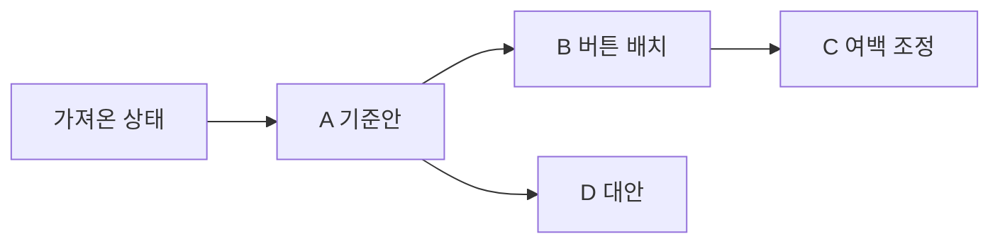

# Console Canvas PRD

제품 요구사항 기준 문서 · 정리/전수 대조일 2026-10-25 · 현재 구현 기준 0.15.0

이 문서는 지금까지 확정한 제품 목적과 사용자 동작을 통합한다. 제품 동작은 이 문서, 사용법은 [README](../README.md), 구현 구조는 [architecture.md](architecture.md), 실제 확인 결과는 [verification.md](verification.md)에서 관리한다. 요구사항을 적었다는 이유로 구현 또는 검증 완료로 간주하지 않는다. 전체 진입점과 코드·검사 대응, 발견한 차이는 [기능 전수 대조표](feature-audit.md)에 기록한다.

## 1. 제품 목적

Console Canvas는 실제 콘솔 웹 화면을 소스코드 없이 가져와, 요소를 직접 옮기거나 지우고 자유 텍스트 주석으로 개선 의도를 설명하는 로컬 편집기다. 사용자는 시안을 여러 갈래로 보관하고, **변경 후 화면과 주석을 포함한 이미지 한 장**으로 개발 에이전트에게 구현 방향을 전달한다. 에이전트는 로컬 MCP로 복제본을 조회·편집할 수도 있다.

사용자가 원본 소스를 가지고 있는지는 가져오기·시안 편집의 전제 조건이 아니다. 원본 소스를 수정하는 작업은 해당 프로젝트에 접근할 수 있는 개발 에이전트가 별도로 수행한다.

### 해결할 문제

- 말로만 배치·간격·삭제·문구 변경을 설명하기 어렵다.
- 몇 개의 큰 박스만 옮길 수 있으면 실제 버튼·입력·문구·행의 변경 의도를 표현하기 부족하다.
- 과거 시안에서 대안을 만들 때 기존 미래 시안을 잃거나 부모 관계를 혼동하기 쉽다.
- 픽셀 이동량만 전달하면 반응형 레이아웃의 구현 의도가 충분히 전달되지 않는다.
- 사용자 편집과 에이전트 편집, 주석과 속성 변경을 다른 화면에서 확인하면 맥락을 놓치기 쉽다.

### 사용자와 주요 작업

| 사용자 | 주요 작업 | 얻는 결과 |
| --- | --- | --- |
| 콘솔 UI를 기획·검토하는 사람 | 실제 화면을 가져와 배치 수정·삭제·주석 작성 | 설명 가능한 시안 |
| 여러 안을 비교하는 사람 | 스냅샷 저장·분기·과거/미래 이동 | 원래 안을 잃지 않는 대안 탐색 |
| 소스를 수정하는 개발자·에이전트 | 전달 이미지와 필요 시 원본 식별 정보 확인 | 반응형 UI에 맞는 구현 방향 |
| MCP를 사용하는 에이전트 | 연결된 복제본 조회·편집·실행 취소 | 사용자와 공유하는 편집 상태 |

## 2. 범위와 원칙

### 대상과 제공 경로

- 목록·검색·선택·입력·편집·표·관리 메뉴가 중심인 HTML/CSS 콘솔 UI를 우선 대상으로 한다.
- Chromium 내장 독립 앱이 주 경로다. Chrome 확장과 독립 HTML 샘플은 보조 경로다.
- 로그인 후 화면을 가져올 수 있다. 앱의 로그인 세션은 기존 Chrome과 별개다.
- 현재 배포 대상은 macOS Apple Silicon이며 Python 3.9 이상이 필요하다.

### 제품 원칙

1. 원본 웹사이트와 복제본 편집을 분리한다. 복제본의 업무 버튼은 디자인 요소이며 원본 업무를 실행하지 않는다.
2. 캔버스는 변경 의도를 표현하는 공간이다. 캡처 좌표를 원본 소스의 절대 위치 CSS로 그대로 적용하라는 뜻이 아니다.
3. 기본 편집·저장·전달 이미지 생성에 클라우드 서버나 AI API 키를 요구하지 않는다.
4. 자동 저장·실행 취소·스냅샷·파일 백업은 목적이 다르며 서로 대체하지 않는다.
5. 과거·미래·병렬 시안과 미저장 작업을 임의로 버리지 않는다.
6. 구현됨, 계획됨, 검증됨을 구분한다. 환경 제한으로 하지 못한 검사는 남은 항목으로 기록한다.

### 현재 제외 범위와 한계

- 임의의 모든 사이트를 완벽하게 재현한다고 보장하지 않는다. 다른 경로·닫힌 UI·서버에만 있는 정보·가상 목록의 미렌더링 행은 수집 대상이 아니다.
- Canvas·영상·iframe 내부 개체, 닫힌 Shadow DOM을 모두 개별 요소로 분해하는 기능은 제공하지 않는다. SVG 아이콘도 보통 한 레이어로 다룬다.
- 외부 인증 리소스·웹폰트·특수 CSS·변형·고정 요소 등은 원본과 차이가 날 수 있다. 수집 가능한 리소스를 내장하고 제약은 안내한다.
- 편집 중 원본 서비스 저장, 원본 프로젝트 소스 자동 수정, 자동 반응형 코드 생성, 실시간 다중 사용자 협업은 현재 범위에 포함하지 않는다.
- 복사/붙여넣기는 같은 캡처 안에서 제공한다. 문서 간 요소 이식이나 전용 표 열 재정렬 편집기는 현재 범위에 포함하지 않는다.
- 폭넓은 스타일 편집기 전체를 약속하지 않는다. 현재 **요소 편집**은 위치·정렬 등 제공된 조절 항목을 대상으로 한다.

## 3. 용어와 상태

| 용어 | 의미 |
| --- | --- |
| 원본 화면 | 앱의 웹사이트 화면에서 실제로 접속한 서비스 |
| 캡처 / 문서 | 한 시점에 가져온 화면과 그 화면의 편집 작업 단위 |
| 요소 | 복제본에서 선택·이동·삭제할 수 있는 문구·아이콘·버튼·입력·셀·행·영역 등 |
| 현재 작업 | 문서에 자동 저장되는 최신 편집·주석·추가 설명 |
| 기준 스냅샷 | 현재 작업의 출발점인 실제 활성 버전 |
| 미리보기 선택 | 그래프에서 확인 중인 저장 버전. 실제 기준 버전과 다를 수 있음 |
| 저장 전 변경 | 기준 스냅샷과 달라진 현재 작업. 자동 저장되지 않았다는 뜻이 아님 |
| 스냅샷 | 이름과 부모 관계를 가진 편집·주석·추가 설명·이력 위치의 저장 버전 |
| 변경 이력 | 작업 종류·대상·전후 값·주석 내용과 분기 맥락을 가진 이벤트 목록 |
| 전달 이미지 | 결과 화면·번호 하이라이트·하단 요청 카드가 포함된 PNG 한 장 |
| 편집 파일 | 다른 기기에서 이어 편집하거나 복구하기 위한 전체 백업 JSON |

`현재 작업 자동 저장`과 `스냅샷 저장`을 구별해 표시한다. 미리보기만 선택해서는 기준 버전이나 현재 편집이 바뀌지 않는다.

## 4. 핵심 사용자 흐름

### 4.1 실제 화면으로 개선안 만들기

1. 웹사이트 화면에서 URL을 열고 필요하면 로그인한다.
2. 원하는 상태를 표시한 뒤 **이 화면 가져오기**를 누른다.
3. 편집기에서 요소를 선택·이동·삭제·복제하거나 주석을 남긴다.
4. 오른쪽 통합 이력에서 작업 내용과 주석을 확인한다.
5. 이름을 입력해 스냅샷을 저장한다.
6. **변경 내용 전달**에서 결과와 요청 카드를 검토해 이미지 한 장을 복사하거나 저장한다.
7. 개발 에이전트는 이미지와 요청의 의도를 실제 소스의 정렬·간격·순서·반응형 동작으로 구현한다.

### 4.2 과거에서 대안 분기 만들기

1. A→B→C를 저장한 상태에서 **스냅샷 목록**을 연다.
2. A를 클릭하면 선택 이름과 하단 미리보기만 바뀐다. 현재 작업의 기준은 여전히 C다.
3. **이 버전으로 이동**을 눌러 실제 기준을 A로 바꾼다. 이동 전 작업이 달라졌다면 먼저 자동 보관한다.
4. A에서 수정하고 D를 저장하면 D의 부모는 A다. B와 C는 남는다.
5. 그래프에서 C나 D를 선택하고 적용하면 각 버전으로 다시 이동할 수 있다.

**A를 미리보기만 한 뒤 C 위에서 D를 저장했다면 부모는 C다.** 그래프를 저장 순서대로 연결하거나 미리보기 선택을 실제 복원으로 혼동하지 않는다. 병합 커밋이나 Git 저장소 기능을 제공하는 것은 아니다.

### 4.3 에이전트로 복제본 편집하기

1. 앱에서 화면을 가져오고 MCP에 연결한다.
2. 에이전트는 연결 화면·요소·주석·버전·이력을 조회한다.
3. 최신 revision과 고유 operation ID로 이동·삭제·주석 작업을 적용한다.
4. 사용자는 같은 캔버스와 이력에서 결과를 확인하고 한 단계로 실행 취소할 수 있다.
5. 결과를 PNG로 전달하거나 저장 버전으로 보관한다.

## 5. 기능 요구사항

### FR-01. 실제 화면 가져오기

- 원본 소스코드 없이 현재 DOM·계산된 스타일·요소 정보와 읽을 수 있는 이미지/폰트를 수집한다. 화면 밖이라도 DOM에 존재하는 대상은 포함될 수 있으나 가상 목록의 미렌더링 행은 포함하지 않는다.
- 일반적인 표시 요소는 큰 박스에 한정하지 않고 세부 문구·아이콘·버튼·입력·표 셀·행·영역까지 편집 대상으로 다룬다. 2절의 분해 한계는 적용한다.
- 원본 selector·ID·문구 등 식별 근거를 유지한다. 캡처 내부 ID는 원본 소스 컴포넌트 ID와 구별한다.
- 원본 이벤트를 실행하거나 원본 DOM을 수정하지 않는다. 가져온 스크립트는 복제본에서 실행하지 않는다.
- 가져오는 중 진행 상태를 표시하고 실패 원인을 안내하며 다시 시도할 수 있게 한다.
- HTTP/HTTPS 웹사이트를 대상으로 하며 주소에서 스킴을 생략하면 HTTPS를 붙인다. 뒤로/앞으로·새로고침·샘플 콘솔을 제공하고 이동 기록이 없으면 해당 버튼을 비활성화한다.
- DOM의 입력값·체크/선택 상태·텍스트·의사 요소와 가능한 스크롤 상태를 보존한다. hidden input과 password input의 값은 제외한다. 화면 전체의 개인정보 자동 마스킹을 의미하지 않는다.
- 접근 가능한 open Shadow DOM은 펼쳐 가져오되 슬롯 등의 차이를 안내한다. 캡처 이미지에서 편집 화면 내 래스터 영역을 보완할 수 있다.
- 원본 스크린샷은 경로별로 다르다. 데스크톱은 웹 뷰 캡처가 필요해 표면을 얻지 못하면 가져오기가 실패할 수 있다. 확장은 활성 탭 확인 후 보이는 영역을 캡처하고 실패/탭 변경 시 경고와 함께 DOM만 가져올 수 있다. 단독 샘플의 screenshot은 없을 수 있다.

### FR-02. 워크스페이스와 패널

- 외부 앱 헤더는 웹사이트/편집기 전환과 앱 설정을 담당한다. 주소창은 웹사이트 화면에서만 표시한다.
- 편집기 내부는 별도 브랜드 헤더를 반복하지 않는 한 줄 도구 모음을 사용한다. 문서·편집·확대·스냅샷·전달 기능에 접근할 수 있어야 한다.
- 왼쪽은 레이어, 가운데는 캔버스, 오른쪽은 **탭 없는 변경 이력**이다.
- 펼친 패널의 접기 버튼은 해당 패널 상단에 둔다. 접으면 전체 높이의 좁은 세로 바를 남기고 맨 위 버튼으로 다시 연다.
- 열기/닫기는 같은 화살표 디자인 체계를 사용한다. 패널 경계 드래그와 키보드로 너비를 조절하며 너비·접힘 상태를 재실행에 보존한다.
- 패널을 접거나 너비를 조절하면 캔버스가 남은 공간을 사용한다. 문서 메뉴와 주요 도구는 패널 접힘에 종속되지 않는다.
- **앱 설정**은 연결/스킬과 업데이트 화면으로 이어지고 **작업으로 돌아가기**는 이전 웹사이트/편집기로 복귀한다. 원본 정보의 URL은 앱 웹사이트 화면에 연다. **원본에서 다시 가져오기**는 현재 구현상 웹사이트 뷰로 돌아가는 버튼이며 자동 재수집·기존 문서 갱신은 하지 않는다.

### FR-03. 선택과 탐색

- 일반 클릭은 의미 있는 요소를 선택하며 Alt+클릭으로 세부 요소를 선택할 수 있다. Shift+클릭·상위 선택 버튼·클릭 가능한 상위 경로로 부모를 고른다.
- Cmd/Ctrl+클릭은 다중 선택을 지원한다. 빈 곳 드래그는 영역 안에 완전히 포함된 요소를 선택하며, 추가 선택과 Esc 취소를 제공한다.
- 부모와 자식을 함께 선택했을 때 하위 요소에 같은 이동을 두 번 적용하지 않는다.
- 확대/축소·너비 맞춤·선택 맞춤·스크롤로 긴 화면과 작은 요소를 탐색한다.
- 레이어 트리 접기/펼치기, 문구·태그·캡처 ID 검색, **주요 요소만** 필터와 선택/변경/삭제/주석 표시를 제공한다. 검색어가 있으면 일치하는 대상의 조상을 함께 보여 준다.
- 한 번에 100개까지 선택한다. 확대는 10~250%이며 버튼·비율 선택·Cmd/Ctrl+휠을 제공한다. 이 비율은 시안 보기용이며 원본 반응형 뷰포트 변경을 뜻하지 않는다.

### FR-04. 이동·삭제·복사와 실행 취소

- 요소 또는 선택 묶음을 드래그해 자유 배치한다. 방향키와 **요소 편집** 모달의 위치·정렬 기능도 제공한다.
- 삭제는 복제본 요소를 숨기는 동작이다. 자유 배치 시안을 유지하기 위해 원래 빈자리가 자동으로 재배치된다고 가정하지 않는다.
- 부모 이동/삭제는 이미 따로 편집한 자식에도 적용한다.
- 같은 캡처 안에서 복사/붙여넣기하며 하위 요소와 요소 주석도 복제한다. 복사본은 원본과 별도 편집 대상이다.
- 사용자 편집과 MCP 편집은 실행 취소/다시 실행을 공유한다. 작업 묶음은 한 단계로 되돌린다.
- 실제 입력란의 텍스트 편집 단축키와 캔버스 단축키를 구분한다.
- 다중 선택의 왼쪽/위쪽/가로 중앙/세로 중앙 정렬은 두 개 이상, 가로/세로 간격 맞춤은 세 개 이상의 최상위 선택 요소를 기준으로 한다. **정렬선에 맞추기**를 켜면 드래그 시 주변 요소의 경계/중앙에 맞추며 Alt로 일시 해제한다.
- 방향키는 1px, Shift+방향키는 10px, 요소 편집 모달의 방향 버튼은 8px 이동한다. Cmd/Ctrl+Z, Cmd/Ctrl+Shift+Z 및 웹 편집기의 Cmd/Ctrl+Y로 실행 취소/다시 실행한다. 데스크톱 메뉴도 같은 캔버스 기록에 연결한다.
- 실행 취소/다시 실행 스택은 현재 문서 세션의 메모리 상태다. 실행 취소는 최근 100단계를 보관하며 문서 열기/전환·앱 재실행 때 초기화한다. 영구 변경 이력과 저장 스냅샷은 남아도 과거 undo 스택이 복원되는 것은 아니다.
- 복사/붙여넣기는 하위 요소 포함 한 번에 5,000개까지이며 같은 문서 ID를 확인한다. 반복 붙여넣기는 기본 24px씩 어긋나게 배치한다. 텍스트 클립보드 권한이 없으면 버튼은 이 창의 내부 복사 데이터 또는 키보드 붙여넣기를 안내한다.

### FR-05. 요소·좌표 주석

- 별도 선택/주석 모드를 요구하지 않는다. 선택한 요소 위의 주석 아이콘을 누르면 자유 텍스트 모달을 연다.
- 빈 곳 클릭은 해당 문서 좌표에 주석을 남길 진입점을 표시한다. 빈 곳 드래그의 영역 선택과 구분한다.
- 저장된 주석은 번호 배지로 표시하고 다시 눌러 편집한다. 요소 주석은 요소를 따라가며 좌표 주석은 문서 좌표에 남는다.
- 자동 저장, **주석 저장**, Cmd/Ctrl+Enter를 제공한다. 닫기·Esc·문서 전환·정상 종료에서도 입력 초안을 잃지 않는다.
- 주석을 편집·삭제하고 실행 취소할 수 있어야 한다. 삭제된 요소의 주석도 전달 시 맥락을 보존한다.
- 주석은 구현 요청이며 작성만으로 화면이나 원본 소스를 자동 수정하지 않는다. 주석만 남긴 문서도 유효한 전달 대상이다.

### FR-06. 문서와 휴지통

- 문서명 메뉴에서 저장 문서 검색·전환, 현재 이름 변경, 원본 정보, 편집 파일 열기/저장, 휴지통에 접근한다.
- 문서 이름은 원본 사이트 제목과 별도로 관리한다.
- 문서를 삭제하면 원본 캡처·편집·주석·스냅샷을 함께 보존한 채 휴지통으로 이동한다. 활성 문서는 초안까지 저장한 뒤 닫고 MCP 연결 대상에서도 제거한다.
- **복구**는 목록으로 돌려놓고 **복구하고 열기**는 문서를 연다. 삭제 알림의 되돌리기도 제공한다.
- 휴지통을 자동으로 비우거나 기존 자료를 임의로 영구 삭제하지 않는다.

### FR-07. 스냅샷 저장과 분기 보존

- **스냅샷 저장**은 이름 입력 모달을 연다. 이름과 현재 편집·주석·추가 설명·이력 위치를 저장하며 초기 **가져온 상태**도 버전으로 남긴다.
- 저장 직후 스냅샷 목록을 열고 새 버전을 선택한다. 새 버전의 부모는 저장 시점의 실제 기준 스냅샷이다.
- 과거 복원이 이후/병렬 버전을 삭제하지 않는다. 저장 전 변경이 있으면 이동 전에 자동 스냅샷으로 보호한다.
- 복원 자체도 실행 취소할 수 있다. 한도나 저장 오류로 현재 작업을 보호할 수 없으면 작업을 잃는 이동을 강행하지 않는다.
- 위 저장 오류 정책은 목표 요구다. 현재 구현은 먼저 메모리를 복원하고 나중에 저장해 실패 시 되돌리지 않는 결함 #11이 있으므로 내구성 보존 완료로 표시하지 않는다.
- 이름 변경·휴지통·복구를 지원하며 기존 버전 ID·부모·후손 관계를 유지한다.
- **복구**는 버전 목록만 복구하고 **복구하고 적용**은 해당 버전을 적용한다. 활성 버전을 휴지통으로 옮겨도 현재 편집과 후손은 지우지 않는다.

### FR-08. 스냅샷 Git 그래프와 미리보기

- 중앙 도구 모음의 버튼을 **스냅샷 목록 · 선택한 이름**으로 표시한다. 실제 기준과 다르면 **미리보기**, 기준 이후 작업이 달라졌다면 **편집 중**을 구별한다.
- 목록을 열면 좌우로 스크롤 가능한 Git 형태의 그래프를 보여 준다. 부모 깊이에 따른 가로 진행과 다른 분기 줄을 사용하며 실제 부모 ID로만 선을 잇는다.
- 노드/연결선과 현재 버전·선택한 미리보기·저장 전 작업을 구별한다. 살아 있는 후손의 연결을 설명하는 휴지통 조상은 비활성으로 남길 수 있다.
- 노드 선택 시 같은 목록의 그래프 아래에 미리보기 화면을 표시한다. 선택 이름을 즉시 갱신하되 편집 데이터·revision·이력을 변경하지 않는다.
- **이 버전으로 이동**을 눌러 실제로 복원한다. 미리보기와 적용의 차이를 문구로 안내한다.
- 빠르게 다른 버전/문서를 선택해도 늦게 도착한 미리보기가 현재 선택을 덮어쓰지 않아야 한다.

### FR-09. 통합 변경 이력

- 오른쪽 패널에는 속성/주석 등의 별도 탭을 두지 않고 모든 종류의 작업을 시간순 목록에 모은다.
- 이동·복사·삭제·속성 변경·주석 추가/수정/삭제와 실행 취소 등의 종류·대상·시각을 표시한다. 속성은 전후 값, 주석은 요청 본문을 함께 표시한다.
- 현재 가지/모든 가지, 종류 필터와 통합 검색을 제공한다. 필터는 같은 이력 목록의 범위를 바꾸며 별도 속성/주석 화면으로 전환하지 않는다.
- 이력 대상 클릭은 현재 화면의 대상이나 주석을 확인하는 동작이며 과거 버전 복원과 구별한다.
- 과거 버전에서 분기해도 다른 가지의 이력을 지우지 않는다. 기존 작업의 시각이 없으면 임의의 과거 이벤트를 만들어내지 않고 보존된 주석임을 표시한다.

### FR-10. 이미지 한 장으로 변경 내용 전달

- 전달할 현재 작업 또는 저장 버전을 선택하고 결과 이미지를 미리 본 뒤 복사하거나 PNG로 저장한다.
- 이미지 상단에는 변경 후 화면, 변경 구역 하이라이트와 번호 아이콘을 배치한다. 하단에는 같은 번호의 요청 카드를 두 열로 배치한다.
- 각 카드에는 대상과 요청 내용을 읽을 수 있게 표시한다. 요소 이동량만 나열하기보다 그림과 주석으로 정렬·간격·순서·반응형 줄바꿈 의도를 전달한다.
- 요청 10개 이상에서도 글자를 작게 줄이거나 카드를 누락하지 않고 이미지 높이를 늘린다. 추가 설명도 같은 이미지에 포함한다.
- 삭제 대상은 이전 위치의 점선과 삭제 전 참고 이미지, 작은 대상은 필요한 확대 이미지로 맥락을 설명한다.
- 별도 텍스트/JSON 파일을 에이전트에게 첨부하도록 요구하지 않는다. 백업 JSON은 재편집용으로 구별한다.
- 원본 selector/ID는 MCP 조회의 보조 근거로 유지하지만 이미지 전달의 필수 첨부물로 만들지 않는다.
- 미리보기와 이미지 생성은 현재 선택·편집·이력·revision을 변경하지 않는다. 생성 한도를 넘으면 내용을 자르지 말고 분할/범위 조정을 안내한다.
- 전달 기준에는 **가져온 원본·현재 작업·휴지통을 제외한 저장 버전**이 있다. 원본 기준에는 편집/주석이 없다. 추가 설명 입력은 현재 작업에서만 제공하고 다른 버전은 저장된 설명을 사용한다.
- 이미지 클립보드를 지원하지 않거나 권한이 없으면 PNG 저장을 안내한다. 데스크톱 PNG 저장은 현재 결함 #8로 완료되지 않았으며 9절의 상태를 따른다.

### FR-11. 자동 저장과 복구

- 문서·편집·주석·추가 설명·전체 분기·변경 이력을 로컬 IndexedDB에 자동 저장한다. 원본 캡처 HTML을 스냅샷마다 중복 저장하지 않는다.
- 문서 전환·정상 종료·업데이트는 초안과 저장 큐의 완료를 기다린다. 저장 실패 시 성공했다고 표시하거나 작업을 버리고 종료하지 않는다.
- 앱 재실행은 마지막 문서를 연다. 패널 너비·접힘 같은 작업 환경도 보존한다.
- 편집 파일은 현재 작업, 과거/병렬/휴지통 스냅샷과 이력을 포함해 다시 열 수 있는 백업이다. 문서 휴지통 보존은 앱 프로필 백업 검증에도 포함한다.
- 앱 업데이트나 내부 리팩토링이 저장 형식을 바꾸더라도 기존 사용자 자료를 보존한다. 개발 단계의 하위 호환 계층은 필수가 아니지만 검증한 일회성 이전 또는 파일 왕복이 필요하다.
- DB 쓰기가 실패해도 메모리에 남은 작업을 긴급 편집 파일로 내보낼 수 있어야 한다. 현재는 공통 flush 실패가 백업도 차단하므로 결함 #10의 미충족 요구다.

### FR-12. 로컬 MCP

- 명시적으로 연결한 복제본만 에이전트에게 공개한다. 원본 웹사이트/로그인 조작이나 원본 프로젝트 소스 변경을 MCP 편집 범위에 포함하지 않는다.
- 화면·요소·원본 식별 정보·요소/좌표 주석·분기 스냅샷·현재/모든 가지 이력과 전달 이미지를 조회한다.
- 이동·삭제·주석 작성/수정/삭제·실행 취소/다시 실행·스냅샷 생성/복원을 제공한다.
- 쓰기는 최신 revision과 고유 operation ID를 사용한다. 묶음 검증 실패는 전체 무변경이며 응답이 불확실하면 같은 ID/인수 재시도로 중복 실행을 막는다.
- 드래그/입력 등과 충돌하는 편집은 busy/conflict로 처리한다. 조회 결과에는 실제 기준 버전과 미리보기 선택을 구별한다.
- 인증된 localhost 브리지와 stdio MCP를 사용한다. 연결 토큰을 이미지·문서·로그·저장소에 노출하지 않는다.
- 등록 명령이나 도구 목록 확인만으로 화면 연결 성공이라고 하지 않는다. 실제 연결 화면과 요소/주석 조회가 성공해야 한다.
- 데스크톱은 자동 연결하고 브라우저/확장은 주소·연결 코드를 입력해 연결/해제한다. 연결 상태·revision·최근 행위자를 표시하고 일시 연결 오류는 재시도한다.
- 조회 목록은 페이지로 나눈다. list_elements의 parent_id는 직계 자식 필터이며 전체 후손 조회와 다르다. 휴지통 스냅샷/삭제 문서의 관리, 요소 복사, 원본 수집은 현재 MCP 도구에 없다.
- MCP 편집 응답의 메모리 적용 성공(ok)과 영구 저장 결과(persisted/save_error)를 구분한다. 저장 실패 응답을 DB 보존 완료로 해석하지 않는다. operation ID 재시도 캐시는 브리지의 메모리에 한정되며 영구적인 중복 방지 저장소가 아니다.

### FR-13. 앱 제공 스킬과 에이전트 안내

- 앱 설정에서 번들 스킬 설치/업데이트·ZIP 저장·MCP 등록 명령 복사를 제공한다. 스킬 설치와 MCP 등록은 별개다.
- MCP의 get_agent_guide로 앱에 포함된 같은 지침을 읽을 수 있어야 한다. 이 조회는 별도 스킬 설치나 화면 가져오기를 전제하지 않는다.
- 앱 업데이트 후 실행 시 이미 설치된 관리 파일을 자동 동기화하고 이전 파일을 백업한다. 사용자가 추가한 개인 파일은 유지한다.
- 스킬이 설치되지 않았다면 자동 설치를 강제하지 않는다. 동기화 실패는 앱 설정에 원인/경로를 안내하고 앱 사용을 계속할 수 있게 한다.
- 안내는 복제본 편집과 원본 소스 구현을 구별하고, 전달 이미지의 의도를 반응형 레이아웃으로 구현하도록 설명한다.

### FR-14. 설치와 업데이트

- GitHub Releases의 DMG를 열어 Applications로 드래그 설치할 수 있게 한다. ZIP은 보조 배포 방식이다.
- 앱에서 업데이트 확인·다운로드·적용을 제공한다. 실행 중인 앱에 Git 소스를 덮어쓰는 업데이트 방식은 사용하지 않는다.
- 적용 전 저장 완료를 확인하고 앱 종료→교체→자동 재실행으로 이어져야 한다. 교체 실패 시 이전 앱을 복원한다.
- 다운로드 무결성과 앱 식별/버전/아키텍처를 검증한다. 업데이트는 사용자 편집 데이터·로그인 프로필·스냅샷과 설치 스킬을 보존한다.
- 쓰기 권한이 없거나 DMG 안에서 실행하는 등 적용할 수 없는 환경은 설치/복구 방법을 안내한다.
- 현재 개발판의 ad-hoc 서명과 일반 배포에 필요한 Developer ID 서명·공증을 구별한다. 보안 검사 우회를 제품 설치 절차로 안내하지 않는다.
- 앱 메뉴에서도 **업데이트 확인…**을 제공한다. 확인 중/다운로드 중/준비 완료/적용 중/오류에 따라 버튼을 활성화하고 진행률을 표시한다. 최신 버전이나 오류 상태에서 무효한 적용 버튼을 노출하지 않는다.
- 0.x 개발판은 시험 릴리스도 업데이트 후보로 삼고 1.x 이상은 prerelease를 제외한다. 현재보다 높은 버전과 해당 아키텍처의 검증 가능한 ZIP만 자동 적용한다. 같은/이전 버전 자동 교체는 제공하지 않는다.
- 네이티브 메뉴의 앱 정보·종료, 텍스트 잘라내기/복사/붙여넣기/전체 선택, 개발자 도구와 전체 화면은 Electron 기본 기능이다. 캔버스의 요소 복사/삭제 기능으로 혼동하지 않는다.

### FR-15. 두 버전 비교

- 스냅샷 미리보기의 **현재 작업과 비교** 또는 버전의 기타 작업 메뉴에서 비교 모달을 연다.
- 왼쪽과 오른쪽에서 각각 가져온 원본·현재 작업·휴지통을 제외한 저장 버전을 선택한다. 초기 선택은 선택 스냅샷과 현재 작업이다.
- 두 화면을 나란히 보여 주고 각 변경/주석 개수·추가 설명, 서로 다른 요소 수와 설명 차이를 표시한다. 서로 다른 요소 수는 픽셀 이미지 diff나 요청 카드 수가 아니다.
- 비교 선택/닫기는 현재 편집·활성 스냅샷·revision·이력을 바꾸지 않는다. 원본과 현재만 비교하거나 두 저장 버전을 비교할 수 있다.

### FR-16. 편집 파일 입출력

- 문서 메뉴·시작 화면의 파일 열기 또는 파일 드롭으로 JSON을 연다. 드롭 시 첫 파일을 사용하고 모달이 열렸다면 먼저 닫도록 안내한다.
- 원본 캡처 형식(console-canvas-snapshot)과 재편집 형식(console-canvas-review)을 지원한다. 에디터는 ZIP·changes-only JSON·PNG를 편집 문서로 직접 가져오지 않는다.
- 파일 입력의 확장자 필터와 실제 검증을 구분한다. 현재 파일 크기 제한은 85,000,000바이트이며 HTML/요소 수·계층·복사 구조·타임라인도 검증한다.
- 같은 문서 ID를 다시 열면 새로운 문서를 자동 생성하는 가져오기와 다르다. 기존 캡처는 불변이며 휴지통 문서는 먼저 복구해야 한다.
- 내보내기는 현재 문서 한 개의 현재 작업·분기/휴지통 스냅샷·이력을 포함한 .uiclone.json이다. 전체 문서 목록/문서 휴지통·패널 환경·로그인 세션의 일괄 백업은 아니다. 이들은 앱 프로필 백업과 구별한다.
- 네이티브 JSON 저장은 취소 시 무변경이고 임시 파일 뒤 rename으로 저장한다. 브라우저는 다운로드 경로를 사용한다.
- 유효하지 않은 파일은 기존 활성 문서와 DB를 바꾸지 않고 거절해야 한다. 현재 타임라인을 늦게 검증해 부분 등록하는 결함 #9가 있다. 저장 오류 중 긴급 백업은 결함 #10으로 미충족이다.

### FR-17. 보조 사용 경로와 에이전트 CLI

- 독립 HTML은 내장된 가상 샘플로 서버 없이 시작하고, 브라우저 출처의 최근 문서(기본 4개)·전체 저장 목록·파일 열기를 제공한다. 임의 원격 사이트를 같은 HTML에서 바로 수집하는 도구는 아니다.
- Chrome 확장은 HTTP/HTTPS 탭에서 확장 버튼으로 가져온 후 편집기 탭을 연다. 로딩/오류 배지를 제공하며 Chrome 설정·스토어 등 제한 페이지는 지원하지 않는다.
- 스킬 helper의 prepare는 번들/체크섬을 확인해 새 폴더에 편집기 런타임을 준비한다. review는 기존 ZIP/JSON을 실행하지 않고 현재 변경/주석 요약과 참고 파일을 새 폴더에 만든다.
- helper의 mcp는 번들 어댑터를 실행하고 --start/--stop과 상태 경로·포트를 지원한다. CLI review에서 ZIP을 지원하는 것과 에디터의 직접 ZIP 열기를 구별한다.
- 이전 코드의 HTML 비교 보고서·ZIP 생성 helper는 호환/검증 경로로 남아 있지만 현재 전달 메뉴의 사용자 출력은 PNG 한 장이다. 숨겨진 구형 주석 popover DOM을 별도 제공 기능으로 세지 않는다.

## 6. 데이터와 보존 기준

| 구분 | 보존할 내용 | 구별할 내용 |
| --- | --- | --- |
| 캡처 | 원본 HTML·요소·계층·출처·화면 이미지·원본 식별 근거 | 편집기 내부 ID와 원본 ID |
| 문서 | 사용자 이름·원본 정보·휴지통 메타데이터 | 원본 사이트 제목과 사용자 이름 |
| 현재 작업 | 이동·삭제·복사·요소/좌표 주석·추가 설명·현재 이력 위치 | 자동 저장 여부와 스냅샷 대비 변경 |
| 스냅샷 | ID·이름·시각·부모·종류·휴지통·저장 상태·활성 버전 | 저장 순서와 부모 관계, 복구와 적용 |
| 이력 | 이벤트와 선행 관계·행위자·작업 내용 | 현재 가지와 다른 가지 |
| 환경 | 패널 너비·접힘·마지막 문서·웹사이트 로그인 세션 | 편집 상태와 로그인/연결 설정 |

편집 데이터는 앱의 `~/Library/Application Support/Console Canvas/Partitions/console-canvas-editor/IndexedDB`에 있다. MCP 연결 정보의 기본 경로인 `~/.codex/console-canvas`는 편집 저장소와 별개다. 화면·주석·로그인 데이터는 GitHub나 클라우드에 자동 업로드하지 않는다. 사용자가 전달 이미지를 에이전트에 첨부하거나 MCP로 조회하는 것은 별도의 명시적 전달 경로다.

## 7. 품질·오류 처리 요구사항

| ID | 요구사항 |
| --- | --- |
| NFR-01 데이터 보존 | 종료/업데이트/문서 전환/버전 이동/휴지통 복구에서 작업을 잃지 않는다. 백업과 파일 왕복으로 확인한다. |
| NFR-02 격리 | 원본은 읽기만 하고 복제본 스크립트를 실행하지 않는다. Electron sandbox·contextIsolation·webSecurity와 IPC 신뢰 프레임 검증을 유지한다. |
| NFR-03 입력과 접근성 | 접근성 이름, 모달 제목, 키보드 이동/확인/취소, 포커스 복귀를 제공한다. 한글 조합 입력과 편집 단축키의 충돌을 검증한다. |
| NFR-04 상태 일관성 | UI·MCP·저장·이력이 같은 명령 결과를 보여 준다. 늦은 응답·중복 명령·부분 실패로 다른 상태가 되지 않는다. |
| NFR-05 반응성 | 선택/드래그/검색/버전 탐색에서 현재 기준 대비 눈에 띄는 성능 회귀를 막는다. React 재렌더마다 전체 장면을 다시 만들거나 저장하지 않는다. 수치 SLA는 아직 확정하지 않았다. |
| NFR-06 결과의 정직성 | 실제 창 조작, 실제 사이트 수집, 샘플/가상 이미지, offscreen 검사를 구별한다. 실패·미검증을 통과로 보고하지 않는다. |

저장 실패는 작업을 유지하고 재시도를 안내한다. 캡처/리소스/이미지 한도 실패는 원인과 조정 방법을 알려 준다. 유효하지 않은 명령·백업 파일은 부분 반영하지 않는다. 사용자 문서의 문구·주석은 자료로 취급하며 에이전트의 시스템 지시와 혼동하지 않는다.

현재 주요 한도는 스냅샷 문서당 500개(초기·자동 보관·휴지통 포함), 문서/스냅샷 이름 120자, 주석 4,000자, 동시 선택/MCP 쓰기 묶음 100개, 하위 포함 한 번의 복사 5,000개다. 캡처 탐색의 기본 상한은 15,000개 요소이며 가져오기/복사 확장의 전체 노드 상한은 40,000개다.

최종 전달 PNG는 높이 32,760px·1억 픽셀을 검사한다. 그 전에 데스크톱 원본 장면 렌더러가 너비 8,192px·높이 16,000px·4,800만 픽셀을 제한하므로 긴 문서가 최종 PNG 합성 한도보다 먼저 거절될 수 있다. 브라우저/확장의 SVG 기반 보조 PNG는 1,600만 픽셀 및 너비/높이 한도에 맞게 축소하고 외부 이미지를 생략할 수 있다. 한도 초과가 자동 분할/타일 렌더링을 제공한다는 뜻은 아니다. 한도는 [관련 코드](../edit-policy.json), [스냅샷](../snapshot-history.js), [전달 이미지](../handoff-image.js), [보조 PNG](../export.js), [데스크톱 이미지 렌더러](../desktop/render-image.cjs)와 함께 변경한다.

## 8. 수용 기준과 검증 시나리오

아래는 앞으로도 유지할 합격 조건이다. 목록 자체는 이번 문서 정리에서 새로 테스트를 실행했다는 의미가 아니다.

| ID | 시나리오와 합격 조건 | 관련 요구사항 | 검증 근거/경로 |
| --- | --- | --- | --- |
| AC-01 | 소스 없이 가상 NORTH를 가져오고 세부 버튼·문구·아이콘·행을 편집한다. 원본 DOM/이벤트는 변하지 않는다. | FR-01, NFR-02 | tests/integration.html, tests/desktop-fixture.cjs |
| AC-02 | 패널 상단에서 접고 가장자리 바에서 다시 연다. 경계/키보드 너비와 접힘은 재실행에 유지된다. | FR-02 | tests/panels.html, 데스크톱 재실행 |
| AC-03 | 빈 곳 드래그로 다중 선택·이동·복사/붙여넣기하고 실행 취소한다. 부모/자식 이동이 중복되지 않는다. | FR-03, FR-04 | tests/selection.html, 실제 포인터 검사 |
| AC-04 | 요소 아이콘·빈 좌표로 주석을 쓰고 번호 배지로 다시 편집한다. Esc/종료 후 초안과 좌표가 보존된다. | FR-05, FR-11 | tests/evolution.html, 데스크톱 재실행 |
| AC-05 | 문서/버전 이름 변경→휴지통→복구를 거쳐 내용·ID·후손이 유지된다. 복구만으로 버전이 적용되지 않는다. | FR-06, FR-07 | tests/trash.html, tests/placement.html |
| AC-06 | 이름 저장 직후 목록이 열리고 선택 이름이 버튼에 나온다. A 미리보기만으로 현재 C와 revision이 바뀌지 않는다. | FR-07, FR-08 | tests/graphflow.html |
| AC-07 | A→B→C 뒤 실제 A로 이동해 D를 저장한다. A→D 선과 별도 줄이 있고 C→D 선은 없다. C/D를 다시 적용한다. | FR-07, FR-08 | tests/graphflow.html, 실제 그래프 화면 |
| AC-08 | 미저장 작업에서 버전을 이동하면 자동 보관되고 돌아올 수 있다. 재실행/파일 왕복 뒤 전체 분기가 유지된다. | FR-07, FR-11 | tests/snapshots.html, 데스크톱 재실행 |
| AC-09 | 속성 전후 값과 주석 본문·삭제/복사가 오른쪽 같은 목록에 나온다. 탭 없이 필터/검색하고 현재/다른 가지를 구별한다. | FR-09 | tests/graphflow.html, tests/evolution.html |
| AC-10 | 요청 10개와 주석만 있는 시안을 각각 PNG 한 장으로 만든다. 화면/카드 번호와 삭제 전 참고가 맞고 현재 편집은 변하지 않는다. | FR-10 | tests/evolution.html, MCP PNG, 실제 저장/복사 |
| AC-11 | UI/MCP 편집을 조회하고 한 번에 되돌린다. 충돌·busy·중복 재시도·잘못된 묶음이 작업을 이중/부분 적용하지 않는다. | FR-12, NFR-04 | scripts/verify_mcp.mjs, 공식 SDK |
| AC-12 | 문서 전환·정상 종료·재실행에서 편집·초안·추가 설명·스냅샷·이력이 유지되고 저장 실패가 숨겨지지 않는다. | FR-11, NFR-01 | tests/storage.html, 데스크톱/저장 큐 검사 |
| AC-13 | 업데이트 버튼으로 종료·교체·자동 재실행하고 기존 작업/스냅샷을 연다. 설치 스킬은 자동 갱신되고 개인 추가 파일은 남는다. | FR-13, FR-14 | docs/update-verification.md, 실제 배포 빌드 |
| AC-14 | 격리 QA에서 실제 설치 앱의 주석·분기·미래 이동·전달 이미지 저장을 사용한다. 설치 앱 MCP의 실제 화면/요소 조회와 기존 자료 지문을 확인한다. | 전체, NFR-06 | docs/verification.md, docs/usability-check.md |
| AC-15 | 비교 모달 양쪽에서 원본·현재·서로 다른 저장 버전을 선택하고 차이 요약을 본다. 현재 편집/활성 버전/revision은 변하지 않는다. | FR-15 | tests/ux.html, tests/snapshots.html |
| AC-16 | 레이어 주요 요소/검색·Shift 부모 선택·정렬/간격·스냅·각 방향키·보기 확대를 사용한다. undo 스택은 문서 재열기 뒤 초기화되지만 이력/스냅샷은 남는다. | FR-03, FR-04 | tests/ux.html, tests/selection.html, 전수 대조 재현 |
| AC-17 | 타임라인이 잘못된 파일은 기존 UI/DB 무변경으로 거절한다. DB 저장 실패에서도 현재 상태의 긴급 편집 파일을 내보내고 재가져온다. | FR-11, FR-16 | 결함 #9·#10: 재현됨, 수정/회귀 검사 필요 |
| AC-18 | 저장 오류를 주입한 스냅샷 이동은 미저장 작업을 내구성 있게 보호하거나 원래 UI/상태로 복구한다. 메모리 적용과 persisted 결과를 구별한다. | FR-07, FR-12 | 결함 #11: 재현됨, 수정/회귀 검사 필요 |

## 9. 구현·검증·계획 상태

상태 기준은 2026-10-25의 0.15.0 코드와 기록이다. 과거 버전의 직접 사용 성공을 현재 버전 전체의 직접 사용 완료로 확대하지 않는다.

| 영역 | 현재 상태 | 남은 확인/경계 |
| --- | --- | --- |
| 화면 수집·세부 편집·다중 선택·복사 | 구현, 샘플/회귀 검사 존재 | 임의의 모든 실제 사이트 재현 보장은 없음. 개인 Chrome 확장의 설치/탭 권한 경계는 미검증 |
| 패널·주석·문서/휴지통·자동 저장 | 구현, 자동/과거 직접 사용 기록 존재 | 0.15.0 설치 창의 최신 흐름 직접 사용은 잔여 |
| 분기 Git 그래프·선택 이름·미리보기·통합 이력 | 0.15.0 구현, 실제 Chromium 렌더링/자동 검사 확인 | 최신 설치 창에서 A→D·미래 이동 직접 조작은 잔여 |
| 단일 전달 PNG | 생성·10개 요청·비파괴 처리 및 SDK 응답 확인, 데스크톱 파일 저장은 결함 | #8: 네이티브 저장기가 PNG를 거절함. 클립보드·브라우저 다운로드·MCP 이미지 성공과 구별 |
| 두 버전 비교·파일/보조 경로 | 비교/입출력/보조 CLI 구현 | #9: 잘못된 파일의 부분 등록. ZIP은 에디터 입력이 아닌 helper review 경로 |
| 저장 오류 처리 | 정상 경로의 자동 저장/flush·종료 보호 구현 | #10: 긴급 파일 백업 차단. #11: 복원 후 flush 실패 시 메모리 미복구 |
| MCP와 스킬 | 13개 도구 구현, 격리 SDK 22개 검사·설치 스킬 동기화 확인 | 잠긴 실제 0.15.0 앱에서 활성 화면 목록이 비어 화면 조회 검증은 미완료 |
| DMG·업데이트·자동 재실행 | 구현, 0.6/0.7 실제 업데이트 버튼 경로 기록 존재 | 0.15.0은 빌드·설치 교체·실행 확인이며 같은 버전의 전체 Releases 업데이트 검증은 아님 |
| 0.15.0 사용자 자료 보존 | 기존 7문서·13개 전체 스냅샷의 보존 지문 일치 | 설치 후는 DB 파일의 복사 일관성을 확인한 사본 감사이며 실제 창 직접 사용은 아님 |
| React·TypeScript·Tailwind·shadcn/ui | 합의된 개선 방향, 이슈 #1~#7 등록 | 현재 소스에 아직 도입하지 않음 |
| Developer ID 서명·공증 / 다른 OS·아키텍처 | 현재 개발판 범위 밖 | 일반 배포 확대 전에 별도 결정·검증 필요 |

0.15.0 기록상 Python 39·Node 23·Chromium 227개가 통과했다. Mac 잠금으로 표준 전체 검사의 데스크톱 캡처 단계가 중단됐으며, 가상 캡처/offscreen 조건에서 공식 SDK 22개와 종료/재실행을 별도로 확인했다. **표준 전체 검사가 통과한 상태는 아니다.** 상세 조건과 증빙은 [검증 기록](verification.md), 과거 실제 버튼 업데이트는 [업데이트 기록](update-verification.md)을 따른다.

### 9.1 전수 대조에서 확인한 미충족 요구

| 결함 | 재현한 현재 동작 | 요구사항/완료 조건 | 상태 |
| --- | --- | --- | --- |
| [#8 PNG 저장](https://github.com/kimyongin/console-canvas/issues/8) | 데스크톱 저장 API가 .png를 파일 대화상자 전 단계에서 거절 | FR-10, AC-10/14 | 열린 결함, 미수정 |
| [#9 파일 열기](https://github.com/kimyongin/console-canvas/issues/9) | 잘못된 타임라인 거절 후에도 새 문서 메타데이터가 남고 기존 활성 화면이 해제됨. 기존 문서 DB는 보존됨 | FR-16, AC-17 | 열린 결함, 미수정 |
| [#10 긴급 백업](https://github.com/kimyongin/console-canvas/issues/10) | DB 오류에서 편집 파일 저장도 같은 flush 실패에 막힘 | FR-11/16, AC-17 | 열린 결함, 미수정 |
| [#11 복원 저장 실패](https://github.com/kimyongin/console-canvas/issues/11) | 자동 보관/복원을 메모리에 먼저 적용하고 영구 저장 실패 후 되돌리지 않음. 이전 작업은 메모리 자동 보관에는 남음 | FR-07/11/12, AC-18 | 열린 결함, 미수정 |

품질 요구를 제거해 코드에 맞추지 않는다. 정상 기능 구현과 오류 경로의 미충족을 함께 기록하고, AC-01~AC-18을 모두 달성한 것으로 표시하지 않는다. 상세 조사 범위·버그 재현·기능별 근거는 [전수 대조표](feature-audit.md)에 있다.

## 10. React·shadcn/ui 개선 계획과 추적

전환 목표는 기능 재정의가 아니라 상태·표시의 일관성과 공통 UI 유지보수성 개선이다. 이 PRD의 동작과 데이터 보존 기준을 만족하면서 단계적으로 전환한다.

| 실행 순서 | 티켓 | 담당 범위 | 관련 요구사항 |
| --- | --- | --- | --- |
| 전체 계획 | [#1](https://github.com/kimyongin/console-canvas/issues/1) | 범위·순서·공통 완료 조건 | 전체 |
| 0a | [#8](https://github.com/kimyongin/console-canvas/issues/8) | 데스크톱 PNG 네이티브 저장 결함 | FR-10, AC-10/14 |
| 0b | [#9](https://github.com/kimyongin/console-canvas/issues/9) | 잘못된 파일의 UI/DB 무변경 거절 | FR-11/16, AC-17 |
| 0c | [#10](https://github.com/kimyongin/console-canvas/issues/10) | DB 오류 중 긴급 편집 파일 백업 | FR-05/11/16, AC-04/12/17 |
| 0d | [#11](https://github.com/kimyongin/console-canvas/issues/11) | 복원 저장 실패의 보호/롤백 | FR-07/11/12, AC-08/11/18 |
| 1 | [#2](https://github.com/kimyongin/console-canvas/issues/2) | React/TS/Tailwind·기존 esbuild·배포 진입점 | FR-01/12/13/17, NFR-02/04 |
| 2 | [#3](https://github.com/kimyongin/console-canvas/issues/3) | 기존 엔진과 상태/명령·저장 결과 어댑터 | FR-04/05/07/08/09/11/12/16 |
| 3 | [#4](https://github.com/kimyongin/console-canvas/issues/4) | shadcn 공통 컴포넌트·토큰·스타일/포커스 | FR-02/05, NFR-02/03/04 |
| 4 | [#5](https://github.com/kimyongin/console-canvas/issues/5) | 워크스페이스·레이어·문서/파일·주석/속성 | FR-02~FR-06, FR-11/16 |
| 5 | [#6](https://github.com/kimyongin/console-canvas/issues/6) | 그래프·미리보기·두 버전 비교·통합 이력·PNG 전달 | FR-05/07/08/09/10/11/15 |
| 6 | [#7](https://github.com/kimyongin/console-canvas/issues/7) | 전체 AC·보조 경로·MCP/스킬·보존·설치 앱 | FR-01~FR-17, NFR-01~06, AC-01~18 |

0단계는 기존 코드에서 먼저 수정해 정상/오류 회귀 기준을 확보한다. #8→#9→#10→#11은 추천 순서이며 #8/#9/#10 사이의 기술적 의존성은 없다. #11은 #10의 긴급 백업/저장 실패 계약과 먼저 맞춘다. #2의 빌드 준비는 먼저 할 수 있지만 사용자 편집을 담당하는 React 경로 활성화는 0단계 검증 뒤에 진행한다.

결함 티켓이 오류 정책을 수정하고 #3이 이를 어댑터에 노출한다. #5/#6은 해당 계약을 UI에 연결하며 #7은 통합 검증을 맡는다. #7로 기존 결함 구현을 미루거나 같은 수정을 중복 구현하지 않는다. 각 기능·수용 기준의 담당과 제외 범위는 [티켓 재검토 기록](ticket-review.md)에 정리한다. 11개 이슈는 모두 열린 작업이며 이 순서 변경은 구현 완료 보고가 아니다.

DOM 복제/이동 엔진은 React 외부에서 유지한다. UI와 MCP는 기존 명령·검증·실행 취소·저장 큐를 공유한다. Electron/백엔드 전체 재작성이나 추가 클라우드 서버는 이 전환의 필수 범위가 아니다. 상태 관리 라이브러리와 빌드 도구 추가는 구현상 필요와 비용을 확인한 뒤 결정한다.

## 11. 완료·문서 관리 기준

- 변경한 기능의 FR/AC와 해당 이슈를 연결하고, 사용자 동작을 바꾸면 이 PRD와 README·스킬을 함께 갱신한다.
- 검증 기록에는 앱 버전·환경·시험 데이터·실행 방법·통과/실패·대체 조건·잔여 항목을 남긴다. 검사 수만으로 기능 완료를 판단하지 않는다.
- 실제 사용자 자료에는 테스트 편집을 하지 않는다. 설치 앱 교체 전 초안 저장·정상 종료·복구 가능한 앱/데이터 백업을 확보한다.
- 앱/기능 변경 완료는 빌드뿐 아니라 설치 앱 갱신·재실행·격리 QA 직접 사용·기존 자료 보존·실제 MCP 화면 조회·설치 스킬 확인을 포함한다.
- 잠금/권한으로 직접 사용을 못 했다면 가능한 자동 검사는 수행하되 남은 항목을 명시한다. 완료되지 않은 검증을 이슈에서 체크하지 않는다.
- 이 문서 정리 자체는 기능 변경/새 앱 배포가 아니다. 코드와 기능 상태는 9절에 기록된 기준을 따른다.

### 관련 자료

- [README / 사용법](../README.md)
- [구현 구조](architecture.md)
- [버전별 검증 기록](verification.md)
- [직접 사용 기록](usability-check.md)
- [티켓 재검토·요구사항 담당표](ticket-review.md)
- [앱 업데이트 검증](update-verification.md)
- [에이전트 스킬 원본](../skills/console-canvas/SKILL.md)
- [개발 완료·데이터 보존 작업 지침](../AGENTS.md)

### 변경 기록

| 날짜 | 변경 |
| --- | --- |
| 2026-10-25 | 대화에서 확정한 요구사항·0.15.0 구현/검증 상태·React/shadcn 개선 티켓을 최초 통합 |
| 2026-10-25 | 112개 정적 조작 정의와 동적/MCP/CLI 경로 전수 대조. FR-15~17·AC-15~18, 실행 취소 수명·환경별 한도·열린 결함 #8~#11을 보완 |
| 2026-10-25 | 전체 11개 티켓 재검토. 기존 결함 우선 순서·전환 책임·전체 FR/NFR/AC 담당과 오류/설치 검증 조건을 명확히 연결 |
