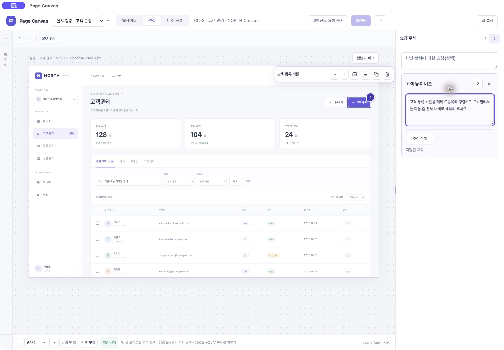

# Page Canvas · 0.56.0 이름 변경과 보안 식별 보존

2026-11-02. #208(이름 변경)과 업데이트 중 실제 발견한 #209(종료 후 늦은 IPC)를 구현했다. 사용자는 원격으로 암호를 입력할 수 없다고 밝혔다.

## 적용 범위

제품 표시를 Page Canvas로 바꿨다. 앱/공통 편집기 헤더·윈도/HTML 제목·About·About/Quit 메뉴 항목·앱 복제 화면 정보·파일/오류 안내·MCP 도구 설명/오류·스킬 표시 이름·README·PRD·사용 가이드에 적용한다. 콘솔 외 일반 웹페이지를 편집하는 제품이라는 설명을 README에 반영했다.

연결과 저장소를 새 제품으로 바꾸는 작업은 아니다. 아래 이름은 의도적으로 유지한다.

| 항목 | 유지 값 |
|---|---|
| Bundle ID | com.consolecanvas.desktop |
| CFBundleName / 초기 Electron name | Console Canvas |
| CFBundleDisplayName | **Page Canvas로 변경** |
| 설치 파일 | ~/Applications/Console Canvas.app |
| 사용자 자료 폴더 | ~/Library/Application Support/Console Canvas |
| 브라우징/편집 partition | persist:console-canvas-websites / persist:console-canvas-editor |
| MCP 등록·서비스 / 스킬 명령 | console-canvas / $console-canvas |
| Git 저장소·기존 가이드 URL | 기존 주소 유지 |

macOS 최상단 앱 메뉴 제목은 Console Canvas로 남는다. 실제 App/윈도 표시, 앱 내부 헤더와 About/Quit 항목은 Page Canvas다. 모든 기술 이름과 OS 표면까지 바꿨다고 주장하지 않는다. 현재 제약에서는 키체인·연결 보존을 우선한다. 인증서·개인 키·키체인 ACL/신뢰·OS 보안 정책을 변경하지 않았다.

Electron45의 [macOS 앱 이름 조회](https://github.com/electron/electron/blob/v45.0.0/shell/common/application_info_mac.mm)와 [키체인 서비스 초기화](https://github.com/electron/electron/blob/v45.0.0/shell/browser/electron_browser_main_parts.cc)를 확인해 표시 이름과 보안 이름을 분리했다. 동일 서명을 유지해야 하는 이유는 [Electron safeStorage 공식 설명](https://www.electronjs.org/docs/latest/api/safe-storage/)도 참고했다. 이름 변경만으로 모든 환경에서 키체인 승인이 없다고 보장하는 대신, 이 Mac의 실제 업데이트와 두 번 실행에서 확인했다.

## 서명·설치·보존 검증

- 기존 Apple Development 신원을 재사용해 새 빌드를 서명했다. 지문1AF1575737F365CF53DD6AEAA9C102E7ACF53A07, Team SM838N234X와 Designated Requirement가0.55 설치본과 같다. 개인 키를 내보내거나 새 인증서를 만들지 않았다.
- 서명/설치/실행 과정에서 암호 입력이나 새 키체인 승인을 요구하지 않았다. 사용자에게 보안 창 조작을 요청하지 않았다.
- 기존 앱을 정상 종료하고0.56.0으로 교체했다. codesign --verify --deep --strict 통과. 실제 실행한 앱의 창 제목/헤더 Page Canvas, About의 Page Canvas 버전0.56.0을 확인했다.
- 기존 CC-3 편집·주석·확정됨이 복원되고 목록에 세 티켓이 있다. 업데이트 전후 stdio SDK로 티켓3개·확정 목표3개 및 작업공간/주석/이미지 내용 비교가 일치했다. MCP 도구19개·등록 경로/인증은 유지했다.
- 설치 스킬 SKILL.md/agents/openai.yaml/런타임 ZIP은 소스와 같고 quick_validate 통과. 스킬 표시 이름은 Page Canvas이며 기존 명령은 유지한다.

## 종료 오류 #209

기존0.55.0의 티켓 목록을 열어 둔 채 Quit했을 때 JavaScript error `Cannot read properties of null (reading webContents)`가 workspace-state 전달에서 실제 발생했다. 저장 뒤 창이 닫혔지만 편집기의 늦은 IPC가 이미 null이 된 셸을 참조했다. 일반 오류 안내이며 키체인 창이 아니다.

workspace-state 처리 시작에 셸 존재/파괴 여부를 확인해 종료 중 늦은 메시지를 무시한다. 살아 있는 셸의 mainFrame 인증과 값/크기 제한은 유지한다. 실제 IPC 통합 fixture는 closed 이벤트 뒤 같은 메시지를 보내고 prepare/reopen 두 번의 결과 파일을 확인한다. desktop-checks의 lateWorkspaceAfterClose는 [prepare, reopen]이다. 설치0.56에서 같은 목록 열린 상태로 정상 종료·재실행을 직접 수행해 오류가 재발하지 않고 자료가 복원됨을 확인했다.

## 검사·빌드

- npm run check 통과: 타입·포맷·번들, Python57·Node43, Chromium 티켓64·selection32·panels35·core33·storage15 및 수집/복구/독립 실행 검사.
- npm run test:desktop 통과: 공식 SDK17+modern SDK6(protocol2026-07-28), visual8/native scopes6, IPC/클립보드/파일 취소·복구/스킬/저장·정상 종료·재실행과 늦은 IPC 두 단계 회귀. 품질 숫자는 고정 fixture의 결과이며 임의 사이트 보장은 아니다.
- Documents 경로의 빌드 정체를 피하려고 같은 소스를 /private/tmp/console-canvas-0521-f_21fnsr에서 검사/서명했다. runtime-manifest SHA-256으로 원본 소스 일치를 확인해 생성물을 복사했다. local/check-056.log, desktop-056.log, build-056.log는 커밋하지 않는다.
- 기존 Codex 호스트의 오래된 MCP401이나 OS IME/파일 권한 잔여 #7은 이번 이름 변경으로 해결된 것으로 표시하지 않는다. 설치 stdio SDK의 현재 연결 검증과 구별한다.

## 가이드

[Page Canvas 사용 가이드](https://console-canvas-guide.yonginkim.chatgpt.site/)는 이름과 실제 설치 앱 사진 네 장을 갱신했다. 편집/확정 설명의 겹치는 사진을 한 장으로 합쳤다. 프로젝트 입력 사진은 실제 추가 프로젝트 화면이며 첫 가져오기 양식과의 차이를 캡션에 명시한다. 소스05655b73351d1f4b61f8c33d6844ac1d11ff9a9c, 배포appgdep_6ae7da314a14819187d73ab9d2dfcea6 succeeded. 기존 owner-only 접근 범위를 유지했다.
