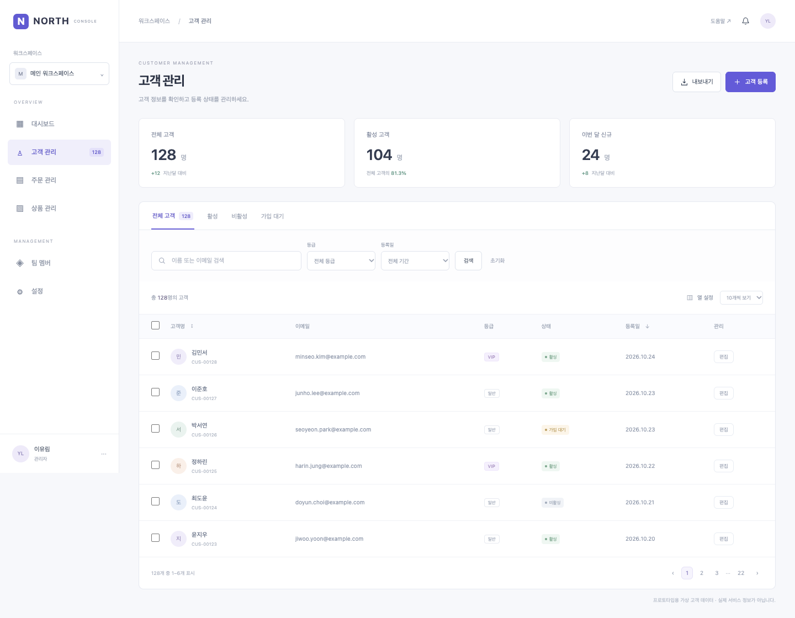
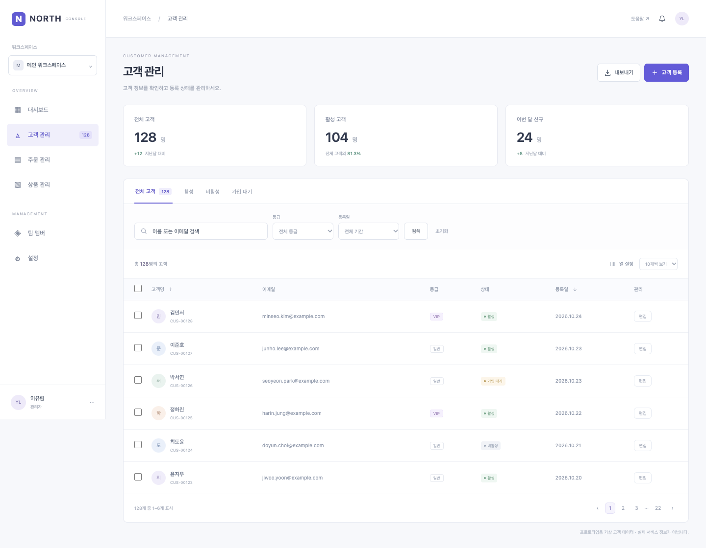

# Chrome 확장 · 공통 엔진 입력 호환성 확인

2026-11-02 · 제품0.56.0 · **조사/실험 완료, 공식 확장 지원 재개 아님**.

후속 사용자 결정: [앱과 확장 독립 실행 계획](independent-extension-plan.md)을 승인했다. 아래는 로컬 Node에서 공통 엔진을 실행한 실험 당시의 결과이며, 새 계획의 브라우저 단독 실행·저장·WebMCP 제품 연결 완료 근거가 아니다. 새 계획에는 앱↔확장 통신을 넣지 않는다.

## 결론

같은 복제 엔진을 사용할 수 있다. 실제 Chrome 확장은 명령 전달과 대상 연결만 수행하고, 현재 `desktop/capture-cdp.cjs` 원본을 Node에서 그대로 실행했다. Electron 대조군은 현재 `captureWebsite()` 진입점으로 같은 엔진을 실행했다. 별도 Chrome용 DOM/CSS/이미지 수집 알고리즘을 만들지 않았고 제품 엔진·설치 앱·사용자 프로필을 수정하지 않았다.

- 환경: macOS arm64, Node24.21.0, Chrome156.0.8078.76, Electron45.0.0/Chromium156.0.8078.48.
- 공통 엔진 SHA-256: `4dc6df65b893ec51ae2f86d7203d68f64bc6ac3068456c85f820ed956166d4bc`. HEAD 파일과 바이트가 같음을 확인했다.
- 현재 엔진의 명시적 CDP20개 중 raw 경로에서19개를 성공시켰다. 시험한 iframe에 대한 `Target.attachToTarget`은 `-32000 / Not allowed`였다. 모든 대상에서 해당 명령이 금지된다는 의미는 아니다.
- 같은 iframe은 `chrome.debugger.attach({targetId})`로 직접 연결할 수 있었다. 연결부에서 가상 session ID→실제 debuggee 대상을 매핑해 이 동작을 정규화했다. 복제 로직을 바꾸지 않고 필요한20개 동작을 모두 실행했다.
- 공통 엔진의 실제 복구 분기를 확인하려고 발견된 자식 프레임의 컨텍스트 생성 실패를 한 번 주입했다. 같은 엔진이 기존 catch/재연결 경로로 이어가75개 요소·2개 DOM 프레임을 수집했다. 주입 오류를 실제 권한 오류로 세지 않는다.

## 입력 차이

1. **메시지 형식**: Electron의 sendCommand(method,params,sessionId)와 확장의 sendCommand(debuggee,method,params)를 연결부에서 통일한다. 이벤트의 session/대상 식별도 매핑한다.
2. **대상 연결 조건**: raw Target.attachToTarget과 확장 attach API가 이번 대상에서 다른 결과를 보였다. 단순히 도메인 이름이 지원 목록에 있다고 모든 동작을 동일하다고 가정하지 않는다. [Chrome 공식 API](https://developer.chrome.com/docs/extensions/reference/api/debugger), [Chromium의 대상별 연결 검사](https://github.com/chromium/chromium/blob/main/chrome/browser/extensions/api/debugger/debugger_api.cc)도 참고했다. 설치된 Chrome의 실제 실행 결과가 이 보고서의 근거다.
3. **연결 후 뷰포트**: 디버거 안내가 나타나는 동안 초기 높이912/902/908px 등이857px로 바뀌는 것을 관찰했다. 최초 시험은 scope 높이와 수집 사진 높이가 달랐다. 최종 시험은 양쪽에 같은 읽기 전용 안정화 전제(650ms 크기 유지)를 적용했고 모든 scope와 실제 수집 viewport가 일치했다. 실제 제품 연결부에도 연결 준비 완료 조건이 필요하다. 안내를 숨기거나 웹 보안을 끄지 않았다.
4. **실행 환경**: 엔진의 CommonJS/Buffer 처리는 공통 로컬 Node 실행부에 둔다. 이번 실험은 ‘확장만 설치해 브라우저 안에서 엔진까지 실행하는 독립 제품’을 증명한 것이 아니다. Chrome 입력을 기존 로컬 앱의 공통 엔진으로 전달하는 구조를 증명했다. 임시 HTTP 릴레이는 제품 브리지 구현이나 권한 설계의 완료가 아니다.

## 수집과 시각 비교

여섯 가상 샘플을 양쪽에서 수집했다. 각 샘플의 요소 수·DOM 프레임 수가 같고 원본 HTML/스크롤/업무 액션이 유지됐다. 복잡한 샘플에서20ms마다 바뀌도록 의도한 srcdoc iframe 하나는 **양쪽 모두** 같은 frame_changed_during_capture 판정과 사진 폴백을 사용했다. 다른 출처 iframe 수집 실패와 혼동하지 않는다. 닫힌 Shadow DOM·중첩/sandbox iframe·리소스 캐시 누락→스트림 읽기·스크롤 범위를 포함한다.

저장한 캡처를 **현재 CanvasScene과 native PNG 렌더러**로 그려 원본 실제 PNG와 비교했다. 기준은 RGB 각 채널 최대 차이16 이하이며 exact 픽셀 비율도 JSON에 함께 기록한다. 아래 숫자는 같은 tolerance로 각각의 원본과 비교한 값이다. 두 입력 사이의 PNG가 바이트 단위로 같다는 뜻은 아니다.

| 샘플 | 실제 비교 범위 | Chrome 확장 입력 | 내장 앱 입력 | 양쪽 동일 요소 / DOM 프레임 |
| --- | --- | ---: | ---: | ---: |
| 컨텍스트 실패 후 iframe 재연결 | 현재 화면 | 99.9974% | 99.9974% | 75 / 2 |
| 고객 콘솔 | 전체 문서 | 99.9548% | 99.9548% | 364 / 1 |
| 이미지·SVG·닫힌 Shadow DOM·다른 출처 iframe | 처음 뷰포트만 | 99.9726% | 99.9726% | 73 / 5 |
| 중첩·sandbox iframe | 전체 문서 | 99.9112% | 99.9112% | 25 / 6 |
| 내부 스크롤·현재 화면 | 현재 화면 | 99.7712% | 99.7712% | 855 / 1 |
| 내부 스크롤·선택 영역 | 선택 영역 | 100.0000% | 100.0000% | 855 / 1 |

12개 비교 모두99% 이상이었다. complex는 긴 페이지 전체를99%로 검증한 것이 아니라 첫 뷰포트만 비교했다. 문서 모드가 아닌 캡처를 전체 문서로 세거나 미촬영 부분을 흰색으로 채워 성공으로 세지 않았다. 복제 화면의 이미지·요소는 현재 제품 모델을 그대로 사용했다.

## 실패 기록과 검증 범위

- 최초 가상 샘플 단언의 ‘모든 iframe 실패0’은 의도적으로 변하는 srcdoc의 올바른 공통 폴백까지 실패로 셌다. 작은 iframe 전용 페이지에 적용한30노드 최소값도 부적절했다. 이를 실제 fixture의 구조/예상 상태 검사로 수정했으며 raw 연결 거절은 그대로 실패 기록으로 남겼다.
- 자동 연결 알림을 전부 생략한 주입은 자식 발견 자체를 없애 복구 검사가 되지 않았다. 최종 주입은 자식을 정상 발견한 후 해당 컨텍스트 생성만 실패시키고, 재연결이 실제 실행됐는지를 단언한다.
- 기존 verify-capture-quality의 저장/편집 시나리오는 현재 프로젝트가 없는 캡처의 저장을 시도해 ‘프로젝트를 먼저 선택’ 오류를 냈고, viewport-only 입력에 전체 페이지 범위 검사를 적용했다. 그 전체 실행을 통과로 표시하지 않는다. 이번 비교는 제품 렌더러를 재사용하는 별도 read-only 시험으로 저장/편집 없이 실제 캡처 범위만 확인했다. 기존 스크립트를 이 실험에서 제품 변경으로 고치지는 않았다.
- npm run check(타입·포맷·패키징·Python/Node/Chromium 공통 회귀)는 통과했다. 최종 로그는 local/check-cdp-compat.log에 둔다. 제품 런타임/스킬 변경은 없으므로 버전·설치·서명을 변경하지 않았다.
- 사용자 Chrome·확장·로그인·Page Canvas 티켓·MCP 설정은 건드리지 않는다. 별도 headless 프로필/확장과 테스트 전용 인증 토큰은 종료 후 정리한다. Browser CDP는 버전 확인·확장 로드·종료에만 사용하고 **복제 명령은 실제 chrome.debugger API로 보냈다.**
- 이는 공개 웹사이트/로그인 화면 전체의99% 보장이 아니다. 기업 정책·DevTools 동시 사용·실제 사용자 탭 가져오기/앱 전달·티켓 저장·배포/스토어·권한 UX·연결 해제 복구는 다음 제품화 검증 대상이다.

## 다음 구현에 적용할 원칙

공통 엔진 하나와 플랫폼 연결부 둘을 유지한다. 기존 archive 확장 수집 코드를 되살리거나 복사하지 않는다. 연결부는 CDP 호출/이벤트/대상 연결/수명·입력 준비 조건만 처리한다. DOM·스타일·iframe 합치기·이미지/폰트·사진 폴백 정책은 공통 엔진에 둔다. 개선은 같은 모듈과 같은 검사를 양쪽에서 통과시킨다.

[명령별·사례별 수치](chrome-shared-engine-probe.json), [재현 코드와 실행 방법](../experiments/cdp-compat/README.md). 원본 캡처/전체 로그는 ignored local/cdp-compat/에 있다. 현행 PRD의 공식 지원은 계속 내장 앱 한 경로다.
