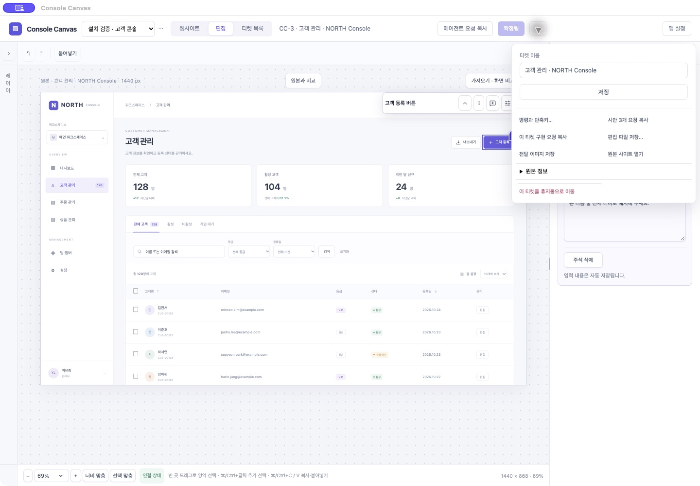
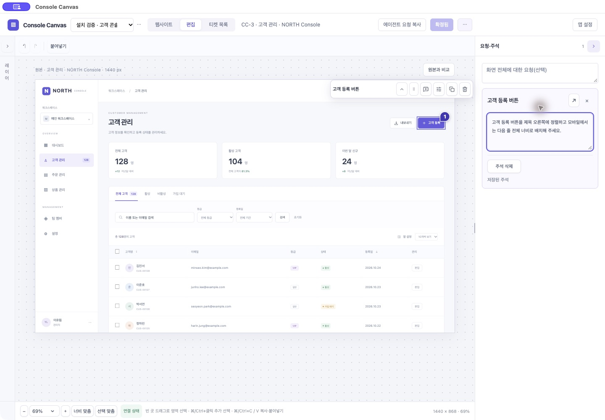

# 0.54.0 · 덜어내기 검토와 검증

2026-11-02. 실제 설치0.53.0과 공통 브라우저 편집기를 사용해 발견한 세 항목을 #203~#205로 작성하고 구현했다. 새 기능/설정/데이터 모델을 추가하지 않았다.

## 관찰과 변경

- #203: 티켓 메뉴가 항상 이름 폼과 저장 버튼을 표시했다. 설치 앱에서 같은 버튼과 Esc로 닫히지 않는 것도 재현했다. 상시 폼·전용 저장/오류 UI를 제거하고 기존 공통 이름 변경 창을 재사용한다. 메뉴를 먼저 닫고 현재 이름 전체 선택으로 연다. 네이티브 포커스와 aria-expanded를 맞췄다.
- #204: 요청·주석 → 주석 편집 → 대상 → 수정 요청의 반복 시각 제목을 대상 하나로 줄였다. 공통 요청 설명은 placeholder에 모으고 빈 입력칸 높이를 줄였다. 요청이 없는 일반 안내와 빈 주석의 삭제 버튼을 제거했다. 접근성 입력 이름, 실제 삭제, 오류, 확대와 닫기는 유지한다.
- #205: 정상 화면에도 나타나던 ‘가져오기 · 화면 비교 전’ 상시 버튼과 실제로 원본 이동만 하는 ‘원본에서 다시 가져오기’를 제거했다. 원본 URL/크기/수집 정보는 기존 메뉴의 ‘원본·가져오기 정보’에서 같은 창으로 보여준다. 실제 누락·제약은 직접 경고로 남으며 원본 사진 비교도 바로 연다. 기록된 제한 없음이 시각적 일치 보장은 아니다.

## 사용자 액션

클릭, 메뉴 펼치기, 입력, 링크 이동을 각각 센다. 필드 자동 선택은 별도 액션이 아니다.

| 흐름 | 이전 | 이후 | 이유 |
|---|---:|---:|---|
| 이름 변경 | 4 | 4 | 메뉴→기존 이름 선택→입력→저장 대신 메뉴→이름 변경→입력→저장 |
| 신규 주석 | 3 | 3 | 요소→주석 아이콘→입력, 자동 저장 |
| 기존 주석 교체 | 3 | 3 | 카드→전체 선택→입력 |
| 확정 | 1 | 1 | 추가 양식·화면 이동 없음 |
| 목록에서 티켓 편집 | 2 | 2 | 목록→행 |
| 원본 사진과 비교 | 1 | 1 | 직접 버튼 유지 |
| 실제 누락/제약 확인 | 1 | 1 | 직접 경고 유지 |
| 정상 수집 정보 | 1 | 2 | 상시 버튼 대신 메뉴→정보로 한 번 늘어난다. 드문 진단을 묶어 평소 캔버스를 비우는 교환이다. |

이번 이터레이션은 주 동선의 클릭 수보다 읽을 대상·반복 제목·빈 공간을 줄이는 데 초점을 맞췄다. 모든 작업의 액션이 줄었다고 주장하지 않는다.

## 검증 결과

- `npm run check` 통과: 타입·포맷·빌드, Python57, Node43, Chromium capture-enhancements24, selection32, panels35, tickets58, core33, storage15 및 수집·복구·파일 검사.
- `npm run test:desktop` 통과: 실제 IPC 메뉴 toggle/Esc, 좁은 헤더·요청 클립보드·정상 종료/재실행·파일 취소/복구·PNG·스킬, 공식 SDK17+modern SDK6(protocol2026-07-28), visual8, native scopes6.
- Documents 경로의 esbuild 정체를 피하기 위해 `/private/tmp/console-canvas-0521-f_21fnsr`에서 같은 소스를 검사/빌드했다. runtime-manifest SHA-256으로 원본 소스 일치를 확인한 뒤 생성물과 같은 Apple Development 서명 앱을 복사했다. 테스트 로그는 커밋하지 않는 local/check-054.log, desktop-054.log, build-054.log에 있다.
- 공통 브라우저 샘플을 실제 클릭해 이름 변경·저장, 고객 등록 요소 선택·주석 입력·자동 저장·확정을 확인했다. 설치 앱에서는 이름 변경의 기존 값 전체 선택/취소, 메뉴 재클릭/Esc 닫기, 기존 주석 열기, 원본 정보 창과 사진 비교 진입의 존재를 확인했다. 샘플 확정은 ‘확정됨’, ‘자동 저장 완료’로 끝났다.
- 설치 앱을 저장 후 정상 종료해0.54.0으로 교체하고 다시 실행했다. `codesign --verify --deep --strict` 통과. 기존 세 티켓·세 확정 목표와 주석/작업공간/이미지 내용의 SHA 비교로 보존을 확인했다. 설치된 스킬 SKILL.md/런타임 ZIP은 소스와 같고 quick_validate 통과다. 새 키체인 접근 승인을 요구하지 않았다.
- 기존 Codex 호스트의 오래된 MCP 연결401은 이번 UI 변경으로 해결된 것으로 간주하지 않는다. 업데이트 설치본의 stdio 공식 SDK 연결과19도구는 별도로 검증했다. 실제 OS IME/파일 권한의 잔여 #7은 이번 간소화 티켓과 별개로 열린 상태다.

## 문서와 가이드

PRD·README·관리 스킬을0.54.0에 맞췄다. [사용 가이드](https://console-canvas-guide.yonginkim.chatgpt.site/#edit)는 새 설치 앱 주석 패널 사진과 이름 변경/수집 정보 경로를 반영해 게시했다. 가이드 소스 `2b6e1f48d4b42a2ce735cedf92151e346614995c`, 배포 `appgdep_6ae763e75ea48191bd53104c4be66f41` succeeded. 기존 owner-only 접근 범위를 유지했다. 원본 사이트와 수집 기능의 변경은 없다.
