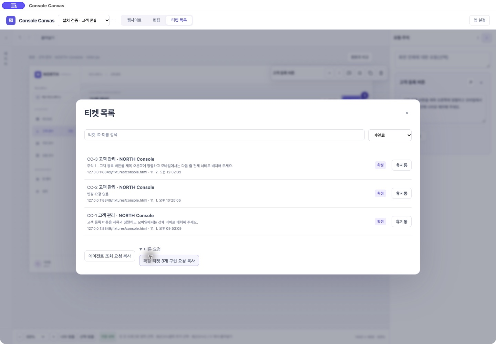
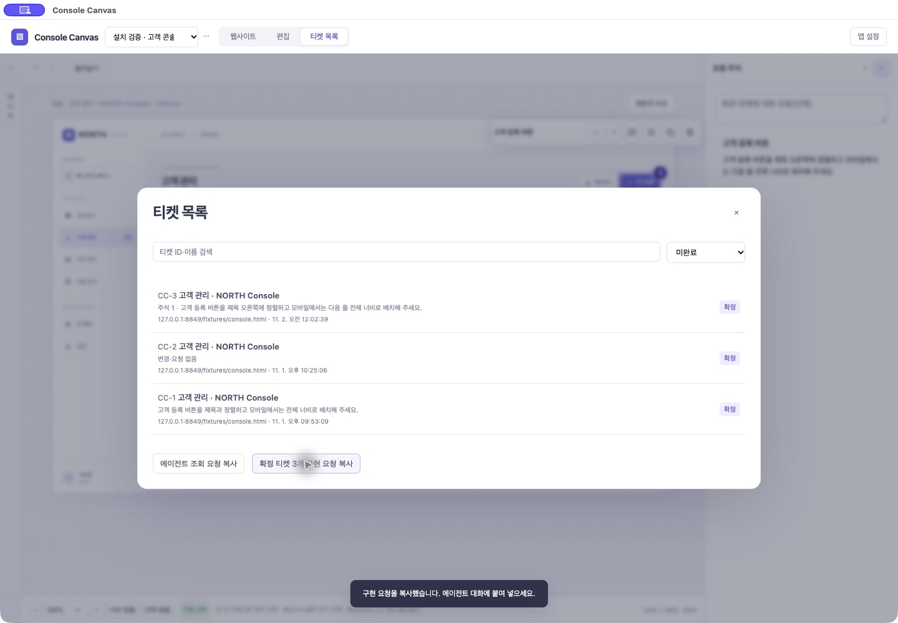
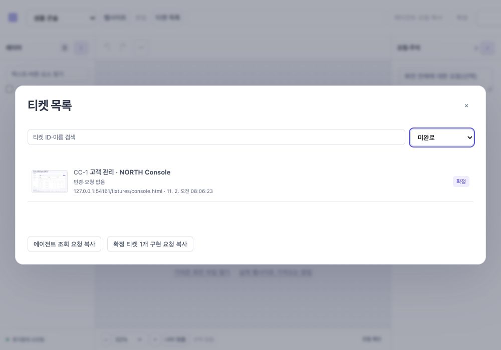

# 0.55.0 · 티켓 목록을 덜어내는 검토

2026-11-02. 설치0.54.0의 티켓 목록을 실제 클릭해 검토하고 #206·#207로 정리해 구현했다. 새 기능·행 메뉴·설정·데이터 모델은 추가하지 않았다.

## 발견과 구현

- #206: ‘다른 요청’을 펼치면 일괄 구현 요청 버튼 하나만 나왔다. 단일 항목 details/summary와 관련 CSS를 제거하고 조회·확정 티켓 구현 요청 두 버튼을 기존 하단에 바로 둔다. 구현 요청은 확정 미착수0개면 비활성화된다. 필터/검색에 관계없이 현재 프로젝트 전체의 요청 시점 대상을 사용한다. 복사가 작업 착수/목표 manifest 확정은 아니다.
- #207: 일반 목록의 모든 행에 휴지통 버튼이 반복됐다. 행별 삭제 버튼과 전용 removed 콜백·삭제 분기를 제거했다. 일반 행은 티켓 열기 하나, 휴지통 행은 기존 직접 복구를 제공한다. 삭제는 편집기의 기존 티켓 메뉴로 모았다. 삭제 API·휴지통·복구·목표와 주석은 유지한다.

## 액션과 교환

클릭·메뉴 펼치기·입력을 각각 센다. 링크 이동은 이번 변경에 없다.

| 흐름 | 0.54 | 0.55 |
|---|---:|---:|
| 편집 화면→목록→일괄 구현 요청 복사 | 3 | 2 |
| 편집 화면→목록→조회 요청 복사 | 2 | 2 |
| 목록 열기→티켓 편집 | 2 | 2 |
| 신규 주석 / 확정 | 3 / 1 | 3 / 1 |
| 목록이 열린 상태에서 티켓 삭제 | 1 | 3 |
| 편집 중인 티켓 삭제 | 2 | 2 |
| 휴지통 행에서 복구 | 1 | 1 |

목록에서 삭제는 기존 행의 ‘휴지통’1액션에서 ‘행 열기→티켓 메뉴→휴지통’3액션으로 늘었다. 자동 목록 갱신은 사용자 액션으로 세지 않는다. 이는 자주 쓰는 탐색을 비우기 위해 드문 정리 작업의 두 클릭을 교환한 것이다. 편집 중인 티켓 삭제는 같은 메뉴의2액션으로 유지한다. 모든 액션이 줄었다고 주장하지 않는다. 티켓3개 기준 반복 삭제 버튼3개와 펼침 컨트롤1개가 사라졌다.

## 검증

- `npm run check` 통과. 타입·포맷·번들, Python57, Node43, Chromium 티켓64(기존58+6), selection32·panels35·core33·storage15와 수집/복구/파일/독립 실행 검사 통과.
- 티켓 회귀는 일반 행 단일 동작·일괄0개 비활성·직접 요청·기존 메뉴 삭제 후 문서 닫힘·휴지통 직접 복구·동일 ID/확정 목표 복원을 추가 검증한다.
- `npm run test:desktop` 통과. 공식 SDK17+modern SDK6(protocol2026-07-28), visual8·native scopes6, 메뉴 toggle/Esc·클립보드·파일 취소/복구·정상 종료/재실행·MCP·스킬 통합을 확인했다. 수집 품질 숫자는 고정 fixture의 검사이며 임의 사이트 품질 보장이 아니다.
- 별도 localhost 샘플에서 목록→행 편집→확정→목록→직접 구현 요청 복사를 사용해 성공 피드백을 확인했다. 확정 전0개 비활성, 확정 후1개 활성, 메뉴 삭제→휴지통 필터→복구→미완료에서 동일 CC-1/확정 상태를 확인했다. 1000×700 화면에서 키보드 Home/End로 필터를 바꾸고 버튼/목록이 잘리지 않는 것을 확인했으며 임시 viewport는 복원했다.
- 실제 설치 앱은 정상 종료 후 동일 Apple Development 서명으로0.55.0을 설치·재실행했다. 기존 CC-3 편집과 주석·확정됨이 복원됐고, 목록의 세 행에서 반복 삭제 버튼 없이 구현 요청3개를 바로 복사해 성공 피드백을 확인했다.
- 설치 stdio SDK 조회에서 버전0.55.0과 티켓3개·목표3개를 확인했다. 업데이트 전후 작업공간/주석/목표/이미지 내용 비교가 일치했다. 설치 스킬 SKILL.md/런타임 ZIP cmp와 quick_validate, codesign --verify --deep --strict 통과. 새 키체인 승인은 없었다.
- Documents 경로의 빌드 정체를 피하려고 동일 소스를 `/private/tmp/console-canvas-0521-f_21fnsr`에서 검사/서명했다. runtime-manifest SHA-256으로 원본 소스 일치를 확인한 후 생성물을 복사했다. local/check-055.log, desktop-055.log, build-055.log는 개인 작업 기록으로 커밋하지 않는다.
- MCP 도구19개·계약·수집 엔진 변경 없음. 기존 Codex 호스트의 오래된 연결401이나 실제 OS IME/파일 권한 잔여 #7을 이번 UI 작업에서 해결/통과로 바꾸지 않는다.

## 문서

PRD CC-FR-05·README·관리 스킬을 갱신했다. [사용 가이드](https://console-canvas-guide.yonginkim.chatgpt.site/#agent)는 새 실제 설치 앱 목록 이미지, 직접 구현 요청과 메뉴 삭제 경로를 반영했다. 소스 `7bdd08d241c0f8e4f04257105ca20a7f11890ecc`, 배포 `appgdep_6ae7c79c7b6c8191809fd3740042f604` succeeded. 기존 owner-only 접근 범위를 유지했다.
