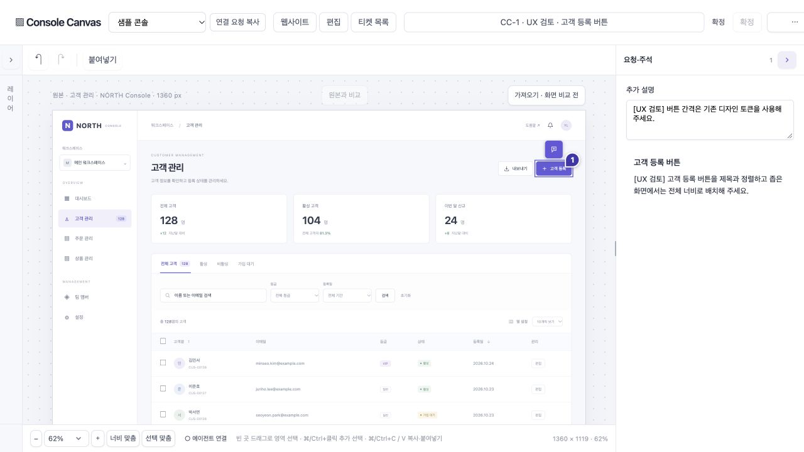

# 0.52.1 동선 UX 재검토

2026-11-01 · 검토/개발 티켓 작성 결과. **이 문서는 다음 개선안이며 구현 완료 기록이 아니다.** 현재 제품 계약은 [PRD](PRD.md), 이전 구현 결과는 [0.52 검증](workflow-0.52.md)을 따른다.

[상위 #197](https://github.com/kimyongin/console-canvas/issues/197)

## 이번에 실제로 한 일과 한계

- 설치된 0.52.1의 편집 화면과 헤더를 관찰했다. 원본 탭·목록·가져오기를 조작하려 했으나 화면 제어 도구가 오래된 AX 요소와 전환 상태를 반환했다. 새 네이티브 수집을 이번 회차에 완료했다고 표시하지 않는다. 앱 결함이나 Mac 잠금이라고 단정하지 않는다.
- 같은 설치 런타임을 제공하는 별도 브라우저 작업 공간에서 NORTH 가상 샘플 로딩과 자동 CC-1 생성, 고객 등록 요소 선택, 주석 입력/완료, 확정, 목록, 이름 변경, 추가 설명 수정/재확정, 목록 행에서 직접 편집을 사용했다. 샘플 로딩은 실제 웹사이트를 네이티브 수집한 것과 구별한다.
- 설치 앱의 실제 MCP는 공식 SDK로 조회했다. 현재 저장소를 resolve_project로 해석해 P-01과 CC-1/CC-2를 받았고, 기존 티켓의 추가 설명·확정 목표·이미지2개 유지도 확인했다. 소스 수정/착수 도구는 호출하지 않았다.
- 반면 이 대화에 기존 등록된 MCP의 get_agent_guide는 401 Unauthorized였다. 새 stdio 클라이언트의 v0.52.1·19개 도구 조회 성공과 구별한다. 인증 만료/오래된 프로세스/설정 중 원인은 아직 확정하지 않았다.
- 이번에는 앱 구현·빌드·설치·인증 설정을 변경하지 않았다. 설치 앱 자료를 초기화하거나 기존 티켓을 수정하지 않았다. 브라우저 검토 자료는 가상 샘플이며 설치 앱과 별도 저장 공간이다.

## 유지할 것

확정에 필수 양식/추가 확인 창이 없고 제자리에 머무르는 점, 목록 행에서 바로 편집으로 돌아오는 점은 유지한다. 실제 추가 설명 변경에 재확정 필요가 표시되고 이름 변경은 확정을 무효화하지 않았다. 현재 목록이 추가 설명을 미리보기로 우선 표시하는 점도 유지한다.

문제는 주 동선의 클릭 수 자체보다 **확정한 뒤 무엇을 전달해야 하는지, 연결됐다는 말의 의미가 무엇인지, 같은 제목의 티켓을 어떻게 구별하는지**에 있다.

## 개발 순서와 개선안

| 순서 | 티켓 | 확인한 문제 | 방향 |
| --- | --- | --- | --- |
| 1 | [#198 연결 진단](https://github.com/kimyongin/console-canvas/issues/198) | 서버 실행/최근 에이전트 통신/저장소 연결이 분산돼 있고 기존 MCP만 실패하는 상황을 사용자가 구별하기 어렵다. 연결 창에 제거한 공개 권한 문구가 남아 있다. | 한 진입점에서 확인 가능한 상태와 필요한 복구만 제공. 권한/토큰을 넓히지 않고 기존 클라이언트 실패 원인을 별도로 조사. |
| 2 | [#199 에이전트 전달](https://github.com/kimyongin/console-canvas/issues/199) | 확정 뒤 ID 복사와 연결 요청 복사 중 무엇을 써야 하는지 애매하고, 구현/조회 요청은 다시 작성해야 한다. | 최초 연결과 일상 조회를 구분. 현재 티켓/프로젝트의 짧은 요청을 맥락에 맞게 복사. 직접 짧은 요청을 쓰는 동선은 그대로 유지. |
| 3 | [#200 목록 구별](https://github.com/kimyongin/console-canvas/issues/200) | 같은 페이지의 CC-1/CC-2가 같은 제목·URL이다. 수동 이름 변경을 매번 하면 원래 간단한 동선이 늘어난다. | 추가 설명/주석 요약, 실제 출처·시각으로 구별. 필수 이름 입력·AI 자동 요약·중간 상세 페이지를 추가하지 않음. |
| 4 | [#201 확정 상태](https://github.com/kimyongin/console-canvas/issues/201) | 확정 상태+비활성 확정 버튼이 중복된다. 변경/요청이 없는 원본도 일반 구현 요청을 가진 티켓으로 보인다. 순간 복사 메시지가 헤더에 남는다. | 확정·재확정·저장 중/실패를 일관되게 표시. 무변경 상태를 사실대로 전달하되 참고 화면 확정에 입력을 강제하지 않음. |
| 5 | [#202 패널에서 주석 편집](https://github.com/kimyongin/console-canvas/issues/202) | 새 주석마다 모달 개폐가 필요하고 선택 도구 모음 주석과 위치 주석 진입점이 겹친다. | 명시한 주석 동작을 오른쪽 패널 편집으로 이어주고 일반 선택/이동의 포커스는 유지. 빈 지점의 좌표 주석은 그대로 지원. |

별도 브라우저1280×720 화면에서는 헤더 우측 컨트롤이 화면 끝에 걸리는 점도 관찰해 #201의 공통 웹/설치 앱별 너비 검증 조건에 포함했다. 설치 앱에서도 같은 문제가 재현됐다고 일반화하지 않는다.

연결 상태 진단과 요청 복사가 같은 도움말/화면을 중복해서 만들지 않게 한다. 확정 상태는 전달 동작에서도 재사용한다. 단계별 구현 이후에만 PRD·스킬·사용 가이드를 실제 동작으로 갱신한다.

## 액션 수

메뉴 펼치기·탭/링크 이동·포커스 이동·문자열 선택·입력·제출·드래그·앱/대화 이동을 센다. 대기와 에이전트 내부 호출은 세지 않는다. 네이티브 선택 메뉴는 펼치기와 항목 선택을 구분한다. 도구의 오래된 요소 실패와 재관측은 사용자 비용에 합산하지 않는다. 수동 타이핑 실수도 제품 결함으로 세지 않는다.

| 경로 / 시작 조건 | 현재 확인 | 제안 / 목표 |
| --- | --- | --- |
| 편집 화면에서 새 요소 주석 | 선택1 + 주석 시작1 + 입력1 + 완료1 = **4** | 선택1 + 패널 주석 시작1 + 입력1 = **3**. 구현 후 실측 필요 |
| 기존 주석 교체 | 카드/마커1 + 기존 문자열 선택1 + 입력1 + 완료1 = **4**. 현재 UI 구조 기준이며 이번에 별도 완주 실측한 경로는 아님 | 카드/마커1 + 문자열 선택1 + 입력1 = **3**. 저장 실패/IME 보호는 유지 |
| 편집 내용을 확정 | **1**, 주석 작성 뒤 직접 확인 | **1 유지**. 성공 전 표시 금지 |
| 편집 → 목록의 티켓 편집 | 목록1 + 행1 = **2**, 직접 확인 | **2 유지**. 중간 화면을 추가하지 않음 |
| 티켓 이름 교체 | 메뉴1 + 기존 문자열 선택1 + 입력1 + 저장1 = **4**. 이번 도구에서 필드 타이핑은 기존 문자열에 추가되므로 선택을 별도로 실행 | 매번 이름을 바꾸지 않아도 목록에서 구별하게 함. 숫자만 낮추려고 ID 복사를 없애지 않음 |
| 이미 에이전트 대화에 있음 → 목록 요청 | 짧은 요청 입력1 + 전송1 = **2** | **2 유지** |
| 편집기 → 복사한 요청으로 에이전트 조회 | 연결 요청은 프로젝트 메뉴 펼치기1이 추가될 수 있음. 현재 ID 복사는 요청 문장과 목적이 다름 | 적합한 요청 복사1 + 대화 이동1 + 붙여넣기1 + 전송1 = **4**. 직접 입력2보다 액션이 적다고 주장하지 않음 |

첫 프로젝트 생성/새 실제 웹사이트 가져오기의 이전 측정은 [0.52 결과](workflow-0.52.md)에 있다. 이번에는 네이티브 제어 문제로 다시 실측하지 못했으므로 그 수치를 이번 완주 결과로 복사하지 않는다. 구현 후 실제 설치 앱에서 같은 티켓으로 수집→편집→확정→에이전트 조회를 재검증하는 조건을 #197에 남겼다.

## 개선 시 지킬 경계

- 조회·확정은 구현 지시가 아니다. 대화로 자동 전송하거나 소스를 자동 변경하지 않는다.
- 프로젝트/저장소를 자동 추정해 바꾸지 않는다. 정확한 연결과 티켓 범위를 유지한다.
- 확정 후 자동 원본 이동, 새 필수 양식, 큰 상시 안내, 빠른 제안 칩, 모달 중첩을 추가하지 않는다.
- 실제 주석/화면·저장 큐/CAS·재확정·작업 중 목표·IME 보호를 클릭 수와 맞바꾸지 않는다.
- 기존 정상 동선에 진단 창이나 온보딩을 매번 요구하지 않는다. 필요한 상태에서만 노출한다.
- 기존 OS IME/파일 권한 잔여 #7은 이번 검토로 완료 처리하지 않는다.
