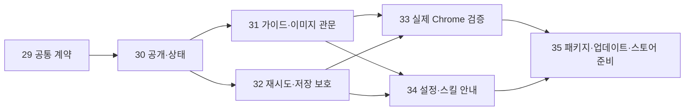

# Chrome 확장 WebMCP 제품화 계획

계획 정리일 2026-10-26 · 제품 기준 [PRD](PRD.md) · 상위 [#28](https://github.com/kimyongin/console-canvas/issues/28). **이번 변경은 PRD·티켓 정리이며 제품 구현은 시작하지 않았다.** 소스 버전은 0.19.2를 유지한다.

## 목표와 출발점

같은 편집 엔진·UI·도구 계약을 독립 앱과 Chrome 확장에서 사용한다. 확장 단독 편집은 Node·Python·전용 호스트 설치 없이 제공하고, 에이전트 제어는 공식 Chrome DevTools MCP와 승인된 Chrome 연결을 사용한다. 기존 앱/로컬 MCP 경로는 유지한다. 전용 Native Messaging 호스트 개발은 보류한다.

[실험 1d5019e](https://github.com/kimyongin/console-canvas/commit/1d5019e)는 공식 SDK→Chrome DevTools MCP 1.12.0→격리 headless Chrome 155→확장의 네이티브 document.modelContext→기존 controller에서 11개 도구·37개 검사를 통과했다. 기본 확장 설정에서는 document.domain 조건으로 등록이 거절됐고 실험용 COOP/COEP 격리로 해소했다. 이 결과는 정식 UI·일반 Chrome·전체 사이트·스토어 배포의 완료 증빙이 아니다.

| 구분 | 상태 |
| --- | --- |
| 실제 확장 수집·11개 도구·이동/주석/undo·분기/미래·탭 새로고침·오류 경계 | 실험 검증 완료. [재현/범위](../experiments/webmcp/README.md) |
| 앱/확장 공통 스키마·제품용 공개/철회·정확한 상태·지원 안내 | 계획 #29/#30 |
| 캡처 전 live guide·단일 PNG의 실제 에이전트 이미지 수신 | 계획 #31. 첫 단계 관문 |
| 재로딩을 넘는 재시도·연결 세대·저장/문서 전환 보호 | 계획 #32 |
| 일반 Chrome 연결·외부 리소스·권한 경계·실제 입력 | 계획 #33 |
| 공식 MCP 설정·스킬 안내·확장 패키지/업데이트·스토어 준비 | 계획 #34/#35 |

## 범위와 사용자 흐름

1. 확장을 설치하고 기존 Chrome의 HTTP/HTTPS 화면에서 가져오기 → 같은 공통 편집기로 작업한다.
2. 에이전트를 사용할 때 공식 Chrome MCP의 Node/Chrome 설정을 안내한다. 에이전트 설정과 확장의 문서 도구 공개는 별개다.
3. 사용자가 공개하면 등록하며 미공개·공개 중·호출 확인·미지원·오류를 구별한다. 실제 왕복 호출 없이 연결 성공으로 표시하지 않는다.
4. 에이전트는 최신 가이드·화면·요소·주석·분기/이력을 읽고 같은 명령으로 편집한다. PNG는 번호와 요청 카드를 담은 이미지 한 장으로 받아 실제 시각 입력으로 읽는다.
5. 사용자는 언제든 도구 공개를 끈다. 문서를 닫거나 삭제하면 접근을 철회하고 문서 전환에는 새 공개 동의를 받는다. 이미 적용된 편집·자동 저장 자료를 지우지 않는다.

제품 도구는 선택한 복제본만 조작한다. 도구 공개/해제는 공식 DevTools MCP 자체의 일반 브라우저 권한을 제한하는 기능이 아니며, 별도 QA와 승인된 Chrome 연결 범위를 함께 안내한다.

이번 범위에는 앱 제거·원본 웹사이트/프로젝트 자동 수정·새 호스트/클라우드 서비스·앱↔확장 자동 동기화·로그인/전체 프로필 이전이 없다. 문서 이동은 기존 편집 JSON으로 한다. 기존 앱의 설치 스킬 자동 동기화는 유지하고 확장은 live guide·ZIP과 에이전트 측 설치/갱신을 구별한다.

## 티켓과 추적

| 순서 | 티켓 | 책임 | PRD | 선행 조건 |
| --- | --- | --- | --- | --- |
| 상위 | [#28](https://github.com/kimyongin/console-canvas/issues/28) | 전체 범위·순서·완료 추적 | FR-18~20 / AC-27~33 | 실험은 출발 증빙 |
| 1 | [#29](https://github.com/kimyongin/console-canvas/issues/29) | 공통 13개 도구 계약·JS/Python 소비·환경 어댑터·입력 검증 | FR-12/18 / AC-27 | 없음 |
| 2 | [#30](https://github.com/kimyongin/console-canvas/issues/30) | 공개/철회·상태·등록 실패/미지원 안내 | FR-02/12/19 / AC-28 | #29 |
| 3 | [#31](https://github.com/kimyongin/console-canvas/issues/31) | live guide·PNG의 실제 에이전트 이미지 수신 | FR-05/10/12/13/19 / AC-29 | #29/#30 |
| 4 | [#32](https://github.com/kimyongin/console-canvas/issues/32) | 연결 세대/재시도·문서 전환·저장/복원 실패 | FR-05/07/11/12/18/19 / AC-30 | #29/#30 |
| 5 | [#33](https://github.com/kimyongin/console-canvas/issues/33) | 일반 Chrome·COOP/COEP 리소스·원본/권한 검증 | FR-01/10/12/17/19 / AC-31 | #30/#31/#32 |
| 6 | [#34](https://github.com/kimyongin/console-canvas/issues/34) | 공식 MCP 설정·스킬/가이드 최신화 책임 | FR-12/13/19/20 / AC-32 | #30/#31/#32 |
| 7 | [#35](https://github.com/kimyongin/console-canvas/issues/35) | 공개 자산 패키지·ID/업데이트 보존·JSON 왕복·스토어 준비 | FR-06/07/11/14/16/17/20 / AC-33 | #33/#34 |

모든 신규 티켓은 계획/미구현·열림이며 완료 체크는 없다. 우선 #29→#30→#31을 첫 구현 묶음으로 진행한다. #32는 계약/공개 기반 뒤 착수할 수 있지만 이미지 관문이 미완료인 상태로 정식 지원·배포를 선언하지 않는다. #33/#34는 안정화된 계약과 이미지 경로를 확인한 뒤 완료하고 #35가 최종 배포물을 다시 검증한다.

#33은 개발 빌드에서 통합 검사를 만든다. #35는 그 기준을 최종 ZIP에 적용하므로 #33이 #35의 완료를 기다리는 순환은 없다. #31은 기능/전송 구현, #33은 일반 환경 통합, #34는 사용자/에이전트 안내를 책임지며 같은 가이드/이미지를 각각 새로 구현하지 않는다.

## 주요 완료 판단

- **이미지:** get_review_image의 PNG 생성·base64 텍스트·경로 반환만으로 완료하지 않는다. 실제 대상 에이전트/클라이언트의 시각 입력으로 읽는 근거가 필요하다. 공식 경로 제약이면 #31과 상위 계획을 미완료로 남기고 대안을 검토한다.
- **공통 계약:** 실험의 Python 스키마 추출을 공통 자원으로 분리한다. 13개 계약·오류·제한과 공통 controller/저장/이력을 공유하고 WebMCP 입력도 실제 코드에서 검증한다. 기존 로컬 MCP/standalone 회귀를 확인한다.
- **재시도:** 실험의 페이지 메모리 캐시는 새로고침을 넘는 보장이 없다. 보존/만료·문서/연결 세대와 revision/operation_id 정책을 정하고 내구 기록 또는 이전 세대 거절로 중복을 막는다. 불명확한 결과는 조회로 확인하며 새 ID로 같은 쓰기를 반복하지 않는다.
- **연결:** 등록만으로 연결 성공을 표시하지 않는다. 공개/철회·문서 전환·휴지통·진행 중 작업을 구별하며 unsupported에서도 일반 편집을 유지한다. 기존 로컬 브리지 상태로 WebMCP 상태를 대신 표시하지 않는다.
- **호환성:** Chrome 155/공식 MCP 1.12.0은 실험 기준이다. 지원 버전과 실험 설정은 실제 확인 후 정한다. COOP/COEP 리소스/iframe·원본 수집·PNG·포커스/입력·권한 거부/탭 전환을 검증하고 보안 격리를 꺼서 통과시키지 않는다.
- **자료 보존:** 고정 확장 ID 업데이트, 앱↔확장 JSON 양방향 왕복, 초안·설명·복사·이력·전체 분기/휴지통과 파일 오류를 확인한다. 확장 ID 변경/재설치를 같은 저장소의 업데이트로 취급하지 않는다.
- **배포:** 최종 ZIP·체크섬/버전·권한/데이터 설명과 설치 안내를 준비한다. 스토어 게시/승인 여부는 준비와 별도로 기록한다. 이번 문서 작업에서 게시나 앱 설치를 수행하지 않는다.

## 기존 티켓과 검증 정책

- [#7](https://github.com/kimyongin/console-canvas/issues/7): 기존 OS/Electron·IME/클립보드·성능 잔여를 유지한다. 공통 Chrome 수집/권한은 #33을 주 담당으로 삼아 증빙을 연결하고 중복 검사를 피한다. #33의 성공으로 #7 전체를 닫지 않는다.
- [#27](https://github.com/kimyongin/console-canvas/issues/27): 사용자 설치 앱 배포·재실행·자료 보존·설치 스킬/MCP 확인이다. 확장 제품화의 선행 조건이 아니며 확장 패키징은 #35가 담당한다.
- [변경별 검증 기준](validation-policy.md): 공통 UI는 웹 검증, WebMCP는 실제 공식 SDK/Chrome 확장, 수정한 Electron 경계는 해당 통합, 앱 설치는 별도 배포로 확인한다. 실제 사용자 자료에 시험 편집을 하지 않는다.

## 이번 계획 정리의 확인 범위

FR-18~20·AC-27~33과 7개 구현 티켓의 대응·선행 조건·미구현 상태, 기존 #7/#27의 경계를 정리한다. 문서/티켓 갱신으로 실험을 제품 구현으로 바꾸거나 이전 미검증 항목을 통과 처리하지 않는다. 코드·버전·런타임·설치 스킬·사용자 앱/프로필은 변경하지 않는다.

문서 ID/링크·티켓 본문/열린 상태·선행 관계 비순환을 확인했다. 기존 공통 `npm run check`도 Python 39·Node 27·Chromium 321을 포함해 통과했다. [검증 기록](verification.md)에 계획 정리의 확인 범위와 실제 실험 결과를 나눠 보관한다.
