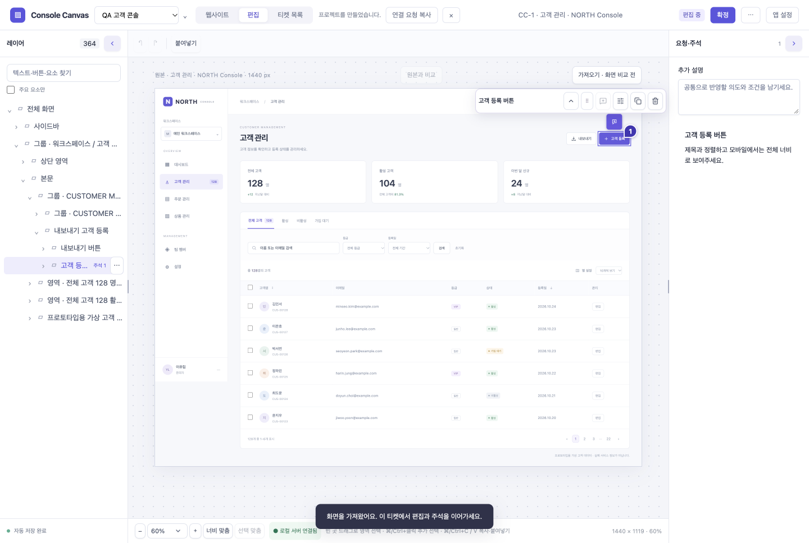
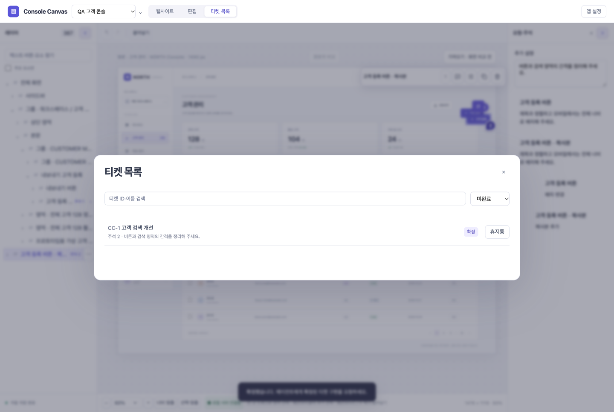

# 프로젝트·가져오기 중심 전환 검증 · 0.52.1

2026-11-01 · #189 및 #190 → #192 → #191 → #188 → #193 → #194 → #195 → #196.

## 결과

웹사이트에서 화면을 가져오는 데 성공하면 현재 프로젝트의 티켓이 자동 생성된다. 직접 편집/주석 후 한 번의 확정으로 같은 ID에 목표를 보관한다. 프로젝트 생성·저장소 연결은 최초 한 번이며 이후 에이전트 대화에서는 짧은 요청으로 같은 저장소의 티켓을 조회·구현한다.

빈 티켓 선생성 함수/버튼/MCP 도구, 별도 목표 등록 양식, 티켓 중간 상세 페이지, 티켓 프로젝트 직접 입력/이동, 작업 복제 메뉴, 중복 편집기 헤더를 제거했다. UI만 숨기거나 이전 API를 남기지 않았다. 스냅샷·후보 갤러리·앱 자체 AI/API·Chrome 확장·공개 ACL은 재도입하지 않았다.

상단은 프로젝트 / 웹사이트 / 편집 / 티켓 목록 / 설정이다. ID 클릭은 복사, 확정은 제자리, 목록 행은 바로 편집이다. 주소창은 원본 웹사이트에서만 보이고 undo/redo·확대는 캔버스에 있다. 연결 요청은 생성 직후 또는 프로젝트 메뉴에서 복사한다. 큰 안내나 별도 정보 화면을 강제하지 않는다.

## 직접 사용하며 발견·수정한 점

- 첫 가져오기 후 원본 URL을 저장하지 않아 재실행 시 원본이 복원되지 않았다. 프로젝트의 마지막 URL/티켓을 저장하도록 수정했다.
- 목록을 열어 둔 채 프로젝트를 바꾸면 이전 프로젝트 목록/폼이 남을 수 있었다. 저장 후 해당 맥락의 모달/팝오버를 닫고 새 맥락을 연다.
- 확정 후 편집을 막던 경로를 제거했다. 실제 변경만 재확정 필요로 판정하며 undo는 확정 내용의 정확한 일치를 복구한다. 명시적 보류·작업 중 목표를 자동 해제하지 않는다.
- 같은 편집기 ID의 닫힌 티켓과 사람 편집이 경합할 때 오래된 저장이 덮어쓸 수 있었다. 저장 버전 CAS를 writer ID와 무관하게 적용하고 저장 큐 자신의 연속 쓰기 버전을 추적한다.
- 오래된 operation 재시도가 이후 변경한 목표를 자신의 결과처럼 돌려줄 수 있었다. 당시 승인 결과 메타데이터를 receipt에 보관하며 이미지 바이트는 중복 저장하지 않는다.
- 목록을 다시 열어도 새 캡처가 반영되지 않을 수 있던 컴포넌트 재사용 상태를 제거했다. 매번 최신 목록을 읽고, 이전 검색 응답이 새 검색 결과를 덮어쓰지 않게 했다. 반복 열기 회귀 검사를 추가했다.
- 목록에서 현재 설명 대신 이전 확정 요청이 보이던 부분을 현재 추가 설명 우선으로 표시한다.
- 설치 앱의 GUI 프로세스에서 실제 저장소 검사가 실패했다. Git identity 검증을 해당 저장소에 접근하는 에이전트 쪽 stdio 어댑터로 옮겼다. 인증한 내부 요청의 검증 맥락만 broker가 전달하며 툴 인자에 임의 repository 객체를 받지 않는다. GUI의 파일 권한을 넓히지 않는다.
- 가이드의 지연 로딩 사진이 공간을 미리 확보하지 않아 이동/확대 중 레이아웃이 변했다. 실제 PNG 치수를 지정하고 이미지 확대·닫기와 가로 넘침을 브라우저에서 확인했다.

## 검증 범위

- `npm run check`: 타입·포맷·런타임/스킬·Python 57·Node 43·Chromium 전체 검사. 티켓/프로젝트 50, 저장 12, 선택 32, 패널 34 및 기존 수집/레이아웃/핵심 편집 검사.
- `npm run test:desktop:offscreen`: 공식 MCP SDK 17, 최신 SDK/2026-07-28 resource·구독 6. 두 stdio 클라이언트 저장소 분리·경합 착수·실제 이미지 블록·확정/증빙/승인 보호.
- 첫 가져오기 프로젝트 입력 취소에 프로젝트/빈 티켓이 남지 않음, 원본 탭 왕복의 URL·검색값·스크롤 유지, 네이티브 파일 열기 취소와 v4 복원, PNG 저장, 스킬 설치, 정상 종료와 재실행의 주석·복사·확정 목표/기록 유지.
- Git 실제 저장소·linked worktree·symlink·독립 clone 구별, 연결 CAS/재시도, 원본이 같은 URL이어도 다른 저장소를 합치지 않음.
- 수집 경계 회귀: viewport 비교99.687%, 영역100%, 영상/HTML 오버레이99.92%, 전체/긴 문서 영역·stale selection 거부. 원본 불변·영상 재생 지속 확인. 이 수치를 임의 사이트 전체의 일치율로 일반화하지 않는다.

0.52.1 최종 검증은 같은 소스를 `/private/tmp/console-canvas-0521-f_21fnsr`에 복제해 수행했다. 원본 경로에서는 esbuild가 상위 Documents 디렉터리 열기에서 대기하는 환경 문제가 재현돼 관련 빌드만 종료하고 임시 경로를 사용했다. 개발 의존성·원본 소스를 복제했으며 앱/개인 자료나 보안 권한을 바꾸지 않았다. 생성물은 검증한 파일을 원본 작업 트리에 반영한다.

## 동선 액션

클릭·메뉴 펼치기·링크/탭·앱/대화 포커스 이동·필드 입력·붙여넣기·제출·드래그를 각각 센다. 대기/에이전트 내부 도구 호출은 사용자 액션이 아니다. 아래는 시작 조건을 고정한 실제 새 UI 동선이며, 사이트 자체 로그인/검색/메뉴 준비와 개별 편집량은 별도로 더한다.

| 시나리오와 시작 조건 | 액션 |
| --- | --- |
| 원본 준비 완료·프로젝트 있음 → 가져오기·설명 입력·확정·원본 복귀 | 4: 가져오기1 + 입력1 + 확정1 + 웹사이트1 |
| 원본 준비 완료·프로젝트 없음 → 이름 입력·같은 동선 완료 | 6: 가져오기1 + 이름1 + 만들고 가져오기1 + 설명1 + 확정1 + 웹사이트1 |
| 편집 화면 → 목록의 기존 티켓 편집 | 2: 티켓 목록1 + 행1. 중간 상세/편집 버튼 없음 |
| 작업 전 확정 티켓 → 실제 수정하고 다시 확정 | 수정 E + 재확정1. 확정 취소·별도 양식 없음 |
| 프로젝트 생성 직후 → 저장소 에이전트 연결+첫 목록 | 4: 요청 복사1 + 대화 이동1 + 붙여넣기1 + 전송1. 나중에는 메뉴 펼치기1 추가 |
| 에이전트 대화에 이미 있음 → 현재 저장소 티켓 조회 | 2: 짧은 요청 입력1 + 전송1. 후보가 여러 개면 선택 요청1회 추가 |
| 같은 대화 → 확정된 티켓 전부 구현 요청 | 2: 요청 입력1 + 전송1. 명확한 구현 지시에 중복 승인 없음 |
| 결과가 대화에 제시됨 → 사람 승인 | 2: 승인 입력1 + 전송1. 캔버스 왕복 없음 |
| 티켓 목록 → 휴지통 항목 복구 | 필터 선택1 + 복구1. 네이티브 select를 마우스로 펼치는 경우 펼치기1 추가 |

이전 UI의 확정은 창 열기+확정(요청이 없으면 입력까지2~3액션), 목록에서 열기는 목록+행/상세+편집3액션이었다. 새 UI에서는 각각1·2로 줄었다. 이전 수치는 기존 소스 동선에 근거하며 모든 과거 경로의 OS 실측으로 표시하지 않는다. 입력 길이/드래그 횟수, 사이트 준비, 최초 MCP 설치와 OS 권한 창처럼 조건에 따라 달라지는 비용은 고정 숫자에 숨기지 않는다. 확인·대상 식별·저장 보호를 없애 액션 수를 낮추지 않았다.

## 실제 화면과 가이드

[사용 가이드](https://console-canvas-guide.yonginkim.chatgpt.site/)는 기존 소유자 전용 공개 범위를 유지해 갱신했다. 실제 가상 NORTH 콘솔을 수집한 앱 화면5장을 포함하고, 이미지를 확대해 볼 수 있다. 최초 생성/편집/확정은 같은 CC-1로 설명하며 긴 프롬프트를 반복하지 않는다.

## 설치·잔여

고정 Apple Development 인증서 `1AF1575737F365CF53DD6AEAA9C102E7ACF53A07`·Team `SM838N234X`를 유지한다. 기존 업무 자료는 승인받은 v3→v4 전환에서 한 번 초기화했다. 전체 프로필·웹사이트 쿠키·OS 키체인·MCP 설정·개인 스킬·소스는 삭제하지 않았다.

0.52.0 설치 앱에서 직접 샘플 웹사이트 → 프로젝트 생성/가져오기 → 추가 설명 → 확정을 사용했고 실제 MCP 이미지/목표를 기록했다. 0.52.1로 정상 종료·업데이트·재실행한 뒤 실제 설치 앱의 공식 SDK에서 저장소 연결/조회에 성공했고, 기존 새 프로젝트 ID·CC-1 ID·goal_id·추가 설명·확정 상태·이미지2개가 동일함을 비교했다. 설치 스킬도0.52.1로 자동 갱신됐다. 실제 설치 앱에서 목록→휴지통→필터→복구→행 클릭 편집도 사용해 같은 ID/확정 상태로 복구함을 확인했다. #7의 실제 OS IME·파일 권한 창 범위는 이 검사로 완료 처리하지 않는다.
