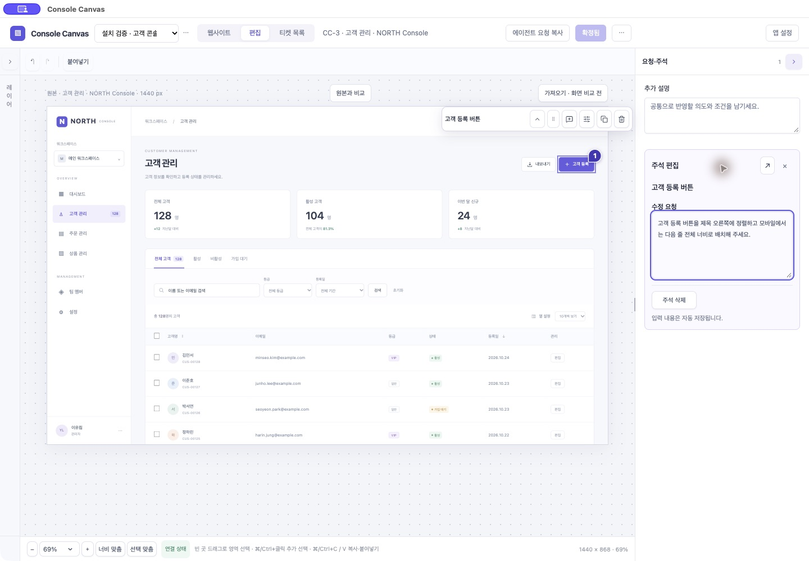

# 0.53.0 · 가져오기부터 에이전트 조회까지

2026-11-02 · #197, #198~#202 구현·검증 결과. [이전 검토](ux-review-0.52.1.md)는 구현 전 관찰이며 최신 기능 계약은 [PRD](PRD.md)다.

## 바뀐 동작

1. **#198 연결 진단**: 캔버스의 연결 상태 한 곳에서 로컬 서버, 최근 에이전트 통신, 현재 프로젝트 저장소를 구별한다. 필요한 서버 재연결·MCP 명령·저장소 연결 요청만 제공한다. 제거된 프로젝트 공개 ACL 안내는 삭제했다. stdio 인증 거절은 상태 코드와 복구 안내를 구조화해 반환한다. 네이티브 편집기는 동일 앱/동일 origin에서 갱신한 인증만 재시도한다. 인증을 끄거나 GUI의 저장소 접근 권한을 넓히지 않는다.
2. **#199 전달**: 편집기의 ‘에이전트 요청 복사’는 해당 티켓 조회, 목록의 같은 동작은 프로젝트 목록 조회다. 시안/구현은 부가 메뉴에서 목적을 구분한다. 처음이면 현재 저장소 연결+조회, 연결됐다면 일치 확인+조회를 요청한다. 복사만으로 대화 전송·구현 착수·일괄 대상 고정을 하지 않는다. 전체 구현 대상은 실제 구현 요청 시점에 정한다. 네이티브 클립보드는 신뢰한 편집기 mainFrame의 제한된 IPC로만 제공한다.
3. **#200 목록**: 같은 제목의 티켓도 현재 추가 설명 → 첫 주석 → 실제 변경 건수 → ‘변경·요청 없음’ 순의 요약으로 구별한다. 원본 경로·가져온 시각을 함께 보이고 ‘확정·미착수’ 필터를 제공한다. 썸네일 실패는 조회를 막지 않는다. 이름 입력은 필수가 아니며 목록 행에서 바로 편집한다.
4. **#201 상태**: 확정 상태와 비활성 확정 버튼을 중복 표시하던 DOM/코드를 제거했다. 한 버튼에서 저장/확정 중·확정됨·재확정·작업/변경 요청 상태를 알린다. 빠른 연타를 막고 실패를 성공으로 표시하지 않는다. 복사 피드백은 만료된다. 요청 없는 참고 화면에는 일반 구현 문장을 자동 생성하지 않는다. 추가 설명은 독립 undo 단위로 저장하고 종료/확정에서도 입력을 flush한다.
5. **#202 주석**: 기본 입력은 오른쪽 패널이다. 선택만으로 입력 포커스를 빼앗지 않고 주석 아이콘·기존 카드/번호 마커를 명시했을 때 입력한다. 완료 버튼 없이 자동 저장하며 큰 미리보기가 필요할 때만 모달로 확장한다. 선택 요소의 중복 위치 주석 아이콘과 편집 중인 주석의 중복 카드는 제거했다. 빈 지점의 좌표 주석·다중 대상 이동·삭제/undo는 유지한다. 한글 조합 중 저장·전환·제출은 차단한다.

## 직접 사용한 경로

같은 런타임의 별도 브라우저 저장 공간에서 새 샘플 CC-1을 만들고 다음을 직접 클릭/입력했다.

- 고객 등록 요소 선택 → 주석 시작 → 입력 → 자동 저장 완료.
- 확정 중 → 확정됨, 요청 복사 성공, 현재 티켓/프로젝트 조회 요청 구별.
- 기존 주석 카드 → 기존 문자열 선택 → 교체 입력 → 자동 저장 → 재확정.
- 목록의 현재 주석 요약/출처/시각, 조회 요청 복사, 다른 요청 펼치기/구현 요청 복사, 행에서 즉시 편집 복귀.
- 구현 요청 복사 뒤에도 티켓은 확정/미착수다. 복사로 소스 구현은 실행하지 않았다.

설치 앱은 기존 업무 자료를 초기화하지 않고 정상 종료·0.53.0 업데이트·재실행했다. 실제 원본 NORTH 페이지에서 ‘현재 화면 가져오기’를 눌러 **CC-3**를 새로 만들고, 복제본 고객 등록 버튼 선택 → 주석 시작 → 한글 요청 입력 → 확정 → 에이전트 조회 요청 복사를 사용했다. 같은 저장소의 공식 SDK가 동일 canonical 티켓을 조회해 **확정 목표, 주석1개, 이미지3개, queued·미착수**를 확인했다.

그 상태로 정상 종료·최종 UI 보완 빌드 설치·재실행했다. 다시 편집에 들어가 같은 CC-3와 저장된 한글 주석을 열고, 편집 중인 주석 카드가 중복 표시되지 않음을 확인했다. 연결 상태 → MCP 명령 복사도 설치 앱에서 직접 사용했다.

## 액션 수

메뉴 펼치기·탭/링크 이동·필드/문자열 선택·입력·제출·앱/대화 이동을 각각 센다. 대기와 에이전트 내부 호출은 제외한다. 시작 조건이 다른 경로의 숫자를 직접 비교하지 않는다.

| 경로와 시작 조건 | 0.52.1 | 0.53.0 | 근거 |
| --- | --- | --- | --- |
| 편집기에서 새 요소 주석 | 4 | **3** | 선택1 + 주석 시작1 + 입력1. 브라우저에서 세 동작과 자동 저장 완료 직접 확인 |
| 편집기에서 기존 주석 교체 | 4(이전 UI 구조 기준) | **3** | 카드1 + 문자열 선택1 + 입력1. 이번에 직접 교체/자동 저장 확인 |
| 프로젝트 있음·원본 준비 완료 → 가져오기·요소 주석·확정 | 6 | **5** | 가져오기1 + 선택1 + 주석 시작1 + 입력1 + 확정1. 설치 앱 완주. 아래 도구 입력 보정 비용은 별도 기록 |
| 현재 편집 확정 | 1 | **1 유지** | 추가 필수 양식/확인 모달/자동 이동 없음 |
| 편집 → 목록의 기존 티켓 편집 | 2 | **2 유지** | 목록1 + 행1. 별도 상세 화면 없음 |
| 이미 에이전트 대화에 있음 → 티켓 조회 요청 | 2 | **2 유지** | 짧은 요청 입력1 + 전송1. 복사를 강제하지 않음 |
| 편집기 → 복사한 티켓 조회 요청 전달 | 이전에는 ID와 목적을 따로 구성 | **4** | 요청 복사1 + 대화 이동1 + 붙여넣기1 + 전송1의 사용자 동선. 실제 테스트에서는 복사 후 SDK가 같은 티켓을 조회했으며, 대화 포커스/메시지 전송을 도구로 대신 실행한 실측은 아님 |
| 목록에서 일괄 구현 요청 복사 | 해당 동작 없음 | **2** | 다른 요청 펼치기1 + 구현 요청 복사1. 이후 대화 이동·붙여넣기·전송3을 별도로 더함 |
| 캔버스에서 MCP 명령 확인/복사 | 설정 경로별로 다름 | **2** | 연결 상태1 + 명령 복사1. 실제 설치 앱에서 확인. 정상 사용에 이 경로를 매번 요구하지 않음 |

기존 주석 교체의 이전4는 당시 UI 구조 기준이지 과거 별도 완주 실측은 아니다. ‘4→3’의 이전 근거는 [0.52.1 검토](ux-review-0.52.1.md)와 구분해 읽는다.

설치 앱 자동 조작의 첫 한글 typeText는 공백/구두점만 입력했다. 기존 문자열 전체 선택+붙여넣기로 복구했으며, 이는 제품의 주석 동작이 아니라 도구 입력 제약이었다. **실제로 수행한 가져오기~확정 조작은 보정 포함7회**, 정상 경로는5회다. 브라우저에서는 새 주석3회와 기존 주석 교체3회를 보정 없이 확인했다. 붙여넣기나 합성 조합 이벤트 성공을 실제 OS 한글 IME 조합 통과로 표시하지 않는다.

## 회귀·통합 검사

- `npm run check`: Python57, Node43, Chromium 티켓/프로젝트58·패널35·선택32·저장12·핵심 편집33 및 기존 수집/레이아웃/독립 실행 전체 통과.
- `npm run test:desktop:offscreen`: 공식 SDK17, 최신 SDK/2026-07-28 리소스·구독6, 이미지 입력8, 네이티브 범위6, 실제 main/preload IPC와 제한된 요청 클립보드, 파일 취소/복원, 스킬 설치, 정상 종료·재실행 통과. 클립보드 목적지와 파일 선택 응답은 격리 통합 검사에서 대체하고 실제 UI 사용과 구별한다.
- 같은 이름의5개 티켓에서 서로 다른 주석/설명/배치 변경/무요청 상태, 빈 요청 목표, 요청 복사 시 미착수 유지, 독립 추가 설명 undo, 조합 중 저장/닫기 방지, 주석 중복 카드 제거를 검증했다.
- 저장소 분리·일괄 대상 고정/경합 claim·CAS·이미지 역할·목표 보호·승인 후 완료는 기존 실제 SDK 회귀를 유지했다.
- 긴 프로젝트/티켓 이름과 설치 앱1000px 너비의 버튼 범위/가로 넘침을 확인했다. 공통 브라우저1280px에서도 직접 화면을 관찰했다.
- 수집 회귀는 viewport99.687%, 영역100%, 영상/오버레이99.92%와 원본 불변을 유지했다. 이 고정 fixture 수치를 임의 웹사이트 전체의 보장으로 일반화하지 않는다.

원본 Documents 경로의 esbuild 디렉터리 열기 대기 문제 때문에 이전과 같은 `/private/tmp/console-canvas-0521-f_21fnsr`에서 동일 소스/의존성으로 검증·빌드했다. 최종 runtime-manifest의 소스 체크섬을 원본과 비교한 뒤 생성물만 동기화했다. 개인 설정/보안 권한은 바꾸지 않았다.

## 설치·스킬·연결 경계

- 고정 Apple Development 지문 `1AF1575737F365CF53DD6AEAA9C102E7ACF53A07`·Team `SM838N234X`를 유지했다. 설치 앱의 deep/strict 코드 서명 검증을 통과했다.
- 업데이트 전 기존2개 티켓의 workspace와 목표 이미지 지문을 기록했고 업데이트 후 같음을 확인했다. 이어 새 CC-3까지 포함한 **티켓3개·목표3개**의 지문이 최종 정상 재실행 뒤에도 같았다. 저장소 연결도 유지됐다.
- 설치된 관리 SKILL.md와 런타임 ZIP이 소스 배포 자산과 바이트 단위로 일치하고 스킬 validator를 통과했다. 개인 파일·원본 프로젝트·브라우저 로그인·키체인은 초기화하지 않았다.
- 기존 대화에 붙어 있던 MCP 도구 목록에는 이미 제거된 스냅샷/AI 후보 도구가 남고 get_agent_guide는 여전히401이었다. 설치 앱의 새 stdio 클라이언트는0.53.0/19도구/저장소 조회에 성공했다. **구형 호스트 세션이 오래된 계약을 유지하는 사실은 확인했지만401의 토큰/프로세스 원인은 확정하지 않았다.** 앱이 실행 중인 호스트 코드를 교체하거나 대화를 재시작할 수 있다고 주장하지 않는다. 이 경우 연결 상태 창의 현재 명령/등록 경로 확인과 클라이언트 재연결 안내를 따른다. 갱신된 stdio의 같은 origin 인증 회전 복구와 실패의 구조화 안내는 SDK 회귀로 검증했다.
- 실제 OS IME·권한 대화상자 조건 #7은 미검증 잔여로 유지한다.

## 사용 가이드

[기존 사용 가이드](https://console-canvas-guide.yonginkim.chatgpt.site/)의 소유자 전용 접근 범위를 유지해 발행했다. 소스9fa7c6b1a5b65fe3b4d198576809ced2b3386af4의 배포 성공을 확인했다. 새 Electron UI5장과 직접 사용한 최종 설치 앱의 패널 주석 화면을 포함한다. 실제 사용/원본 사진을 고정한 offscreen 수집 검사/미검증 OS 조건을 구분한다. 이미지 확대·닫기와 문구를 로컬 브라우저에서 확인했다.
