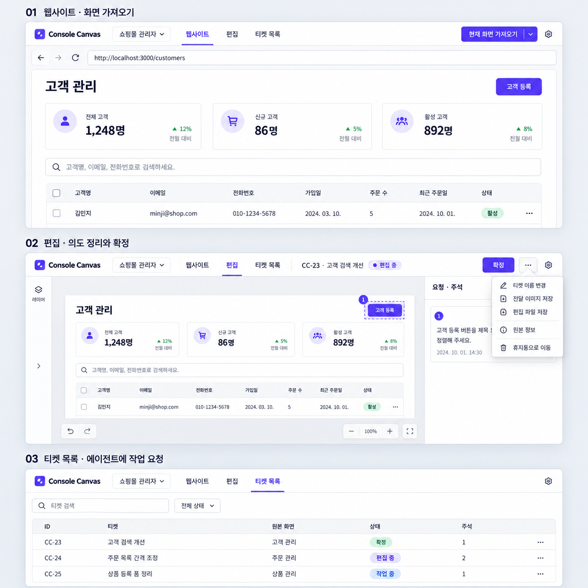
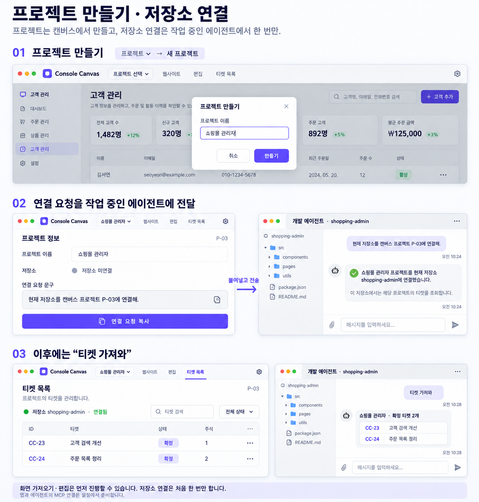

# 프로젝트 연결과 가져오기 중심 워크플로우 · 승인 계획

2026-11-01 · 상위 [#189](https://github.com/kimyongin/console-canvas/issues/189). **0.52.1에서 구현·검증·설치 완료했다. [검증 결과](workflow-0.52.md)에 실제 범위와 동선 액션을 기록한다.** 이 문서는 구현에 사용한 승인 기준이며 아래와 충돌하는 이전 빈 티켓 우선 생성/헤더/프로젝트 연결 규정보다 우선한다.

## 기존 자료 초기화 승인

2026-11-01 사용자가 기존 자료 보존은 불필요하며 모두 삭제해도 된다고 승인했다. 이번 구조 전환에서 현재 앱의 프로젝트·티켓·캡처·편집·주석·확정 목표·작업 기록·휴지통 업무 자료를 한 번 초기화할 수 있다. 보존 이전·구버전 자료 호환·사전 데이터 백업은 개발 범위에서 제외한다. 초기화가 끝난 뒤 새로 만든 자료는 자동 저장·재실행·후속 업데이트에 유지해야 한다. OS 서명·브라우저 로그인·MCP 인증·개인 스킬 파일·프로젝트 소스코드는 이 초기화 대상이 아니다. 이 문서 변경만으로 현재 앱 자료를 지금 삭제하지는 않는다.

## 목적·작업 단위

웹 디자인 의도를 길게 설명하는 대신 실제 화면을 편집·주석하고 확정한 티켓을 개발 에이전트에게 전달한다.

| 단위 | 역할 |
| --- | --- |
| 프로젝트 | 저장소에 대응하는 캔버스 작업 공간. 영속 ID와 이름, 저장소 연결 정보를 소유 |
| 페이지 | 프로젝트에서 가져오는 실제 웹 화면. 별도 등록/관리 절차를 만들지 않음 |
| 티켓 | 한 번 가져온 화면·현재 편집·주석·확정 기준·구현/검토 기록을 묶는 독립 개선 요청 |

동일 프로젝트에 여러 페이지와 티켓이 속한다. 편집·주석은 티켓별로 독립적이고 이미지 시안 제안/비교/선택과 코드 구현/검토는 기존 에이전트 대화에서 수행한다.

## 처음 한 번의 프로젝트·저장소 연결

1. 사이트를 먼저 열 수 있다. 프로젝트가 없는 첫 가져오기는 기본 이름을 제안하는 작은 양식에서 **만들고 가져오기**로 이어간다. 이미 프로젝트가 여럿인데 선택만 없는 경우에는 선택받는다. 프로젝트 ▾ → 새 프로젝트에서 직접 만드는 경로도 유지한다.
2. 저장소 미연결 상태에서도 웹사이트 열기·가져오기·편집·확정할 수 있다.
3. 프로젝트 생성 직후 같은 맥락의 비차단 피드백에서 연결 요청을 복사한다. 나중에는 프로젝트 메뉴에서 복사하며 별도 정보 화면 방문을 필수로 두지 않는다. 예: **현재 저장소를 캔버스 프로젝트 P-03에 연결하고 티켓을 보여줘.** 식별자는 앱이 넣으며 사용자가 긴 요청을 작성하지 않는다.
4. 이미 해당 저장소에서 작업 중인 에이전트 대화에 붙여넣는다. 에이전트는 실제 현재 저장소를 확인해 연결하고 해당 프로젝트 티켓을 바로 보여준다. 연결 뒤 추가 조회 메시지를 요구하지 않으며 코드 구현은 별도 요청에 따른다.
5. 앱에 연결 상태가 자동 반영된다. 연결 확인을 위해 앱으로 돌아와 추가 승인할 필요는 없다. 새 세션은 저장된 연결을 다시 해석해 사용한다.

앱 MCP 연결은 설정에서 준비하는 별도 최초 절차다. 저장소 연결은 캔버스에 코드/계정 정보를 업로드하거나 앱이 에이전트를 실행하는 기능이 아니다. 같은 화면에서 입력 옆 복사 아이콘/큰 버튼을 중복 배치하지 않는다. 연결을 나중에 해도 편집을 막거나 별도의 나중에 확인 버튼을 요구하지 않는다. 저장소 연결됨은 저장된 매핑 상태로, 에이전트가 지금 실행 중이라는 온라인 표시로 해석하지 않는다.

## 일상 동선

**현재 프로젝트의 웹사이트 → 현재 화면 가져오기 → 자동 티켓 생성/편집 진입 → 편집·주석 자동 저장 → 확정 → 웹사이트 복귀**를 반복한다. 이후 해당 저장소 에이전트에게 **확정된 티켓들 구현해**라고 요청한다.

- 캡처가 성공하면 편집기에 들어가기 전에 티켓/캡처/세션을 원자 저장한다. 캡처 실패·취소/중복 재시도 때문에 고아 빈 티켓이 쌓이지 않게 한다.
- 사용자가 먼저 빈 티켓을 만드는 버튼/명령/강제 절차를 제거한다. 같은 원본 재사용을 위한 별도 티켓 분할 UI는 이번에 추가하지 않는다.
- 이번 구조 전환에서 기존 빈 티켓을 포함한 업무 자료를 초기화할 수 있다. 새 구조의 티켓 생성·저장·파일 백업/복구를 검증하며 구버전 자료 호환은 구현하지 않는다.
- 가져온 페이지 제목으로 티켓 이름을 자동 제안하고 변경은 선택 사항으로 둔다. 확정은 현재 이미지·주석/의도·출처/revision을 구현 기준으로 고정하는 한 번의 행동이다. 별도 목표 등록/이름/요청 재입력을 강제하지 않는다. 확정 후에는 제자리에서 상태를 표시하고 원할 때 고정 웹사이트 탭 한 번으로 돌아간다. 자동 화면 이동은 하지 않는다.
- 시각 편집만 한 작업과 주석만 작성한 작업을 모두 지원한다. 실제 구현 착수는 별도의 명시적 에이전트 요청에 따른다.
- 작업 시작 전 확정한 티켓도 직접 편집하고 실제 변경이 생기면 자동으로 재확정 필요 상태가 된다. 명시적 재확정 전에는 일괄 구현 대상에서 제외한다. 확정 취소를 편집의 선행 조건으로 요구하지 않는다. 선택·확대·패널/탐색·티켓 이름 변경은 재확정을 요구하지 않는다. undo로 정확히 기존 확정 내용으로 돌아온 경우 그 상태를 회복하되 명시적 취소/보류를 자동 해제하지 않는다. 작업 중 기준 변경은 수정 요청으로 구별하고 이전 기준을 조용히 바꾸거나 작업을 다시 실행하지 않는다.

## 공통 헤더·메뉴

공통 한 줄: **프로젝트 ▾ / 웹사이트 / 편집 / 티켓 목록 / 설정**. 프로젝트·메뉴·설정 위치를 세 화면에서 고정한다.

| 화면/행동 | 구성 |
| --- | --- |
| 웹사이트 | 주소창과 현재 화면 가져오기 ▾. 편집 왕복 시 원본을 새로고침하지 않아 검색 조건/열린 상태/스크롤 유지 |
| 편집 | 티켓 ID·이름·상태, 확정, 보조 메뉴. 주소창/두 번째 앱 헤더 없음 |
| 편집 탭 | 마지막 편집 티켓으로 복귀. 새 티켓을 만들지 않음 |
| 티켓 목록 | 현재 프로젝트의 미완료 기본 목록. ID+이름·작은 준비된 미리보기·상태·주석 수, 원본은 보조 정보. 한 번 클릭으로 편집 진입, 검색/전체·완료 필터/휴지통 |
| 티켓 보조 메뉴 | 이름 변경·전달 이미지/편집 파일 저장·원본 정보·휴지통 등 |
| 가져오기 보조 메뉴 | 범위 가져오기·앱 화면 가져오기·파일 열기 등 |
| 설정 | 에이전트 연결·스킬·앱 업데이트 |

실행 취소/다시 실행·확대·요소 편집 도구는 캔버스 가까이 둔다. 새 티켓·ID 복사·작업 티켓·전달 이미지의 중복 상위 버튼과 별도 목표 재입력 양식을 정리한다. 보조 기능의 발견성·키보드/포커스·복구를 유지하고 기본 모달은 겹치지 않는다.

## 에이전트 대상·일괄 구현

- 프로젝트별 공개 옵션은 재도입하지 않는다. 앱 연결 인증/작업 공간 격리와 세션별 프로젝트 대상 선택을 구별한다.
- A 저장소 세션의 ‘티켓 가져와’가 B의 티켓을 섞지 않게 한다. 공유 MCP 프로세스/앱에 전역 current_project를 저장하지 않으며 각 요청이 프로젝트 맥락을 명확하게 전달한다.
- URL/localhost 포트/remote URL만으로 프로젝트를 결정하지 않는다. 저장소 신원·worktree 체크아웃·독립 clone·동명/다중 연결을 구별한다. 프로젝트가 유일하면 반복 선택 없이 진행하고 모호한 경우에만 확인한다.
- 프로젝트 이름/경로 변경이나 명시적 재연결은 기존 티켓/목표 출처를 조용히 바꾸지 않는다. 원본 주소와 현재 저장소가 맞지 않을 때 임의로 다른 저장소를 수정하지 않는다.
- 단순 ‘티켓 가져와’는 현재 프로젝트의 미완료 목록 조회다. 완료는 전체/완료 포함 요청이나 직접 ID로 읽을 수 있다. ‘확정된 티켓들 구현해’처럼 대상/행동이 명확하면 별도 목록 선택/재승인을 요구하지 않고 확정·미착수·재확정 불필요 대상을 끝까지 읽어 요청 시점 ID/goal_id/revision으로 고정한 뒤 수행한다.
- 늦게 추가한 티켓이나 진행 중/완료/휴지통을 자동 재구현하지 않는다. 같은 티켓의 동시 착수·불확실한 재시도·다른 확정 기준을 CAS/작업 receipt/점유로 구분한다.
- 의존 작업 순서·독립 작업·부분 실패/재개를 구별하고 실제 결과/검증과 상태를 기록한다. 사람에게 캔버스로 왕복해 상태를 바꾸게 하지 않는다. 대화에서 검토/승인하며 테스트 성공을 사람 승인으로 추정하지 않는다.

## 구현 전 UX 재검토

2026-11-01 사용자 요청으로 구현 전에 전 동선을 다시 검토했다. 아래는 설계 개선/수용 기준이며 실제 구현 성과나 실측 감소율이 아니다. 이 절의 동선 규칙은 승인 시안의 세부 예시보다 우선하며 공통 배치/제품 의도는 유지한다.

| 걸릴 수 있는 부분 | 개선한 기준 | 책임 |
| --- | --- | --- |
| 첫 사용에 프로젝트 설정부터 해야 함 | 웹 주소 입력부터 시작. 프로젝트가 없으면 첫 가져오기에서 한 번 만들고 이어가기 | #190/#191/#188/#193 |
| 생성 후 연결 문구를 찾으러 정보 화면 이동 | 생성 직후 같은 맥락에서 복사, 나중에는 프로젝트 메뉴. 연결 미완료로 편집을 막지 않음 | #191 |
| 저장소 연결 후 다시 티켓 조회 요청 | 복사한 짧은 문구가 연결+첫 목록 조회까지 수행. 구현 승인은 포함하지 않음 | #192/#191/#195 |
| 이름/요청 입력과 확정 취소를 반복 | 자동 제목·선택적 주석. 작업 전 직접 수정→자동 재확정 필요→한 번 재확정 | #188/#190 |
| 무관한 조회/확대 때문에 재확정하거나 undo가 상태를 못 돌림 | 확정 기준의 실제 변경만 판정. undo는 원래 확정 내용/명시 취소 여부를 구별 | #188/#190/#196 |
| 목록의 완료 작업·중복 열/칩·중간 상세 단계 | 미완료 기본, 간결한 한 행에서 바로 편집. 전체/완료·직접 ID 조회는 가능 | #194/#193 |
| 일괄 구현을 요청하고도 선택/승인을 다시 요구 | 명확한 프로젝트·확정 대상이면 짧게 알리고 착수, 단순 조회와 구분 | #192/#194/#195 |
| 클릭을 줄이려고 확정 후 예고 없이 이동 | 제자리 확정 피드백과 고정 탭 한 번 복귀를 유지 | #188/#193 |

진행·저장/확정 오류·재시도는 기존 버튼과 짧은 상태에서 처리한다. 원본 사이트를 새로고침해 작업 맥락을 잃지 않게 한다. 미리보기 준비가 목록 응답을 막지 않게 한다. 내부 작업 점유/CAS를 별도 사용자용 작업 관리 화면이나 자동 실행기로 확장하지 않는다. 반복 안내 배너·중복 버튼·모달로 복잡한 동작을 설명하지 않는다.

연결 후 추가 조회 메시지, 별도 정보 화면 방문, 편집 전 확정 취소를 없애는 효과를 구현 뒤 같은 시작/완료 조건으로 측정한다. 메뉴·링크·입력·앱/대화 왕복을 모두 포함하며 대상 식별·예측 가능성·키보드/포커스·오류 복구를 함께 평가한다.

## 개발 티켓과 순서

| 순서 | GitHub | 작업 | 선행 | 상태 |
| --- | --- | --- | --- | --- |
| 1 | [#190](https://github.com/kimyongin/console-canvas/issues/190) | 프로젝트·저장소 모델과 업무 데이터 초기화 | 없음 | 완료 |
| 2 | [#192](https://github.com/kimyongin/console-canvas/issues/192) | 에이전트 저장소 연결·요청별 프로젝트 맥락/MCP | #190 | 완료 |
| 3 | [#191](https://github.com/kimyongin/console-canvas/issues/191) | 프로젝트 생성·전환·연결 요청 복사/상태 UI | #190/#192 | 완료 |
| 4 | [#188](https://github.com/kimyongin/console-canvas/issues/188) | 가져오기→자동 티켓→편집·한 번의 확정 | #190/#191 | 완료 |
| 5 | [#193](https://github.com/kimyongin/console-canvas/issues/193) | 한 줄 헤더·메뉴·화면 전환 통합 | #191/#188 | 완료 |
| 6 | [#194](https://github.com/kimyongin/console-canvas/issues/194) | 프로젝트별 목록·일괄 구현·진행/검토 | #190/#192/#188 | 완료 |
| 7 | [#195](https://github.com/kimyongin/console-canvas/issues/195) | 실제 도구 스킬·PRD·실제 캡처 HTML 가이드 갱신 | #191/#192/#188/#193/#194 | 완료 |
| 8 | [#196](https://github.com/kimyongin/console-canvas/issues/196) | 전체 시나리오·액션 계수·초기화/설치 검증 | 위 전체 | 완료 |

의존성은 컴포넌트와 연동 책임을 구분한다. #190은 프로젝트 미선택/변경·확정의 저장 모델, #191은 생성/선택 컴포넌트·복사 피드백/결과 콜백, #188은 첫 가져오기에서 그 컴포넌트를 호출해 캡처로 이어가는 흐름, #193은 공통 시작 화면/헤더를 담당한다. 후행 UI 전체를 선행 모델/컴포넌트 티켓의 완료 조건으로 요구하지 않는다.

#188의 과거 원본 재사용 초안/검토 보류를 이번 승인된 캡처 주경로로 대체했다. 프로젝트 공개 옵션 제거 #187은 완료 상태를 유지한다. #7의 실제 OS IME·저장 대화상자 잔여를 이번 계획 등록이나 offscreen 성공으로 닫지 않는다.

## 요구사항·책임 매핑

| 기준 | 수용 조건 | 담당 |
| --- | --- | --- |
| WF-01 | 이름만으로 프로젝트 생성·연결 전 편집·명시 ID로 저장소 연결·재실행 유지 | #190/#192/#191 |
| WF-02 | 동시 세션·다중 후보/동일 포트·clone/worktree·재연결에서 대상 섞임 없음 | #190/#192/#196 |
| WF-03 | 자동 제목/티켓·편집/주석 저장·한 번 확정·직접 수정/재확정·빈 티켓 선생성 제거 | #188/#193 |
| WF-04 | 한 줄 헤더·제자리 확정·원본 상태 유지/한 번 복귀·행에서 편집 진입·보조 메뉴/접근성 | #193/#196 |
| WF-05 | 일괄 대상 고정·동시 착수/재시도·부분 실패·대화 검토·명시 승인 | #194/#192 |
| WF-06 | 구 업무DB 1회 초기화·반복 삭제 방지와 새 티켓/편집/주석/목표/기록 저장·재실행 유지 | #190/#188/#196 |
| WF-07 | 새 실제 도구와 원본/번들/설치 스킬·실제 캡처 가이드 일치 | #195/#196 |
| WF-08 | 모든 액션/메뉴/링크·앱↔대화 왕복을 전후 계수하고 UX 회귀 방지 | #196 |

## 검증·배포 경계

가상 자료/별도 프로필로 기본 생성·연결·반복 캡처·확정·목록/이미지·일괄 구현·검토와 모든 실패/복구를 검증한다. 메뉴 펼치기·링크 이동·프로젝트 선택·복사/붙여넣기·재입력·앱/대화 왕복을 포함한 전체 액션을 기록하며 편집 자체 비용과 동선 비용을 구분해 함께 제시한다. 액션 감소를 위해 대상 식별·발견성·저장/복구·명시적 구현/승인 보호를 없애지 않는다.

공통 UI/필수 npm run check와 실제 브라우저 사용, 공식 MCP SDK와 동시 프로젝트/새 세션, Electron 저장/파일·스킬·종료/재실행을 변경 경계에 맞춰 검증한다. 마지막에 앱 정상 종료→업무 자료 1회 초기화→같은 고정 Apple Development 서명으로 설치 업데이트→새 프로젝트/연결/티켓 생성→재실행 후 새 자료·실제 화면/스킬/MCP 확인을 수행한다. 데이터 보존 이전·전체 프로필 백업은 요구하지 않으며 OS 서명·브라우저 로그인·MCP 인증·개인 스킬 파일은 유지한다. 앱 본체는 하나만 실행하고 웹/offscreen/실제 OS/미검증을 구별한다.

개인 사용 범위를 유지한다. 앱 자체 AI/OAuth·후보 갤러리·스냅샷/분기·Chrome 확장·공개 배포/유료 인증서·팀 공유 ACL·추가 프로젝트 관리 제품을 도입하지 않는다.

## 승인 시안

이미지는 구현 전 설계 시안이다. 공통 배치/제품 의도를 참고하되 연결+첫 목록을 한 요청으로 처리하는 문구, 필수 정보 화면 제거, 직접 수정/재확정 등은 위 UX 재검토 기준을 따른다. 최종 실제 화면 가이드는 #195에서 별도로 캡처한다.

