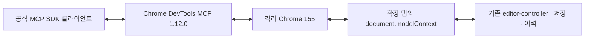

# Chrome 확장 WebMCP 연결 검증

2026-10-26, 소스 0.19.2 기준. 공식 Chrome DevTools MCP 1.12.0을 공식 MCP SDK 클라이언트로 실행하고 실제 Chrome 155의 격리 headless 프로필에서 확장을 설치·수집·편집했다. **37개 검사가 통과했다.** 제품 경로에 활성화하거나 설치 앱을 교체한 변경은 아니다.

## 0.20 제품 코드 검증

`node experiments/webmcp/run.mjs --product`는 어댑터를 주입하지 않고 **최종 Chrome 전용 ZIP**을 풀어 설치한다. 공통 13개 도구를 실제 native API에 공개하고 공식 MCP로 실행한다. `--headed`를 추가하면 별도 프로필의 일반 Chrome 창으로 실행한다. 제품 모드는 Python으로 스키마를 추출하지 않는다. QA의 ZIP 압축 해제에만 Python 표준 라이브러리를 쓰며 확장 실행에는 필요 없다.

실제 도구 호출과 준비/동의·오류 주입·상태 관찰을 구별한다. 편집 명령은 `execute_webmcp_tool`을 사용하고 UI 공개 버튼·IDB 저장 실패 주입과 관찰에는 `evaluate_script`를 사용한다. PNG는 반환한 정확한 blob 미리보기 탭의 크기/출처를 대조한 후 공식 MCP `image/png` 콘텐츠로 수신한다. 주석만·10개 요청·삭제 전 참고·저장 버전과 조회 비변경, 공개 철회·이전 세대·busy/한도·저장 실패/롤백을 포함해 55개를 확인했다. [상세 증빙·남은 QA](../../docs/webmcp-0.20.md)를 따른다.

보고서는 `product-headless-report.json`/`product-headed-report.json`과 최근 실행 `report.json`, 실제 이미지 4종 `agent-*.png`로 `local/webmcp-experiment/`에 남는다. 일반 창 자동 검사와 실제 OS IME/권한/사람 입력을 동일시하지 않는다. 아래 내용은 최초 0.19.2 실험의 역사적 기록이다.

## 최초 실험 재현

Node.js 22.12 이상, Python 3.9 이상, Google Chrome이 필요하다. 아래 명령은 저장소 루트에서 실행한다.

```sh
npm ci
npm run build
npm install --prefix local/webmcp-experiment --ignore-scripts --no-audit --no-fund chrome-devtools-mcp@1.12.0
node experiments/webmcp/run.mjs
```

다른 Chrome 경로는 `WEBMCP_CHROME`, 실험용 공식 MCP 패키지 디렉터리는 `WEBMCP_MCP_ROOT`, Python은 `WEBMCP_PYTHON`으로 지정한다. 기본 Chrome 경로는 macOS `/Applications/Google Chrome.app/Contents/MacOS/Google Chrome`이다. 현재 실제 검증 플랫폼은 macOS Apple Silicon이다. 실험 의존성은 `local/`에 설치하며 제품 의존성에는 추가하지 않는다.

출력은 Git 제외 경로 `local/webmcp-experiment/report.json`, `moved-and-commented.png`, `server.log`에 남는다. 보고서의 `result`, `passed`, `baseline`, `environment`, `checks`, `calls`로 실제 명령과 결과를 확인한다. 서버 stderr는 가상 샘플만 다룬다.

## 구성



- `run.mjs`는 빌드된 공개 런타임·확장 진입점만 임시 디렉터리에 복사한다. 사용자 프로필·캡처·설치 앱은 읽거나 수정하지 않는다. 원본 `manifest.json`과 편집기 진입점도 바꾸지 않는다.
- 실험용 복사본에만 `adapter.js`와 MCP 정의에서 생성한 입력 스키마를 추가한다. 도구 이름에는 `console_canvas_`를 붙이며 현재 문서의 공통 controller로 위임한다. 복제본의 저장/undo/이력/스냅샷 엔진을 다시 구현하지 않는다.
- 등록은 **네이티브 `document.modelContext.registerTool()`**로 수행한다. 폴리필이나 `evaluate_script`로 편집 명령을 우회 호출하지 않는다. `evaluate_script`는 준비 상태·DOM 위치·이력·원본 무변경 관찰에만 사용한다.
- 공식 `list_webmcp_tools`/`execute_webmcp_tool`로 11개 도구를 발견·실행한다. `get_agent_guide`와 `get_review_image`는 이번 도구 목록에서 제외한다.
- 우리 Python MCP 서버/브리지와 Native Messaging 호스트는 실행하지 않는다. localhost HTTP 서버는 수집할 가상 NORTH 원본 HTML/CSS/JS를 제공하는 용도뿐이다. 테스트 확장에는 `nativeMessaging` 권한이 없다.

## 발견한 등록 조건

| 대조 조건 | 실제 결과 |
| --- | --- |
| WebMCP 켬 + 기존 확장 manifest | API 객체는 있지만 등록은 `document.modelContext cannot be used when document.domain is enabled.`로 거절. 편집기는 정상 준비됨 |
| WebMCP 켬 + 확장 COOP/COEP | `crossOriginIsolated=true`, `originAgentCluster=true`; 네이티브 등록·공식 MCP 조회/호출 성공 |
| WebMCP 명시적 끔 + COOP/COEP | 미지원 상태 감지, 도구 등록 없음, 일반 샘플 편집기는 정상 준비됨 |

실험용 manifest에 다음 Chrome 표준 격리 설정을 적용하면 이 환경의 등록 실패가 해소됐다. 이 결과를 모든 브라우저 버전·사이트에 일반화하지 않는다.

```json
{
  "cross_origin_opener_policy": { "value": "same-origin" },
  "cross_origin_embedder_policy": { "value": "require-corp" }
}
```

공식 MCP에는 `--categoryExtensions`, `--categoryExperimentalWebmcp`를 사용하고 Chrome에는 `--enable-features=WebMCP`를 전달한다. 기능을 끈 대조군은 `--disable-features=WebMCP`를 사용한다. 개인 Chrome에 연결하는 `--autoConnect`는 사용하지 않는다. 공식 MCP의 자동 설정 탐색·업데이트 확인·사용 통계·성능 URL 조회도 이 실험에서는 끈다.

## 확인한 동작

- 공식 MCP로 압축 해제 확장 설치 → 가상 HTTP 콘솔 열기 → 실제 확장 액션 실행 → 캡처 문서를 확장 편집기 탭에서 열기.
- 300개 이상 요소·원본 URL/버튼 식별자·화면/revision·빈 주석 조회.
- 공식 WebMCP 실행으로 버튼을 -80/32px 이동하고 주석 추가. 실제 캡처 DOM 좌표·번호 배지·같은 이력 목록과 내구 저장 결과 확인.
- 같은 작업 ID 재전송은 입력 키 순서를 바꿔도 한 번만 적용. 다른 내용으로 ID 재사용·오래된 revision·다른 editor_id는 거절.
- 이동+주석을 하나의 실행 취소로 복원하고 다시 실행.
- A→B→C 저장 뒤 A로 돌아가 D 저장. 실제 부모 ID가 A→D이며 C는 남고 다시 복원됨.
- 편집기 탭 새로고침 뒤 주석과 모든 분기·활성 버전 보존. 앱 종료/재실행이나 확장 전체 재설치 증빙과 구별.
- 원본 DOM SHA-256 동일, 원본 업무 이벤트 실행 횟수 0.

스크린샷은 실제 MCP 편집 뒤 Chrome 스크린샷 도구로 저장해 확인했다. 기존 공통 `npm run check`도 타입·포맷·빌드·Python 39·Node 27·Chromium 321을 통과했다. 실험 37개는 이 기본 검사에 합산하거나 매번 실행하지 않는다.

## 결론과 제품 적용 전 남은 일

**이 환경에서는 우리 전용 호스트·연결 서버 없이 공식 Chrome MCP를 통해 확장 편집기를 제어할 수 있었다.** 에이전트 측에는 공식 Node MCP 프로그램과 Chrome 연결 설정이 여전히 필요하다. Chrome 자체에 범용 MCP 서버가 자동으로 열리는 구성은 아니다.

현재는 실험 복사본에서만 자동 등록한다. 제품 적용 전에는 명시적 연결/해제·등록 철회, 실제 WebMCP 연결 상태 표시, 지원 버전 감지와 안내, 사용자 Chrome의 승인된 연결, 문서 전환/재로딩 중 미확인 결과의 재시도 정책을 설계해야 한다. 재전송 캐시는 현재 문서 컨텍스트의 메모리에만 있으며 탭 새로고침을 넘는 중복 방지를 보장하지 않는다.

COOP/COEP가 다른 사이트의 이미지·폰트·임베디드 리소스와 편집기 iframe에 미치는 영향, 일반 Chrome 창 직접 사용, Chrome 웹 스토어 설치/업데이트, 전체 기존 프로필 이전, 전달 PNG의 WebMCP 반환은 이번에 검증하지 않았다. 기존 앱/로컬 MCP 경로는 유지한다.

## 공식 근거

- [WebMCP 제안과 document.modelContext API](https://github.com/webmachinelearning/webmcp)
- [Chrome DevTools MCP의 WebMCP 도구](https://github.com/ChromeDevTools/chrome-devtools-mcp/blob/main/docs/tool-reference.md#webmcp)
- [실험 플래그·Chrome 연결 설정](https://github.com/ChromeDevTools/chrome-devtools-mcp/blob/main/docs/configuration.md)
- [Chrome 확장의 COEP 설정과 격리](https://developer.chrome.com/docs/extensions/reference/manifest/cross-origin-embedder-policy)
